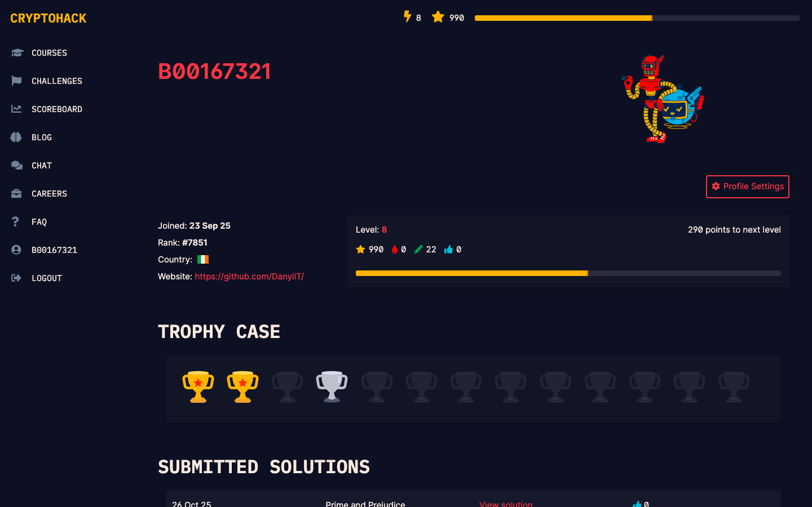
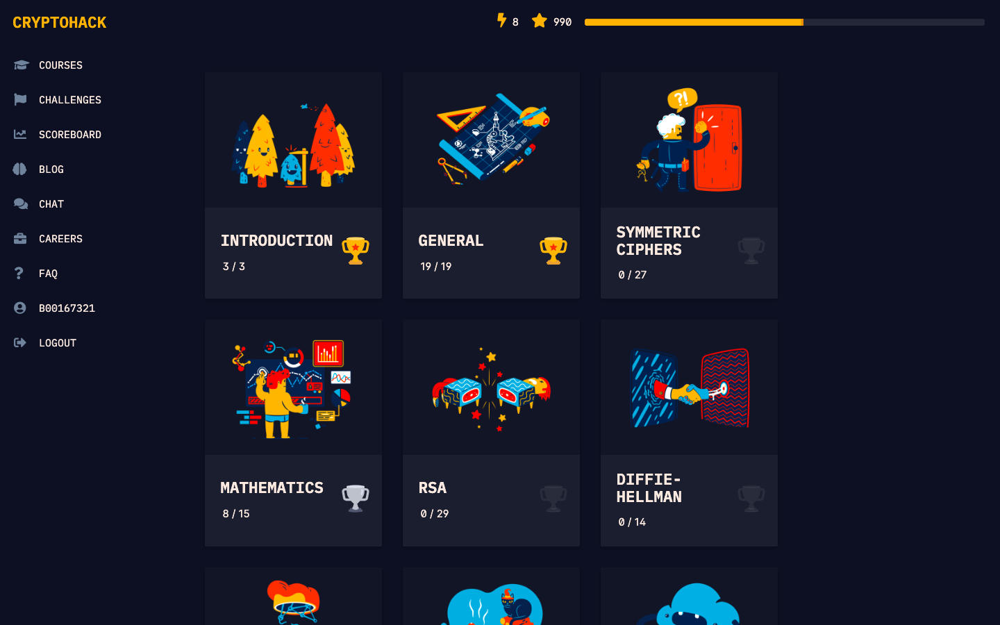
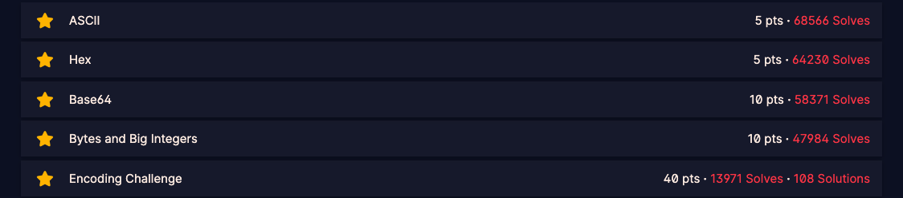
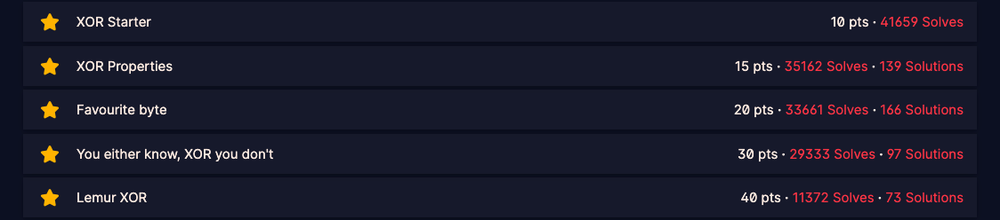
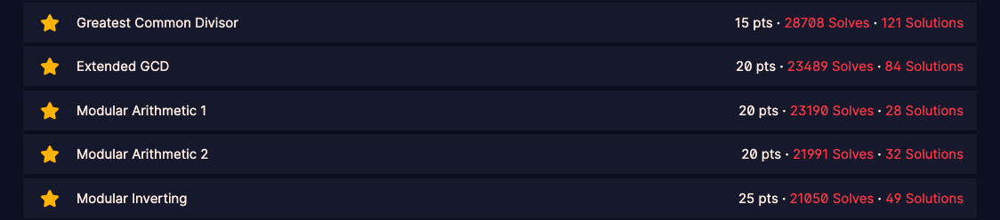
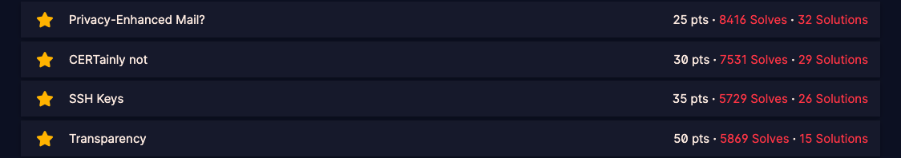
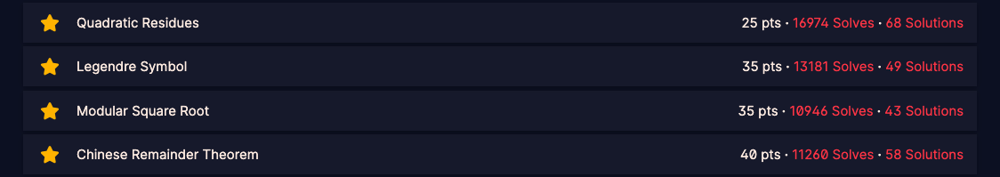
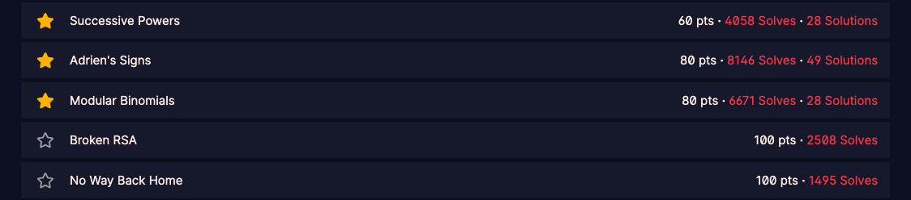
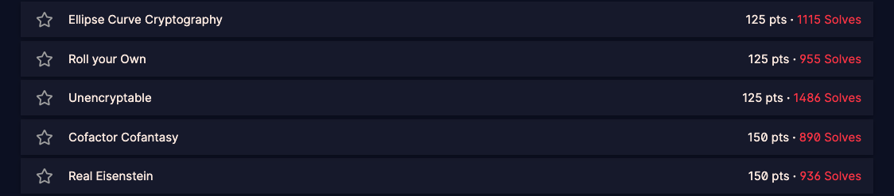
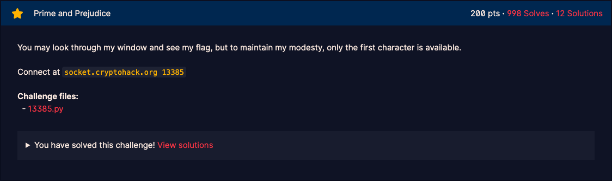

# CryptoHack Solutions Collection

**Last Updated:** 2025-10-26  
**Author:** DanyilT  
**CryptoHack Profile:** [B00167321](https://cryptohack.org/user/B00167321/)

---

## Profile Overview
**CryptoHack Profile:** [B00167321](https://cryptohack.org/user/B00167321/)

**Total Points Earned:** `⚡️8` | `⭐️990`


**Total Challenges Solved:** `28`


**Total Submitted Solutions:** `22` _(100% of solved challenges)_


## Challenges Solved
[All Challenges](https://cryptohack.org/challenges/)


### [INTRODUCTION](https://cryptohack.org/challenges/introduction/)

#### CHALLENGES


##### Finding Flags
- **FLAG:** `crypto{y0ur_f1rst_fl4g}`
- **Points:** `⭐️2`

##### Great Snakes
- **FLAG:** `crypto{z3n_0f_pyth0n}`
- **Points:** `⭐️3`

##### Network Attacks
- **FLAG:** `crypto{sh0pp1ng_f0r_fl4g5}`
- **Points:** `⭐️5`

### [GENERAL](https://cryptohack.org/challenges/general/)

#### ENCODING


##### ASCII
- **FLAG:** `crypto{ASCII_pr1nt4bl3}`
- **Points:** `⭐️5`

##### Hex
- **FLAG:** `crypto{You_will_be_working_with_hex_strings_a_lot}`
- **Points:** `⭐️5`

##### Base64
- **FLAG:** `crypto/Base+64+Encoding+is+Web+Safe/`
- **Points:** `⭐️10`

##### Bytes and Big Integers
- **FLAG:** `crypto{3nc0d1n6_4ll_7h3_w4y_d0wn}`
- **Points:** `⭐️10`

##### Encoding Challenge
- **FLAG:** `crypto{3nc0d3_d3c0d3_3nc0d3}`
- **My Solution:**
    - [Submitted Solution](https://cryptohack.org/challenges/enc_interactive/solutions/#B00167321)
    - **Code:**
        - [GitHub Gist](https://gist.github.com/DanyilT/219547251742456ad1aa17e689885158)
        - Clone:
          ```bash
          git clone https://gist.github.com/219547251742456ad1aa17e689885158.git Encoding_Challenge
          ```
    - **Files:**
        - [solution.py](./Encoding_Challenge/solution.py)
- **Points:** `⭐️40`

#### XOR


##### XOR Starter
- **FLAG:** `crypto{aloha}`
- **Points:** `⭐️10`

##### XOR Properties
- **FLAG:** `crypto{x0r_i5_ass0c1at1v3}`
- **My Solution:**
    - [Submitted Solution](https://cryptohack.org/challenges/xor1/solutions/#B00167321)
    - **Code:**
        - [GitHub Gist](https://gist.github.com/DanyilT/028ae31476a6414505eafeffad68cfa7)
        - Clone:
          ```bash
          git clone https://gist.github.com/028ae31476a6414505eafeffad68cfa7.git XOR_Properties
          ```
    - **Files:**
        - [solution.py](./XOR_Properties/solution.py)
- **Points:** `⭐️15`

##### Favorite byte
- **FLAG:** `crypto{0x10_15_my_f4v0ur173_by7e}`
- **My Solution:**
    - [Submitted Solution](https://cryptohack.org/challenges/xorkey0/solutions/#B00167321)
    - **Code:**
        - [GitHub Gist](https://gist.github.com/DanyilT/b59b12e64647273d3572f23d935e7883)
        - Clone:
          ```bash
          git clone https://gist.github.com/b59b12e64647273d3572f23d935e7883.git Favorite_Byte
          ```
    - **Files:**
        - [solution.py](./Favorite_Byte/solution.py)
- **Points:** `⭐️20`

##### You either know, XOR you don't
- **FLAG:** `crypto{1f_y0u_Kn0w_En0uGH_y0u_Kn0w_1t_4ll}`
- **My Solution:**
    - [Submitted Solution](https://cryptohack.org/challenges/xorkey1/solutions/#B00167321)
    - **Code:**
        - [GitHub Gist](https://gist.github.com/DanyilT/de2c75c829e9e7dc43b794e16e44c9a4)
        - Clone:
          ```bash
          git clone https://gist.github.com/de2c75c829e9e7dc43b794e16e44c9a4.git You_Either_Know_XOR_You_Dont
          ```
    - **Files:**
        - [solution.py](./You_Either_Know_XOR_You_Dont/solution.py)
- **Points:** `⭐️30`

##### Lemur XOR
- **FLAG:** `crypto{X0Rly_n0t!}`
- **My Solution:**
    - [Submitted Solution](https://cryptohack.org/challenges/xorimg1/solutions/#B00167321)
    - **Code:**
        - [GitHub Gist](https://gist.github.com/DanyilT/b59dd3b667b5297a5dcd76e056be656e)
        - Clone:
          ```bash
          git clone https://gist.github.com/b59dd3b667b5297a5dcd76e056be656e.git Lemur_XOR
          ```
    - **Files:**
        - [solution.py](./Lemur_XOR/solution.py)
- **Points:** `⭐️40`

#### MATHEMATICS


##### Greatest Common Divisor
- **FLAG:** `1512`
- **My Solution:**
    - [Submitted Solution](https://cryptohack.org/challenges/gcd/solutions/#B00167321)
    - **Code:**
        - [GitHub Gist](https://gist.github.com/DanyilT/f9d4b5860c0c3f5c09626824f584c2af)
        - Clone:
          ```bash
          git clone https://gist.github.com/f9d4b5860c0c3f5c09626824f584c2af.git Greatest_Common_Divisor
          ```
    - **Files:**
        - [solution.py](./Greatest_Common_Divisor/solution.py)
- **Points:** `⭐️15`

##### Extended GCD
- **FLAG:** `-8404`
- **My Solution:**
    - [Submitted Solution](https://cryptohack.org/challenges/egcd/solutions/#B00167321)
    - **Code:**
        - [GitHub Gist](https://gist.github.com/DanyilT/2524192e373e6d879ea182680872ddd4)
        - Clone:
          ```bash
          git clone https://gist.github.com/2524192e373e6d879ea182680872ddd4.git Extended_GCD
          ```
    - **Files:**
        - [solution.py](./Extended_GCD/solution.py)
- **Points:** `⭐️20`

##### Modular Arithmetic 1
- **FLAG:** `4`
- **My Solution:**
    - [Submitted Solution](https://cryptohack.org/challenges/ma0/solutions/#B00167321)
    - **Code:**
        - [GitHub Gist](https://gist.github.com/DanyilT/bc0cccc72f3b42bc3cde0da450f27999)
        - Clone:
          ```bash
          git clone https://gist.github.com/bc0cccc72f3b42bc3cde0da450f27999.git Modular_Arithmetic_1
          ```
    - **Files:**
        - [solution.py](./Modular_Arithmetic_1/solution.py)
- **Points:** `⭐️20`

##### Modular Arithmetic 2
- **FLAG:** `1`
- **My Solution:**
    - [Submitted Solution](https://cryptohack.org/challenges/ma1/solutions/#B00167321)
    - **Code:**
        - [GitHub Gist](https://gist.github.com/DanyilT/0460d50346cc216533b0208effc3dee4)
        - Clone:
          ```bash
          git clone https://gist.github.com/0460d50346cc216533b0208effc3dee4.git Modular_Arithmetic_2
          ```
    - **Files:**
        - [solution.py](./Modular_Arithmetic_2/solution.py)
- **Points:** `⭐️20`

##### Modular Inverting
- **FLAG:** `9`
- **My Solution:**
    - [Submitted Solution](https://cryptohack.org/challenges/mdiv/solutions/#B00167321)
    - **Code:**
        - [GitHub Gist](https://gist.github.com/DanyilT/f4916fcefb9d0a51eeec06956218b736)
        - Clone:
          ```bash
          git clone https://gist.github.com/f4916fcefb9d0a51eeec06956218b736.git Modular_Inverting
          ```
    - **Files:**
        - [solution.py](./Modular_Inverting/solution.py)
- **Points:** `⭐️25`

#### DATA FORMATS


##### Privacy-Enhanced Mail?
- **FLAG:** `15682700288056331364787171045819973654991149949197959929860861228180021707316851924456205543665565810892674190059831330231436970914474774562714945620519144389785158908994181951348846017432506464163564960993784254153395406799101314760033445065193429592512349952020982932218524462341002102063435489318813316464511621736943938440710470694912336237680219746204595128959161800595216366237538296447335375818871952520026993102148328897083547184286493241191505953601668858941129790966909236941127851370202421135897091086763569884760099112291072056970636380417349019579768748054760104838790424708988260443926906673795975104689`
- **My Solution:**
    - [Submitted Solution](https://cryptohack.org/challenges/pem1/solutions/#B00167321)
    - **Code:**
        - [GitHub Gist](https://gist.github.com/DanyilT/34748c92a92abd813cea83ded479c4f3)
        - Clone:
          ```bash
          git clone https://gist.github.com/34748c92a92abd813cea83ded479c4f3.git Privacy_Enhanced_Mail
          ```
    - **Files:**
        - [solution.py](./Privacy_Enhanced_Mail/solution.py)
- **Points:** `⭐️25`

##### CERTainly not
- **FLAG:** `22825373692019530804306212864609512775374171823993708516509897631547513634635856375624003737068034549047677999310941837454378829351398302382629658264078775456838626207507725494030600516872852306191255492926495965536379271875310457319107936020730050476235278671528265817571433919561175665096171189758406136453987966255236963782666066962654678464950075923060327358691356632908606498231755963567382339010985222623205586923466405809217426670333410014429905146941652293366212903733630083016398810887356019977409467374742266276267137547021576874204809506045914964491063393800499167416471949021995447722415959979785959569497`
- **My Solution:**
    - [Submitted Solution](https://cryptohack.org/challenges/certainly/solutions/#B00167321)
    - **Code:**
        - [GitHub Gist](https://gist.github.com/DanyilT/0a7d4137664618582abf49177d7ee4a0)
        - Clone:
          ```bash
          git clone https://gist.github.com/0a7d4137664618582abf49177d7ee4a0.git CERTainly_Not
          ```
    - **Files:**
        - [solution.py](./CERTainly_Not/solution.py)
- **Points:** `⭐️30`

##### SSH Keys
- **FLAG:** `3931406272922523448436194599820093016241472658151801552845094518579507815990600459669259603645261532927611152984942840889898756532060894857045175300145765800633499005451738872081381267004069865557395638550041114206143085403607234109293286336393552756893984605214352988705258638979454736514997314223669075900783806715398880310695945945147755132919037973889075191785977797861557228678159538882153544717797100401096435062359474129755625453831882490603560134477043235433202708948615234536984715872113343812760102812323180391544496030163653046931414723851374554873036582282389904838597668286543337426581680817796038711228401443244655162199302352017964997866677317161014083116730535875521286631858102768961098851209400973899393964931605067856005410998631842673030901078008408649613538143799959803685041566964514489809211962984534322348394428010908984318940411698961150731204316670646676976361958828528229837610795843145048243492909`
- **My Solution:**
    - [Submitted Solution](https://cryptohack.org/challenges/ssh-keys/solutions/#B00167321)
    - **Code:**
        - [GitHub Gist](https://gist.github.com/DanyilT/2b0aad0281c792d8601e0d4e6c3506b5)
        - Clone:
          ```bash
          git clone https://gist.github.com/2b0aad0281c792d8601e0d4e6c3506b5.git SSH_Keys
          ```
    - **Files:**
        - [solution.py](./SSH_Keys/solution.py)
- **Points:** `⭐️35`

##### Transparency
- **FLAG:** `crypto{thx_redpwn_for_inspiration}`
- **My Solution:**
    - [Submitted Solution](https://cryptohack.org/challenges/transparency/solutions/#B00167321)
    - **Code:**
        - [GitHub Gist](https://gist.github.com/DanyilT/4e27ad25009cd7540a43337a145dff8b)
        - Clone:
          ```bash
          git clone https://gist.github.com/4e27ad25009cd7540a43337a145dff8b.git Transparency
          ```
    - **Files:**
        - [solution.md](./Transparency/solution.md)
- **Points:** `⭐️50`

### [MATHEMATICS](https://cryptohack.org/challenges/maths/)

#### MODULAR MATH


##### Quadratic Residues
- **FLAG:** `8`
- **My Solution:**
    - [Submitted Solution](https://cryptohack.org/challenges/root0/solutions/#B00167321)
    - **Code:**
        - [GitHub Gist](https://gist.github.com/DanyilT/9fc14f7c00a40a78b6d7417077403cde)
        - Clone:
          ```bash
          git clone https://gist.github.com/9fc14f7c00a40a78b6d7417077403cde.git Quadratic_Residues
          ```
    - **Files:**
        - [solution.py](./Quadratic_Residues/solution.py)
- **Points:** `⭐️25`

##### Legendre Symbol
- **FLAG:** `93291799125366706806545638475797430512104976066103610269938025709952247020061090804870186195285998727680200979853848718589126765742550855954805290253592144209552123062161458584575060939481368210688629862036958857604707468372384278049741369153506182660264876115428251983455344219194133033177700490981696141526`
- **My Solution:**
    - [Submitted Solution](https://cryptohack.org/challenges/root1/solutions/#B00167321)
    - **Code:**
        - [GitHub Gist](https://gist.github.com/DanyilT/00175fb77840cd04d9073821a0fe78e7)
        - Clone:
          ```bash
          git clone https://gist.github.com/00175fb77840cd04d9073821a0fe78e7.git Legendre_Symbol
          ```
    - **Files:**
        - [solution.py](./Legendre_Symbol/solution.py)
- **Points:** `⭐️35`

##### Modular Square Root
- **FLAG:** `2362339307683048638327773298580489298932137505520500388338271052053734747862351779647314176817953359071871560041125289919247146074907151612762640868199621186559522068338032600991311882224016021222672243139362180461232646732465848840425458257930887856583379600967761738596782877851318489355679822813155123045705285112099448146426755110160002515592418850432103641815811071548456284263507805589445073657565381850521367969675699760755310784623577076440037747681760302434924932113640061738777601194622244192758024180853916244427254065441962557282572849162772740798989647948645207349737457445440405057156897508368531939120`
- **My Solution:**
    - [Submitted Solution](https://cryptohack.org/challenges/tonelli-shanks/solutions/#B00167321)
    - **Code:**
        - [GitHub Gist](https://gist.github.com/DanyilT/fb0eaa1504adabb723de50669ae7c3ab)
        - Clone:
          ```bash
          git clone https://gist.github.com/fb0eaa1504adabb723de50669ae7c3ab.git Modular_Square_Root
          ```
    - **Files:**
        - [solution.py](./Modular_Square_Root/solution.py)
- **Points:** `⭐️35`

##### Chinese Remainder Theorem
- **FLAG:** `872`
- **My Solution:**
    - [Submitted Solution](https://cryptohack.org/challenges/crt1/solutions/#B00167321)
    - **Code:**
        - [GitHub Gist](https://gist.github.com/DanyilT/63ae6b0e3745450d347a13f663177757)
        - Clone:
          ```bash
          git clone https://gist.github.com/63ae6b0e3745450d347a13f663177757.git Chinese_Remainder_Theorem
          ```
    - **Files:**
        - [solution.py](./Chinese_Remainder_Theorem/solution.py)
- **Points:** `⭐️40`

#### BRAINTEASERS PART 1


##### Successive Powers
- **FLAG:** `crypto{919,209}`
- **My Solution:**
    - [Submitted Solution](https://cryptohack.org/challenges/powers/solutions/#B00167321)
    - **Code:**
        - [GitHub Gist](https://gist.github.com/DanyilT/a42a1da738d570e8729943561a6e974a)
        - Clone:
          ```bash
          git clone https://gist.github.com/a42a1da738d570e8729943561a6e974a.git Successive_Powers
          ```
    - **Files:**
        - [solution.py](./Successive_Powers/solution.py)
- **Points:** `⭐️60`

##### Adrien's Signs
- **FLAG:** `crypto{p4tterns_1n_re5idu3s}`
- **My Solution:**
    - [Submitted Solution](https://cryptohack.org/challenges/adrien/solutions/#B00167321)
    - **Code:**
        - [GitHub Gist](https://gist.github.com/DanyilT/c52c4f201c687e5f158a2b01f61121b4)
        - Clone:
          ```bash
          git clone https://gist.github.com/c52c4f201c687e5f158a2b01f61121b4.git Adriens_Signs
          ```
    - **Files:**
        - [solution.py](./Adriens_Signs/solution.py)
- **Points:** `⭐️80`

##### Modular Binomials
- **FLAG:** `crypto{112274000169258486390262064441991200608556376127408952701514962644340921899196091557519382763356534106376906489445103255177593594898966250176773605432765983897105047795619470659157057093771407309168345670541418772427807148039207489900810013783673957984006269120652134007689272484517805398390277308001719431273,132760587806365301971479157072031448380135765794466787456948786731168095877956875295282661565488242190731593282663694728914945967253173047324353981530949360031535707374701705328450856944598803228299967009004598984671293494375599408764139743217465012770376728876547958852025425539298410751132782632817947101601}`
- **My Solution:**
    - [Submitted Solution](https://cryptohack.org/challenges/bionomials/solutions/#B00167321)
    - **Code:**
        - [GitHub Gist](https://gist.github.com/DanyilT/ea33748b36bc42f5d5322a8417d670a0)
        - Clone:
          ```bash
          git clone https://gist.github.com/ea33748b36bc42f5d5322a8417d670a0.git Modular_Binomials
          ```
    - **Files:**
        - [solution.py](./Modular_Binomials/solution.py)
- **Points:** `⭐️80`

##### Broken RSA
> [!CAUTION]
> Haven't solved yet.

##### No Way Back Home
> [!CAUTION]
> Haven't solved yet.

#### BRAINTEASERS PART 2

> [!CAUTION]
> Haven't solved any of these yet.

#### PRIMES
##### Prime and Prejudice

- **FLAG:** `crypto{Forging_Primes_with_Francois_Arnault}`
- **My Solution:**
    - [Submitted Solution](https://cryptohack.org/challenges/prejudice/solutions/#B00167321)
    - **Code:**
        - [GitHub Gist](https://gist.github.com/DanyilT/9d8fbceddbd05b0fe4c7948e5e624c26)
        - Clone:
          ```bash
          git clone https://gist.github.com/9d8fbceddbd05b0fe4c7948e5e624c26.git Prime_and_Prejudice
          ```
    - **Files:**
        - [solution.py](./Prime_and_Prejudice/solution.py)
- **Points:** `⭐️200`
