# T-Pot: A Multi-Honeypot Platform

**Network Security, Assignment 1**  
**Author:** Danyil Tymchuk  
**Date:** 1 November 2026

# Abstract

This report analyses four weeks of attack data from three T-Pot honeypot instances in Google Cloud: Europe (Netherlands), the United States (Iowa) and Asia (Taiwan, supplementary). It compares Europe and the United States per recorded hour and investigates two automated campaigns. In the 160 hours that both recorded, the United States received 47% more honeypot events per hour. An SSH persistence campaign typed the commands that write the same `authorized_keys` file in 91 United States sessions and 69 Asian sessions and in none in Europe. The stored file's SHA-256 equals the indicator that the SANS Internet Storm Center published for the mdrfckr campaign, yet the sessions used three different SSH client fingerprints, and a rule on the newest published fingerprint would have matched 8.8% of the United States sessions. A web scanner with the user agent `libredtail-http` ran one fixed script of 49 requests in 79 runs from 64 addresses on all three instances. The honeypots answered with default responses, so the logs show attempts, not exploitation. Memory exhaustion and restarts left gaps in the record, so the results describe these instances rather than the regions. Honeynets help learning and defence, but they need memory and monitoring to keep running.

# 1. Introduction and background

A honeypot is a decoy system whose value lies in being probed, attacked or compromised [1]. Legitimate users have no reason to contact it, so almost every interaction is unsolicited. T-Pot [2] packages more than twenty honeypots as Docker containers, sends their events to the Elastic Stack and adds the Suricata network monitor [3]. Cowrie [4] emulates SSH and Telnet and records logins, typed commands and the files that a session writes. Tanner and H0neytr4p emulate web servers on ports 80 and 443. Scanning and default-credential attacks are typical of large botnets [5], and scanning is measured at the scale of the whole internet [6].

Three T-Pot instances ran in Google Cloud for four weeks in October 2026: Europe (Netherlands), the United States (Iowa) and Asia (Taiwan). The brief asks for two regions, so Europe and the United States are compared and Asia is a supplementary source. The report asks four questions:

**RQ1.** How do honeypot activity and the targeted services differ between Europe and the United States, per hour of recording?

**RQ2.** How consistently did one SSH key-installation campaign behave across sessions, instances and SSH client fingerprints, and what does that mean for detection?

**RQ3.** Did a web scanner repeat the same request sequence across instances and source addresses, and did its requests suit the honeypots?

**RQ4.** How useful is a honeynet as a learning tool and as a security tool, given what these campaigns and the operational limits showed?

Section 2 states how the instances were deployed and how the data was collected. Section 3 presents the findings and Section 4 discusses them and concludes. Appendices A to D hold the evidence screenshots, the commands, the scripts and the supplementary results.

# 2. Deployment and data

Each instance ran T-Pot Hive [2] on a Google Cloud e2-standard-4 virtual machine with four vCPUs, 16 GB of memory and a 128 GB disk; T-Pot lists 256 GB of storage for Hive. The firewall allowed TCP and UDP ports 1 to 64000 from any address. The administration ports, SSH on 64295 and the web interface on 64297, accepted connections only from the author's addresses and from Google's Identity-Aware Proxy range. The mail server was disabled because it held port 25, which the Mailoney honeypot needs [2]. Table 1 lists the instances. Recorded hours are hours with at least one event, counted over the 672 hours of 1 to 28 October 2026.

| Instance | Zone | First event (UTC) | Last event (UTC) | Recorded hours | Events | Honeypot events |
|---|---|---|---|---|---|---|
| Europe | europe-west4-a | 1 Oct 19:28 | 28 Oct 23:59 | 300 | 29,389,303 | 776,714 |
| United States | us-central1-a | 1 Oct 19:54 | 28 Oct 23:59 | 251 | 27,672,497 | 982,407 |
| Asia (optional) | asia-east1-c | 15 Oct 16:00 | 28 Oct 23:59 | 103 | 12,093,184 | 339,021 |

*Table 1. The instances. Events include sensor events (Suricata, P0f and Fatt); honeypot events exclude them and the web interface.*

**Note.** Kibana totals are lower than the Events column by 5,610 in Europe, 3,661 in the United States and 2,630 in Asia, because the local Elasticsearch index leaves out the web-interface (NGINX) records and every record from the excluded addresses. Honeypot events are the same in both.

**Evidence.** Kibana Discover page with the honeypot events of each instance. Search query: `not type:(P0f or Fatt or Suricata)`, 1 to 28 October 2026 (UTC). Screenshots: [Appendix A, Evidence 1](#evidence-1-honeypot-events-per-instance).

Europe and the United States started on 1 October and Asia on 15 October; collection ended at 23:59 UTC on 28 October. The European instance recorded events in 300 of the 672 hours, the United States instance in 251 and the Asian instance in 103. The European kernel logs show out-of-memory kills on 16 and 17 October and missed watchdog deadlines on 14, 15, 16 and 19 October; recording stopped until the VM was restarted (Table D1). The United States instance had gaps of 120, 69 and 158 hours. Each restart changed the external IP address. The comparison uses the 160 hours in which Europe and the United States both recorded.

Events were exported from each instance's Elasticsearch with `export_es.py` (Appendix C) into one compressed JSON-lines file per UTC day; for every instance and day the written count equals the expected count in a manifest. The files were copied to a workstation with `scp`. The files that the events refer to (downloads, session recordings, Dionaea and Honeytrap captures) were archived with `tar`, hashed with SHA-256 on the VM and on the workstation, and never executed; the hashes matched. Appendix B lists the commands and Appendix C the scripts that produce the tables. Below each table, a line gives the search query of the Kibana page with the same data and points to its screenshots in Appendix A, whose captions link to the pages.

Honeypot logs contain the addresses of attacking machines, the credentials they tried and the files they wrote, and no data about legitimate users. The report names no individual and reports addresses only as counts. Two Google Identity-Aware Proxy addresses that logged in on 5 October during setup are excluded (10 events in Europe, 16 in the United States).

# 3. Findings

Counts and shares cover each instance's whole recording window, except Table 2, which uses the 160 hours in which Europe and the United States both recorded. Section 3.1 compares the instances. Sections 3.2 and 3.3 investigate two campaigns in detail.

## 3.1 Regional comparison (RQ1)

In the overlapping hours the United States instance received 3,643 honeypot events per hour and the European instance 2,478, a ratio of 1.47 (Table 2). All events, including the sensor events, differed by only 13%, so the difference lies in honeypot-level activity. Figure 1 shows the hours in which each instance recorded.

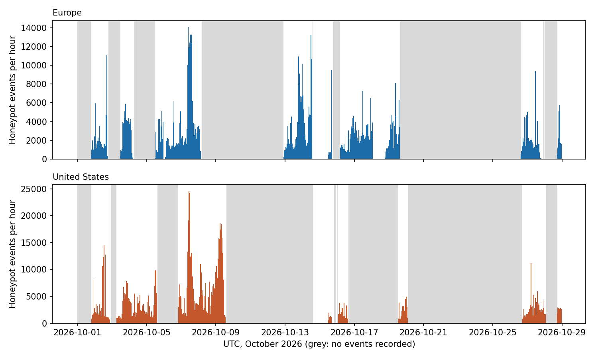

*Figure 1. Honeypot events per hour for each instance. Grey marks hours without events.*

| Measure | Europe | United States | Ratio (US / Europe) |
|---|---|---|---|
| Recorded hours, whole window | 300 | 251 |  |
| Events per overlapping hour | 98,513 | 111,185 | 1.13 |
| Honeypot events per overlapping hour | 2,478 | 3,643 | 1.47 |

*Table 2. Events per hour in the 160 overlapping hours.*

**Evidence.** The histograms of the Kibana Discover pages in Table 1 ([Appendix A, Evidence 1](#evidence-1-honeypot-events-per-instance)) and the hourly chart of the three instances ([Evidence 2](#evidence-2-recording-gaps-and-hourly-volume)) show the hours in which each instance recorded. ES|QL query of the chart:

```
FROM tpot-eu-*, tpot-us-*, tpot-asia-* METADATA _index | WHERE NOT type IN ("P0f","Fatt","Suricata") | EVAL region = CASE(_index LIKE "tpot-eu-*", "Europe", _index LIKE "tpot-us-*", "United States", "Asia") | STATS n = COUNT(*) BY hour = BUCKET(@timestamp, 1 hour), region | SORT hour | LIMIT 5000
```

Table 3 and Figure 2 show the services behind the difference. Its shares are shares of each instance's honeypot events over the whole recording window (776,714 in Europe, 982,407 in the United States and 339,021 in Asia), not of the overlapping hours. SIP (Session Initiation Protocol) on port 5060 and RDP (Remote Desktop Protocol) on port 3389 dominate both regions, but RDP is twice as common in the United States (26.0% of events against 12.4%). SMB on port 445 makes up 2.2% of United States events and 0.4% of European events, MSSQL on port 1433 3.5% of European events and 0.9% of United States events, and Heralding on port 5900 (VNC) 11.3% of European events; it is not among the top services of the other instances. SSH and Telnet are similar. The differences fall on services that scanners target for particular software, which suggests scanners with different target lists. One instance per region cannot show that the regions themselves differ. Source countries and networks, downloads and Suricata alerts are in Appendix D.

| Service and port | Europe | Share | United States | Share | Asia | Share |
|---|---|---|---|---|---|---|
| SIP, 5060 (Sentrypeer) | 126,290 | 16.3% | 241,828 | 24.6% | 31,639 | 9.3% |
| RDP, 3389 (RDPHoneypot) | 96,368 | 12.4% | 255,409 | 26.0% | 4,240 | 1.3% |
| Heralding, 5900 | 87,941 | 11.3% | - | - | - | - |
| SSH (Cowrie), 22 | 29,287 | 3.8% | 37,646 | 3.8% | 24,479 | 7.2% |
| MSSQL (Dionaea), 1433 | 27,546 | 3.5% | 8,756 | 0.9% | - | - |
| SMB (Dionaea), 445 | 3,208 | 0.4% | 21,279 | 2.2% | 24,716 | 7.3% |
| Telnet (Cowrie), 23 | 6,385 | 0.8% | 7,192 | 0.7% | 3,316 | 1.0% |
| HTTP (Tanner), 80 | 7,089 | 0.9% | 4,555 | 0.5% | 4,914 | 1.4% |

*Table 3. Honeypot events by service and port, with the share of each region’s honeypot events over its whole recording window. A dash means that the service is not among that region’s top services.*

**Evidence.** Kibana Discover pages (ES|QL) with the ten largest services of each instance. Screenshots: [Appendix A, Evidence 7](#evidence-7-services-table-3). ES|QL query for Europe; the other pages change the index pattern and the total (982407 for the United States, 339021 for Asia):

```
FROM tpot-eu-* | WHERE NOT type IN ("P0f","Fatt","Suricata") AND dest_port IS NOT NULL | STATS n = COUNT(*) BY type, dest_port | SORT n DESC, type ASC, dest_port ASC | LIMIT 10 | EVAL share = ROUND(n * 100.0 / 776714, 1)
```

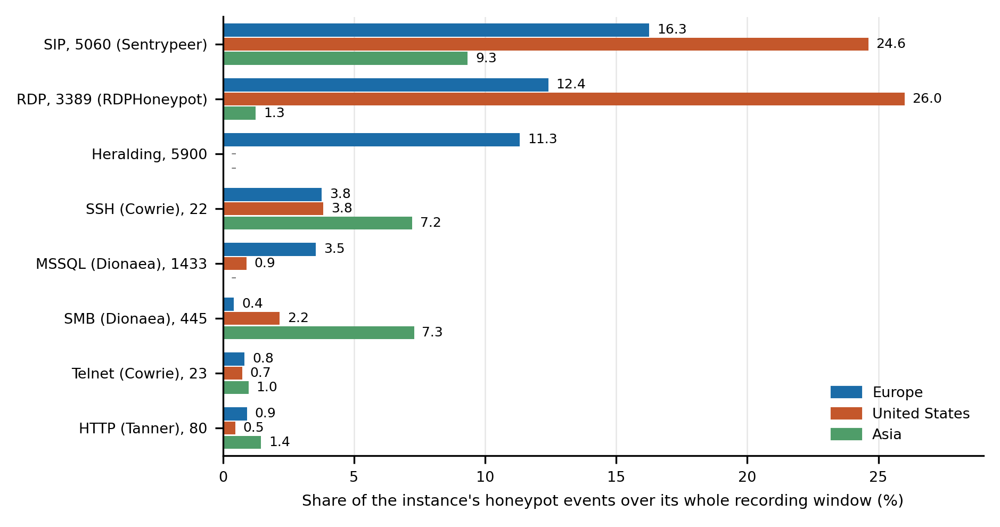

*Figure 2. Share of each instance's honeypot events by service and port, as in Table 3. A service has no bar for an instance when it is not among that instance's ten largest services.*

**Credentials and commands.** Figure 3 shows the six most common pairs of user name and password and the most typed commands of each instance. The most common password pair was `root:root` in Europe (124 attempts), `enable:linuxshell` in the United States (253) and `345gs5662d34:345gs5662d34` in Asia (66). Default-style pairs such as `admin:admin` and `root:123456` made up 29% of attempts in Europe, 25% in the United States and 19% in Asia (among each instance's top 100 entries), and `lghkel:zpz}ld` appeared on all three, which suggests shared credential lists. Typed commands in Europe and the United States were mostly short probes of Telnet-style shells; Asia's were system checks, which the key-writing sessions also ran ([Appendix D4](#d4-credentials-and-typed-commands)).

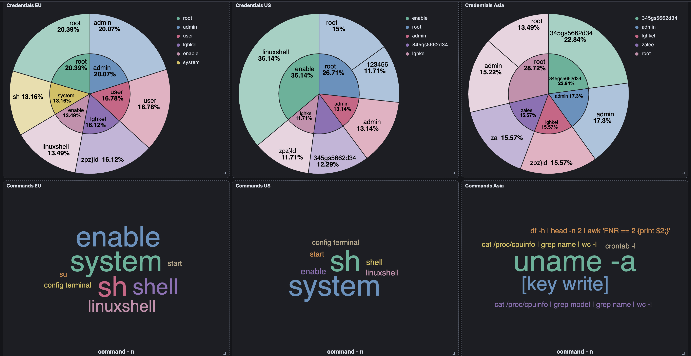

*Figure 3. The most used credentials and commands of each instance, 1 to 28 October 2026. Top: the six most common pairs of user name (inner ring) and password (outer ring), with their share of these six pairs. Bottom: the most typed commands, in larger type when more frequent; the key-writing command is shown as [key write].*

**Evidence.** Kibana dashboard with six ES|QL panels, 1 to 28 October 2026 ([Appendix A, Evidence 15](#evidence-15-credentials-and-commands-dashboard-figure-3)). The six pairs total 608 attempts in Europe, 700 in the United States and 289 in Asia. A word cloud draws only the words that fit, so the third most typed command of the United States, `ls /home; /bin/busybox BOTNET` (255 times), is missing. ES|QL queries for Europe; the panels of the other instances change the index pattern:

```
FROM tpot-eu-* | WHERE type == "Cowrie" AND password != "" | STATS n = COUNT(*) BY username, password | SORT n DESC, username ASC, password ASC | LIMIT 6
```

```
FROM tpot-eu-* | WHERE eventid == "cowrie.command.input" | EVAL command = CASE(input LIKE "*mdrfckr*", "[key write]", input) | STATS n = COUNT(*) BY command | SORT n DESC, command ASC | LIMIT 8
```

## 3.2 SSH persistence across client fingerprints (RQ2)

**The behaviour.** In 91 sessions on the United States instance (15, 16 and 19 October, from 55 addresses) and 69 sessions on the Asian instance (20 and 21 October, from 34 addresses) an attacker typed the same two commands. The first removes the immutable flag of the `.ssh` directory (`chattr -ia .ssh`). The second deletes the directory, creates it again, appends an RSA public key with the comment `mdrfckr` to `authorized_keys` and removes group and other permissions, which gives persistent key-based access (MITRE ATT&CK technique T1098.004, SSH Authorized Keys [7]). The European instance recorded no such session, although it was recording on 15, 16 and 19 October, and none of its Cowrie sessions used any of the three SSH client fingerprints in Table 5. Two addresses appear on both the United States and the Asian instance.

**One session in order.** Table 4 reconstructs the first key-writing session of the United States instance. The client logged in 1.5s after connecting with the pair `panel / 1234`. A `cowrie.login.success` event shows that authentication to the honeypot succeeded, not that a real server was compromised. The unlock command and the key write were the first two commands, 1.2s apart. Cowrie kept the key line as a file because the attacker used a shell redirection [4]. After that the session changed a password, ran 15 reconnaissance commands and closed after 36s. The key write was the second command in all 160 sessions, the sessions lasted a median of 23s on the United States instance and 21s on the Asian instance, and 90 of the 91 United States sessions and 64 of the 69 Asian sessions typed all 15 reconnaissance commands. The fixed order and timing point to a script, not a person.

| Seconds | Event | Detail |
|---|---|---|
| 0.0 | Connection | SSH to port 22; client `SSH-2.0-libssh_0.9.6` |
| 0.3 | Client fingerprint | `f555226df1963d1d3c09daf865abdc9a` |
| 1.5 | Login accepted | `panel / 1234` |
| 2.4 | Command 1 | `cd ~; chattr -ia .ssh; lockr -ia .ssh` |
| 3.6 | Command 2 | `cd ~ && rm -rf .ssh && mkdir .ssh && echo "ssh-rsa [key omitted] mdrfckr">>.ssh/authorized_keys && chmod -R go= ~/.ssh && cd ~` |
| 3.9 | File stored | SHA-256 `a8460f446be540410004b1a8db4083773fa46f7fe76fa84219c93daa1669f8f2` |
| 15.4 to 35.4 | Commands 3 to 20 | A password change with `passwd` (three logged inputs) and 15 reconnaissance commands: processor count and model, memory, `ls -lh $(which ls)`, `crontab -l`, `w`, `uname`, `whoami`, `lscpu` and `df -h` |
| 35.7 | Session closed | after 35.7s |

*Table 4. One key-writing session on the United States instance, reconstructed from its Cowrie events. The public key and the new password are omitted.*

**Evidence.** Kibana Discover page (ES|QL) with the events of this session; it masks the key and the new password. Screenshot: [Appendix A, Evidence 8](#evidence-8-one-key-writing-session-table-4). Query:

```
FROM tpot-us-* | WHERE session == "fe6c39bd67f6" AND eventid IN ("cowrie.session.connect", "cowrie.client.version", "cowrie.client.kex", "cowrie.login.success", "cowrie.command.input", "cowrie.session.file_download", "cowrie.session.closed") | EVAL detail = CASE(input LIKE "*mdrfckr*", "[key write]", input LIKE "*passwd*", "[password change]", input IS NOT NULL, input, version IS NOT NULL, version, hassh IS NOT NULL, hassh, shasum IS NOT NULL, shasum, username IS NOT NULL, CONCAT(username, " / ", password), "") | KEEP @timestamp, eventid, detail | SORT @timestamp
```

**Against published evidence.** The SANS Internet Storm Center published the SHA-256 of the `authorized_keys` file that the mdrfckr campaign writes, `a8460f446be540410004b1a8db4083773fa46f7fe76fa84219c93daa1669f8f2`, and describes the same playbook: the unlock command, the key write, a password change, a clean-up of competing scripts and a fixed reconnaissance sequence [8]. Cowrie stored a file with exactly this hash in 86 of the 91 United States sessions and in all 69 Asian sessions. The other 5 United States sessions, a burst within two minutes on 16 October, typed the same key-writing command but recorded no file event. A password change followed in 90 United States and 64 Asian sessions, and the clean-up of competing scripts in 30 and 33. The diary and earlier reports associate the key with the Outlaw botnet [8], [9].

**Three client fingerprints.** The diary lists a fingerprint (hassh, a hash of the algorithms that the SSH client offers) for each period of the campaign: a libssh 0.6 client in 2022, a libssh 0.9 client from December 2022 and a libssh 0.11.1 client in April 2026, and it warns that rules pinned to the older values miss the newer generation [8]. Table 5 shows the October sessions; none used the libssh 0.6 client of 2022. The libssh 0.9.6 client still accounted for 138 of the 160 key-writing sessions (86%). The fingerprint of April 2026 appeared in 8 of the 91 United States sessions (8.8%) and in 13 of the 69 Asian sessions (18.8%). One United States session used a libssh 0.12.0 client whose fingerprint the diary does not list. Clients of three generations were therefore in use at the same time, and the persistence behaviour did not change with the client. Figure 4a shows the sessions of each day by fingerprint.

| Instance | Fingerprint (client) | Listed in [8] | Sessions | Logged in | Typed commands | Wrote the key |
|---|---|---|---|---|---|---|
| United States | `f555226d…` (libssh_0.9.6) | libssh 0.9.5 and 0.9.6, December 2022 onward | 1,140 | 158 | 83 | 82 |
| United States | `03a80b21…` (libssh_0.11.1) | libssh 0.11.1, April 2026 | 119 | 14 | 8 | 8 |
| United States | `af8223ac…` (libssh_0.12.0) | not listed | 23 | 2 | 1 | 1 |
| Asia | `f555226d…` (libssh_0.9.6) | libssh 0.9.5 and 0.9.6, December 2022 onward | 757 | 110 | 56 | 56 |
| Asia | `03a80b21…` (libssh_0.11.1) | libssh 0.11.1, April 2026 | 171 | 20 | 13 | 13 |

*Table 5. Cowrie sessions by SSH client fingerprint: all sessions with it, those that logged in, those that typed commands and those that wrote the key. The European instance had no session with any of these fingerprints.*

**Evidence.** Kibana Discover pages (ES|QL) with this table for each instance (Europe has no sessions) and with the stored key file (United States and Asia). Key-writing command, search query `eventid:cowrie.command.input and input:*mdrfckr*`. Fingerprint of April 2026, search query `hassh:03a80b21afa810682a776a7d42e5e6fb`. Screenshots: Appendix A, [Evidence 5](#evidence-5-the-key-writing-command), [Evidence 6](#evidence-6-the-ssh-client-fingerprint) and [Evidence 9](#evidence-9-ssh-client-fingerprints-and-stored-files-table-5). The libssh 0.6 fingerprint of 2022 (`hassh:51cba57125523ce4b9db67714a90bf6e`) returns no session on any instance. ES|QL query of the fingerprint pages (replace `tpot-us-*` for the other instances):

```
FROM tpot-us-* | WHERE type == "Cowrie" | STATS n_login = COUNT(CASE(eventid == "cowrie.login.success", 1)), n_typed = COUNT(CASE(eventid == "cowrie.command.input", 1)), n_key = COUNT(CASE(input LIKE "*mdrfckr*", 1)), hassh = MAX(hassh) BY session | WHERE hassh IN ("f555226df1963d1d3c09daf865abdc9a", "03a80b21afa810682a776a7d42e5e6fb", "af8223ac9914f509afdadfaf5f7ee94e") | STATS sessions = COUNT(*), logged_in = COUNT(CASE(n_login > 0, 1)), typed_commands = COUNT(CASE(n_typed > 0, 1)), key_writing = COUNT(CASE(n_key > 0, 1)) BY hassh | SORT sessions DESC
```

ES|QL query of the stored-file pages:

```
FROM tpot-us-* | WHERE eventid == "cowrie.session.file_download" | STATS sessions = COUNT_DISTINCT(session) BY shasum | SORT sessions DESC | LIMIT 5
```

**Consequence for detection.** Figure 4b shows what each indicator flags. A rule on the fingerprint of April 2026 alone would have flagged 8 of the 91 United States sessions (8.8%) and 13 of the 69 Asian sessions (18.8%), and a rule on the libssh 0.9.6 fingerprint 82 (90.1%) and 56 (81.2%); neither flags the libssh 0.12.0 session. The file hash matched 155 of the 160 sessions (96.9%), and the unlock command before the key write matched all of them. The fingerprints are also broad: 1,140 United States sessions used the libssh 0.9.6 fingerprint and 119 the 2026 one, but only 158 and 14 of them logged in. Of the sessions with these fingerprints that typed commands, 91 of 92 on the United States instance and 69 of 69 on the Asian instance wrote the key. A fingerprint therefore identifies the campaign's client early, before a login succeeds, while the file hash and the commands identify the persistence step. A rule should combine them.

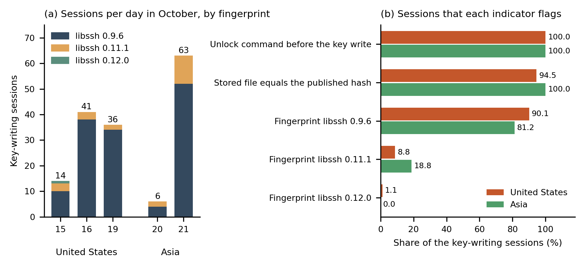

*Figure 4. The key-writing sessions. (a) Sessions per day, by SSH client fingerprint; the total is above each bar. (b) Share of the key-writing sessions of each instance that each indicator flags (91 sessions in the United States, 69 in Asia); Europe had none.*

**Limits.** The matching hash, commands and fingerprints fit the campaign that the diary describes, but a hash shows that the same key file was written, not that one operator ran every session; the diary itself notes that the infrastructure may be shared [8]. The Asian sessions (20 and 21 October) followed the United States sessions (15, 16 and 19 October), and two addresses appear on both. The data show attempts on honeypots, not compromised servers.

## 3.3 Repeated PHP request sequences (RQ3)

**The scanner.** The user agent `libredtail-http` appears in 1,557 requests on the European instance, 1,026 on the United States instance and 480 on the Asian instance, from 64 addresses. The SANS Internet Storm Center ties the agent to an HTTP variant of the Redtail cryptominer and describes each attack as opening with four POST requests [10].

**One run.** Table 6 lists the 49 requests that one European address sent to the Tanner web honeypot in 25 seconds. They fall into six phases: two path-traversal POST requests aimed at `/bin/sh` [10], five POST requests that exploit CVE-2024-4577 in PHP-CGI [11], 37 GET requests for PHPUnit's `eval-stdin.php` (CVE-2017-9841 [12]) and five last probes: two for ThinkPHP, two for a PHP `pearcmd` file inclusion and one for the Docker API. The 37 PHPUnit paths put the same file under common folder names such as `/laravel/`, `/yii/`, `/zend/`, `/cms/` and `/admin/`, as if guessing where an application keeps its `vendor` folder. Tanner answered every request with a default label: `unknown` for the POST requests and `index` for the GET requests. Figure 5a plots the requests of this run.

| Requests | Seconds | Request | Probe | Tanner response |
|---|---|---|---|---|
| 1 to 2 | 0.0 to 0.5 | POST `/cgi-bin/.%2e/.%2e/…/bin/sh` and a double-encoded form | CGI path traversal aimed at `/bin/sh` | unknown |
| 3 to 7 | 1.1 to 3.3 | POST `?%ADd+allow_url_include%3d1+%ADd+auto_prepend_file%3dphp://input` on five paths | PHP-CGI argument injection, CVE-2024-4577 | unknown |
| 8 to 44 | 3.8 to 21.9 | GET `/vendor/phpunit/phpunit/src/Util/PHP/eval-stdin.php` under 37 prefixes | PHPUnit `eval-stdin.php`, CVE-2017-9841 | index |
| 45 to 46 | 22.4 to 23.0 | GET `/index.php?s=/index/\think\app/invokefunction&function=call_user_func_array…` | ThinkPHP `invokefunction` | index |
| 47 to 48 | 23.5 to 24.0 | GET `/index.php?lang=../../…/pearcmd&+config-create+/…` and `lang=../../…/tmp/index1` | PHP `pearcmd` file inclusion | index |
| 49 | 24.5 | GET `/containers/json` | Docker API listing | index |

*Table 6. The 49 requests of one libredtail run on the Tanner honeypot of the European instance (2 October). Seconds are counted from the first request.*

**Evidence.** Kibana Discover page (ES|QL) with the requests of this run. The time window selects the requests of one address and the page shows no address. Screenshot: [Appendix A, Evidence 10](#evidence-10-one-libredtail-run-and-its-paths-tables-6-and-7). Query:

```
FROM tpot-eu-* | WHERE type == "Tanner" AND `headers.user-agent` == "libredtail-http" AND @timestamp >= "2026-10-02T01:14:40Z" AND @timestamp <= "2026-10-02T01:15:30Z" | KEEP @timestamp, method, path, response_msg.response.message.detection.name | SORT @timestamp
```

**Across instances.** The libredtail requests on Tanner used exactly 49 distinct paths, and each path came from 28 to 40 addresses. Requests were grouped into runs per address and honeypot, and a pause of five minutes ends a run. All 79 runs, from 64 addresses, contain only steps of the script and keep its order; 63 of them sent at least 44 of the 49 requests (Table 7 and Figure 5b). H0neytr4p logged 48 of the 49 steps: the malformed second traversal request never appears in its logs. Eight addresses appear on two instances and none on all three. The CVE-2024-4577 requests that H0neytr4p logged carried a body, and 23 of 25 addresses sent the same body, byte for byte; it appears on all three instances. The body is a PHP stub that decodes a shell script. The script fetches a second-stage script from the operator's host, first with `scp` and an embedded private key and then with `wget` or `curl`, runs it with the label `cve_2024_4577` and deletes its files. The key and the host are not reproduced.

| Instance | Addresses | Runs | Runs in script order | Complete runs | Median seconds of complete runs |
|---|---|---|---|---|---|
| Europe | 33 | 36 | 36 | 32 | 25 |
| United States | 28 | 32 | 32 | 21 | 27 |
| Asia | 11 | 11 | 11 | 10 | 20 |

*Table 7. libredtail runs by instance. A run is complete when it has at least 44 of the 49 requests.*

**Evidence.** Kibana Discover pages (ES|QL) with the paths and their addresses and with the sizes of the CVE-2024-4577 bodies. Search query of the user agent `headers.user-agent:"libredtail-http" or user-agent:"libredtail-http"`. Screenshots: Appendix A, [Evidence 4](#evidence-4-the-libredtail-user-agent) and [Evidence 10](#evidence-10-one-libredtail-run-and-its-paths-tables-6-and-7). ES|QL queries of the first two pages:

```
FROM tpot-eu-*, tpot-us-*, tpot-asia-* | WHERE type == "Tanner" AND `headers.user-agent` == "libredtail-http" | STATS requests = COUNT(*), addresses = COUNT_DISTINCT(src_ip) BY path | SORT addresses DESC, requests DESC | LIMIT 60
```

```
FROM tpot-eu-*, tpot-us-*, tpot-asia-* | WHERE type == "H0neytr4p" AND request_uri LIKE "*allow_url_include*" | STATS requests = COUNT(*), addresses = COUNT_DISTINCT(src_ip) BY `header_content-length` | SORT addresses DESC
```

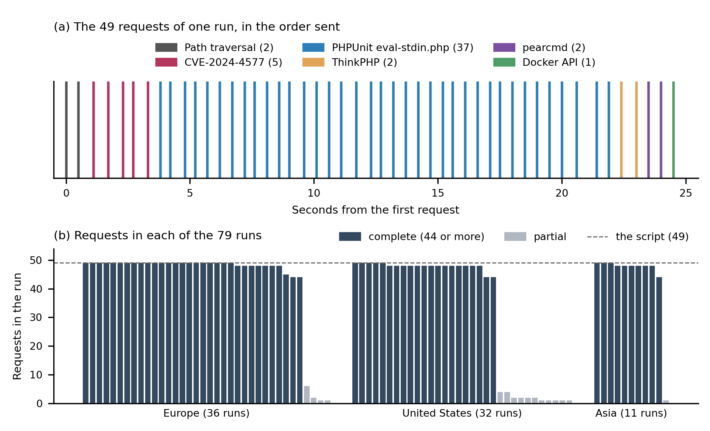

*Figure 5. The libredtail scanner. (a) The 49 requests of the run in Table 6, coloured by phase. (b) Requests in each of the 79 runs, grouped by instance; every run follows the order of the script.*

**Platform and responses.** CVE-2024-4577 affects PHP-CGI under Apache on Windows [11], [13], and the honeypots are Linux containers, so the payloads could not have exploited them. The scanner sent the same requests without checking the platform. It also kept going through every phase after default responses, which suggests a fixed script, not one that reacts. The logs show attempts, not successful exploitation, and the honeypot never ran the second stage. The traffic fits the SANS description [10] with a longer opening: seven POST requests, not four. Table D7 counts the requests by probe.

# 4. Discussion, limitations and conclusion

**Discussion.** The two campaigns are consistent in what they do and vary in how they look. The SSH campaign changed its client library but not its artifact, so a detection that relies on one fingerprint ages quickly, while the file hash, the key comment and the pair of commands stayed stable. The PHP scanner follows one script, so a rule on the ordered paths would have flagged every run, but its user agent is a single field that the operator can change.

**Learning value (RQ4).** A honeynet turns the playbooks of published reports into events that an analyst can follow and check. Table 4 follows one session from the login to the key write, the password change and the reconnaissance, and it matches the SANS description [8]. The printed queries let an analyst repeat each count.

**Security value (RQ4).** Honeypot data gives defenders indicators such as file hashes, command sequences and request sequences. They help only while they are current and only if they reach a blocklist or a detection rule, and no indicator from this project was shared or deployed. The key-writing commands, the key-file hash and the request script could each feed a detection rule, but a rule on the newest fingerprint alone would have flagged 8.8% of the United States sessions (Section 3.2).

**Limitations.** The European instance recorded 300 of 672 hours and the United States instance 251, so the results describe these instances, not the regions, and Asia was supplementary. The instances had the memory that T-Pot's requirements table lists for Hive and still ran out, so a larger instance may record more. The honeypots accept logins, so the SSH sessions show attempts and not compromised servers. A fingerprint describes a client build that many tools can share, and a file hash shows the same key, not the same operator. Outbound traffic was not restricted beyond the cloud platform's defaults, so malware could reach third parties. The default 30-day retention [2] set the deadline for the exports. None of the instances recorded anything from 22 to 25 October, which includes the day on which a researcher reported remote code execution through the PHP2Shell flaws [14], so the data cannot show whether PHP2Shell reached them.

**Conclusion.** The United States instance received 47% more honeypot events per recorded hour than the European one. The strongest findings are two repeated automated behaviours: an SSH campaign that typed the same key-writing commands in 160 sessions, 155 of which stored the published key file, with three different client fingerprints, and a web scanner that repeated one 49-request script in 79 runs. Both involved dozens of source addresses and more than one instance. Honeynets teach and warn well, but these instances stopped when memory ran out, so future deployments should budget for more memory and monitoring.

# References

[1] L. Spitzner, Honeypots: Tracking Hackers. Reading, MA, USA: Addison-Wesley, 2002.

[2] Telekom Security, “T-Pot,” GitHub repository. [Online]. Available: https://github.com/telekom-security/tpotce. [Accessed: Oct. 26, 2026].

[3] Open Information Security Foundation, “Suricata.” [Online]. Available: https://suricata.io. [Accessed: Oct. 26, 2026].

[4] Cowrie, “Cowrie SSH and Telnet honeypot,” GitHub repository. [Online]. Available: https://github.com/cowrie/cowrie. [Accessed: Oct. 26, 2026].

[5] M. Antonakakis et al., “Understanding the Mirai botnet,” in Proc. 26th USENIX Security Symp. (USENIX Security 17), Vancouver, BC, Canada, 2017, pp. 1093–1110.

[6] Z. Durumeric, M. Bailey, and J. A. Halderman, “An Internet-wide view of Internet-wide scanning,” in Proc. 23rd USENIX Security Symp. (USENIX Security 14), San Diego, CA, USA, 2014, pp. 65–78.

[7] MITRE, “MITRE ATT&CK.” [Online]. Available: https://attack.mitre.org. [Accessed: Oct. 26, 2026].

[8] G. P. Thangavel, “[Guest Diary] New Malware Libraries means New Signatures,” SANS Internet Storm Center, May 15, 2026. [Online]. Available: https://isc.sans.edu/diary/32986. [Accessed: Oct. 29, 2026].

[9] C. Souza, A. Muñoz, and E. Ovalle, “Outlaw botnet detected in an incident contained by Kaspersky,” Securelist, Apr. 29, 2025. [Online]. Available: https://securelist.com/outlaw-botnet/116444/. [Accessed: Oct. 29, 2026].

[10] J. Roberts, “Danger of Libredtail [Guest Diary],” SANS Internet Storm Center, Apr. 29, 2026. [Online]. Available: https://isc.sans.edu/diary/32936. [Accessed: Oct. 29, 2026].

[11] National Institute of Standards and Technology, “CVE-2024-4577 Detail,” National Vulnerability Database. [Online]. Available: https://nvd.nist.gov/vuln/detail/CVE-2024-4577. [Accessed: Oct. 29, 2026].

[12] National Institute of Standards and Technology, “CVE-2017-9841 Detail,” National Vulnerability Database. [Online]. Available: https://nvd.nist.gov/vuln/detail/CVE-2017-9841. [Accessed: Oct. 29, 2026].

[13] Tenable, “PHP-CGI Argument Injection CVE-2024-4577 (Direct Check),” Nessus plugin 200464. [Online]. Available: https://tenable.com/plugins/nessus/200464. [Accessed: Oct. 29, 2026].

[14] S. Gatlan, “CISA confirms PHP2Shell vulnerabilities now exploited in attacks,” BleepingComputer, Oct. 27, 2026. [Online]. Available: https://bleepingcomputer.com/news/security/cisa-confirms-php2shell-vulnerabilities-now-exploited-in-attacks. [Accessed: Oct. 29, 2026].

# Appendix A: Screenshots from Elasticsearch and Kibana

The screenshots come from a local Elasticsearch and Kibana that hold the export of each instance. The Kibana screenshots show the time range, 1 to 28 October 2026 in UTC, and, except for Figure A7, the data view or the ES|QL query. The local index leaves out the web-interface records and the records from the excluded addresses, so honeypot counts match the tables (Table 1, note). No screenshot shows a source address, the external address of an instance or the key text; in Figures A50, A52 and A62 to A64 black bars cover the external address of the instance. Each caption links to the page that shows the same data. The links open the local Kibana at `127.0.0.1:5601` and Elasticsearch at `127.0.0.1:9200`, so they work only on the machine that holds the export. Figures A1 to A20 support the counts and the two investigations, Figures A21 to A33 show the pages behind Tables 3 to 7 and Figures A34 to A73 the pages behind Tables D3 to D7.

### Evidence 1: Honeypot events per instance

Table 1 counts honeypot events as all events except the sensor events (P0f, Fatt and Suricata) and the web interface. The query `not type:(P0f or Fatt or Suricata)` returns 776,714 documents in the European data view, 982,407 in the United States view and 339,021 in the Asian view (Figures A1 to A3). Figures A4 to A6 show the same counts from the Elasticsearch interface, requested with `curl` in a terminal. The links in their captions open the same count in a browser.

| Europe | United States | Asia |
|---|---|---|
| 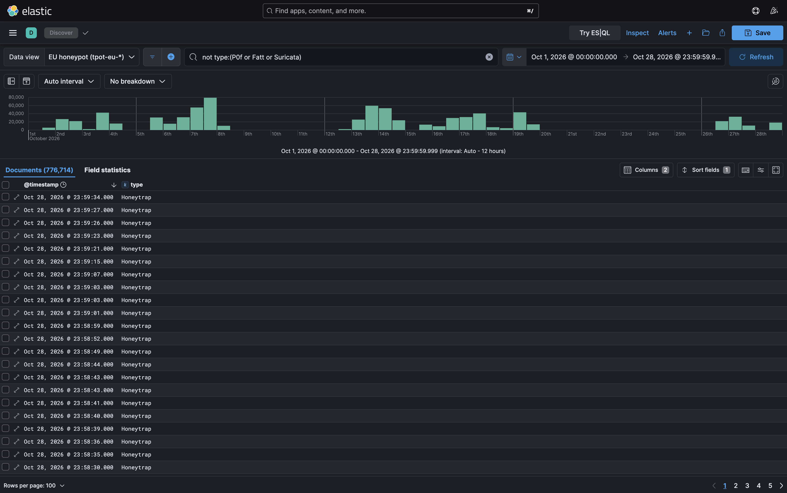<br>*Figure A1. Europe, Kibana: 776,714 honeypot events. [Open in Kibana][t1-eu]* | 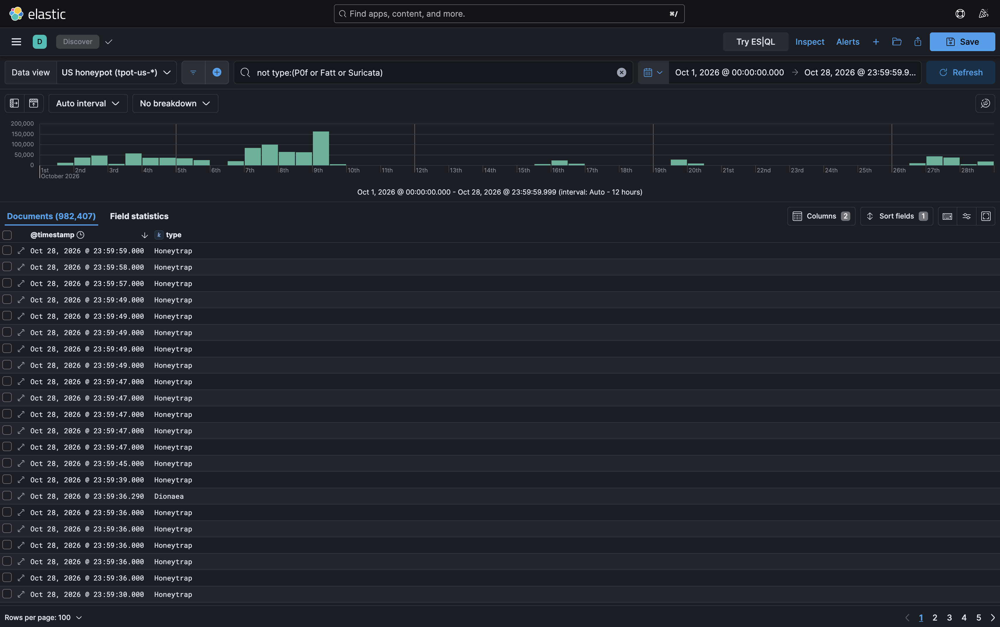<br>*Figure A2. United States, Kibana: 982,407 honeypot events. [Open in Kibana][t1-us]* | 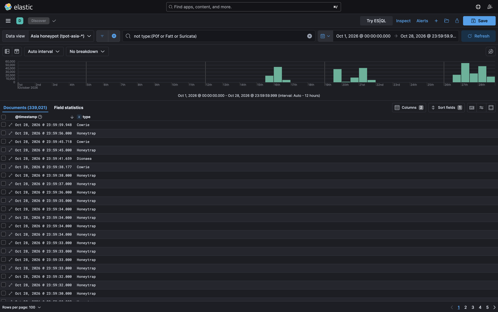<br>*Figure A3. Asia, Kibana: 339,021 honeypot events. [Open in Kibana][t1-asia]* |
| 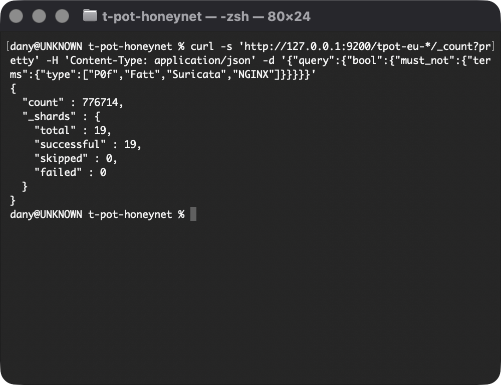<br>*Figure A4. Europe, Elasticsearch count in a terminal: 776,714 honeypot events. [Open the count in a browser][es-count-eu]* | 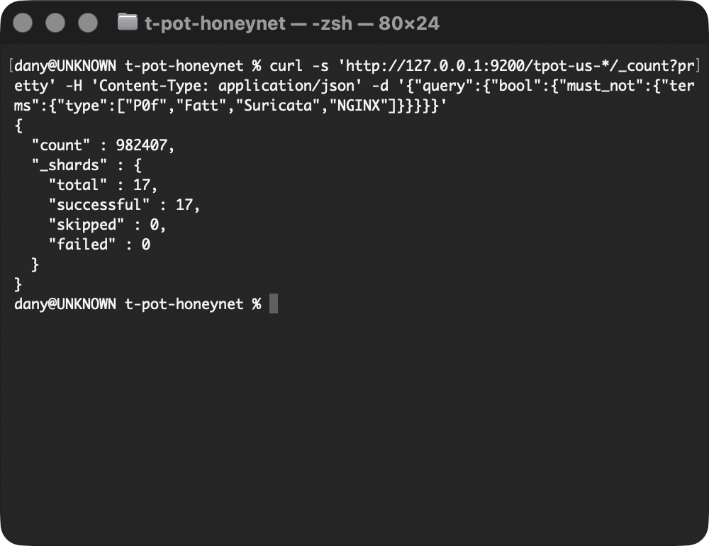<br>*Figure A5. United States, Elasticsearch count in a terminal: 982,407 honeypot events. [Open the count in a browser][es-count-us]* | 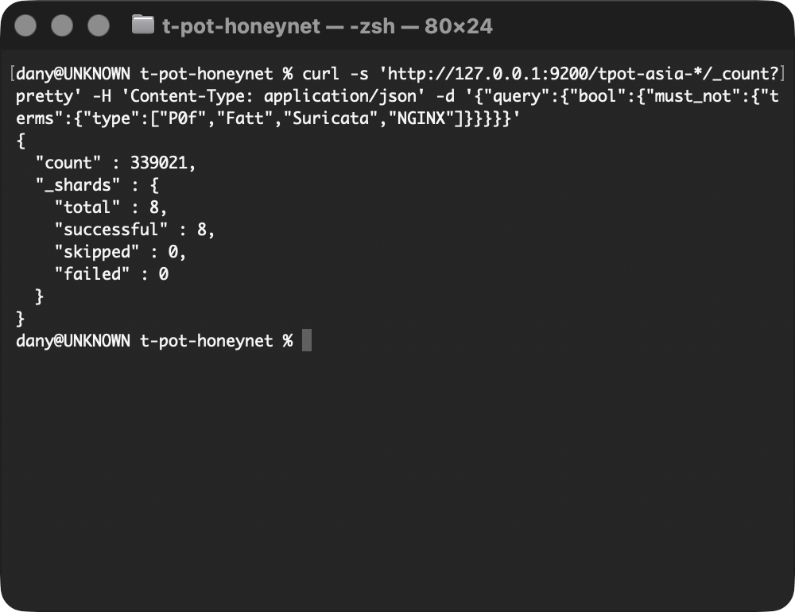<br>*Figure A6. Asia, Elasticsearch count in a terminal: 339,021 honeypot events. [Open the count in a browser][es-count-asia]* |

### Evidence 2: Recording gaps and hourly volume

Figure A7 stacks the honeypot events of the three instances over the window (query `not type:(P0f or Fatt or Suricata or NGINX)`). Together with the histograms in Figures A1 to A3, it shows when each instance recorded. The empty stretches match the gaps in Section 2, and no instance recorded from 22 to 25 October. The screenshot is a Kibana dashboard panel. The link in its caption opens the same data as an ES|QL query in Discover, with one row for each hour and instance and a stacked bar chart above the rows.

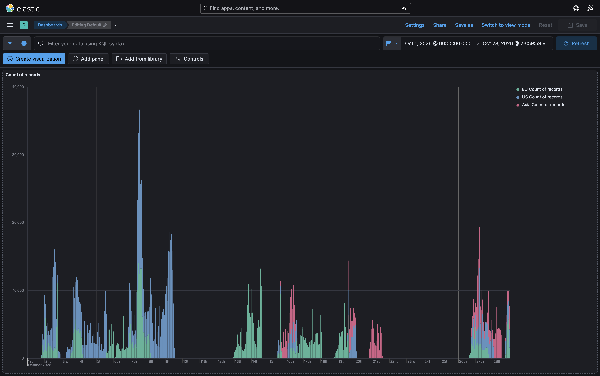

*Figure A7. Honeypot events over time in the three instances, stacked: Europe (green), United States (blue) and Asia (red). [Open the same data in Kibana][a7-timeline]*

### Evidence 3: phpinfo requests

The phpinfo row of Table D7 counts requests whose path, request URI or URL contains `phpinfo` or `info.php`, ignoring case. Kibana's default query language, KQL, is case-sensitive, so these screenshots use the Lucene language with character classes that ignore case. The query returns 273 requests in Europe, 349 in the United States and 487 in Asia (Figures A8 to A10):

```
type:(Tanner OR H0neytr4p OR Honeyaml OR Wordpot) AND (path:/.*([pP][hH][pP][iI][nN][fF][oO]|[iI][nN][fF][oO]\.[pP][hH][pP]).*/ OR request_uri:/.*([pP][hH][pP][iI][nN][fF][oO]|[iI][nN][fF][oO]\.[pP][hH][pP]).*/ OR url:/.*([pP][hH][pP][iI][nN][fF][oO]|[iI][nN][fF][oO]\.[pP][hH][pP]).*/)
```

| Europe | United States | Asia |
|---|---|---|
| 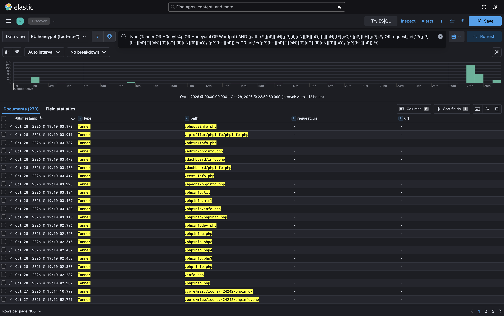<br>*Figure A8. Europe, phpinfo requests: 273. [Open in Kibana][ev3-phpinfo-eu]* | 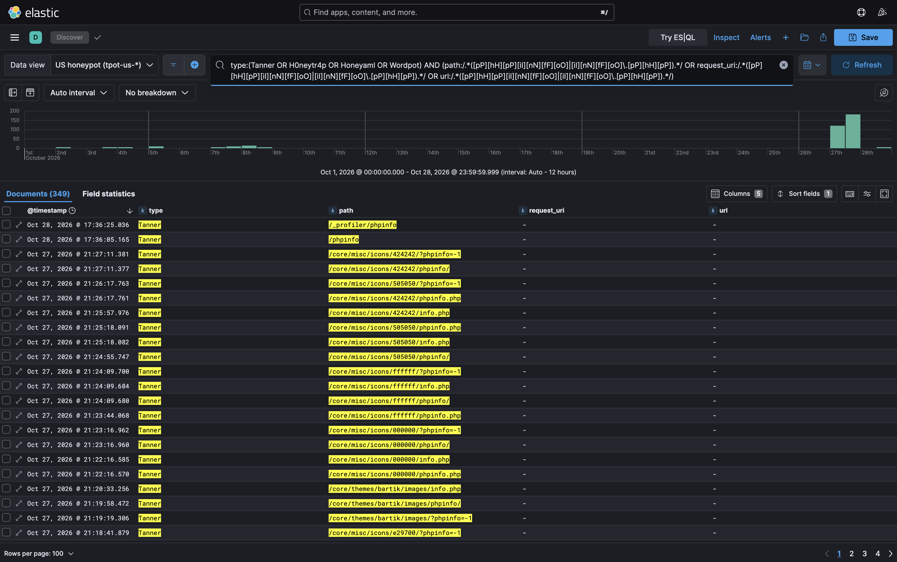<br>*Figure A9. United States, phpinfo requests: 349. [Open in Kibana][ev3-phpinfo-us]* | 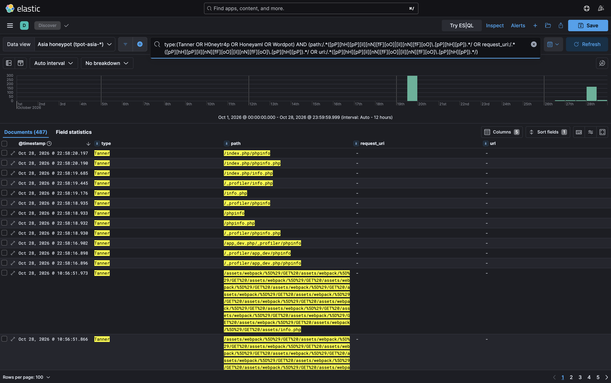<br>*Figure A10. Asia, phpinfo requests: 487. [Open in Kibana][ev3-phpinfo-asia]* |

### Evidence 4: The libredtail user agent

Section 3.3 counts the requests that carry the `libredtail-http` user agent. Tanner records the agent in the request headers and H0neytr4p in a field of its own, so the KQL query checks both fields: `headers.user-agent:"libredtail-http" or user-agent:"libredtail-http"`. It returns 1,557 requests in Europe, 1,026 in the United States and 480 in Asia (Figures A11 to A13).

| Europe | United States | Asia |
|---|---|---|
| 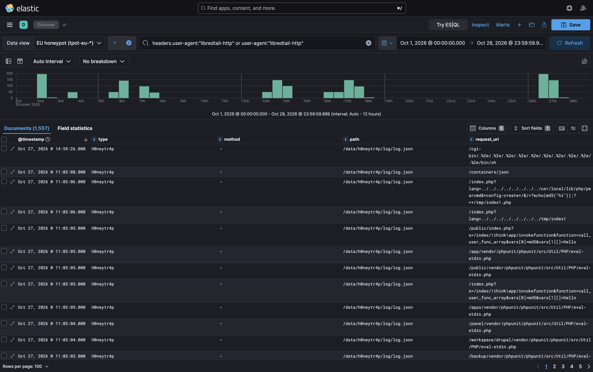<br>*Figure A11. Europe, requests with the libredtail-http user agent: 1,557. [Open in Kibana][ev4-libredtail-eu]* | 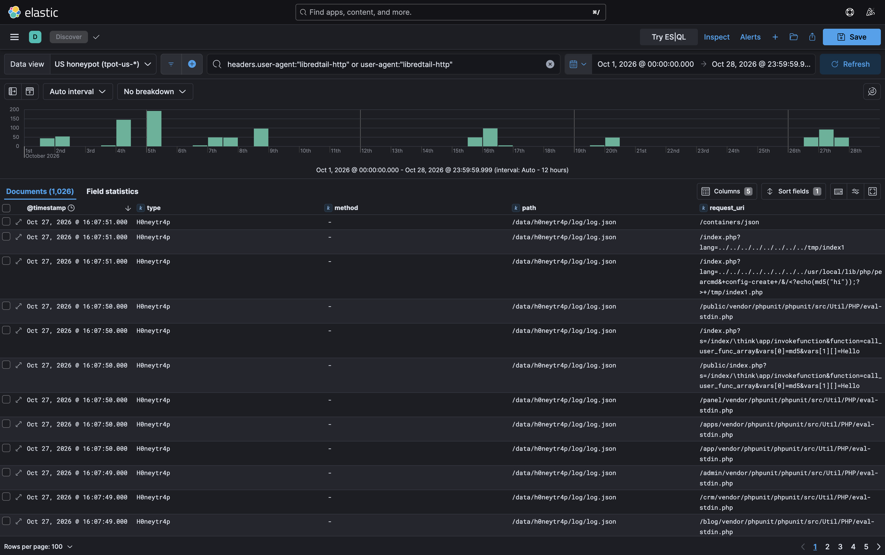<br>*Figure A12. United States, requests with the libredtail-http user agent: 1,026. [Open in Kibana][ev4-libredtail-us]* | 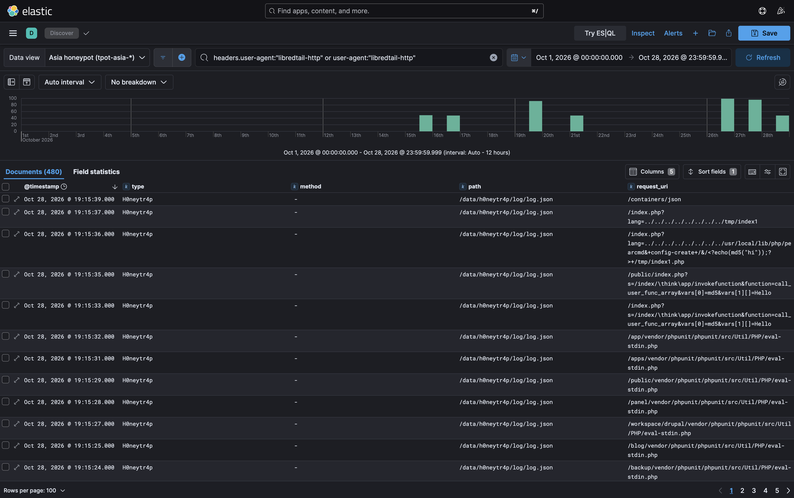<br>*Figure A13. Asia, requests with the libredtail-http user agent: 480. [Open in Kibana][ev4-libredtail-asia]* |

### Evidence 5: The key-writing command

The key-writing sessions of Section 3.2 are the `cowrie.command.input` events whose command contains the key comment `mdrfckr`. The query `eventid:cowrie.command.input and input:*mdrfckr*` returns 91 sessions in the United States and 69 in Asia (Figures A15 and A16), and no result in Europe for the whole window (Figure A14). The screenshots list the session identifier and the country but not the command, because the command contains the key. Figure A17 is a terminal capture. It lists the stored key file, which is 389 bytes, and the SHA-256 digest of the file, which equals the file name. The capture shows neither the key nor an address.

| Europe | United States | Asia |
|---|---|---|
| 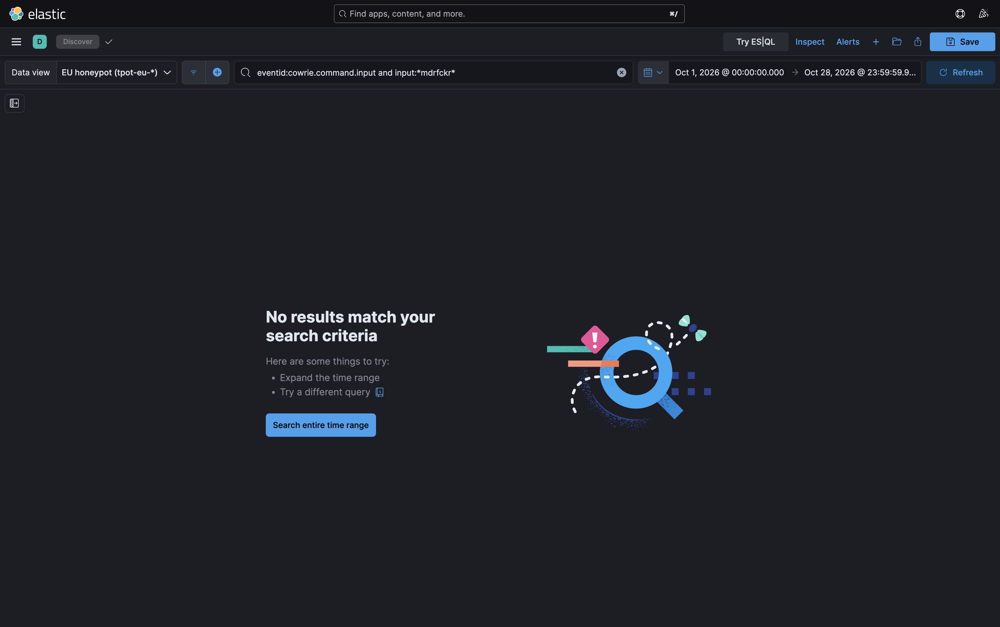<br>*Figure A14. Europe, key-writing command: no results. [Open in Kibana][ev5-mdrfckr-eu]* | 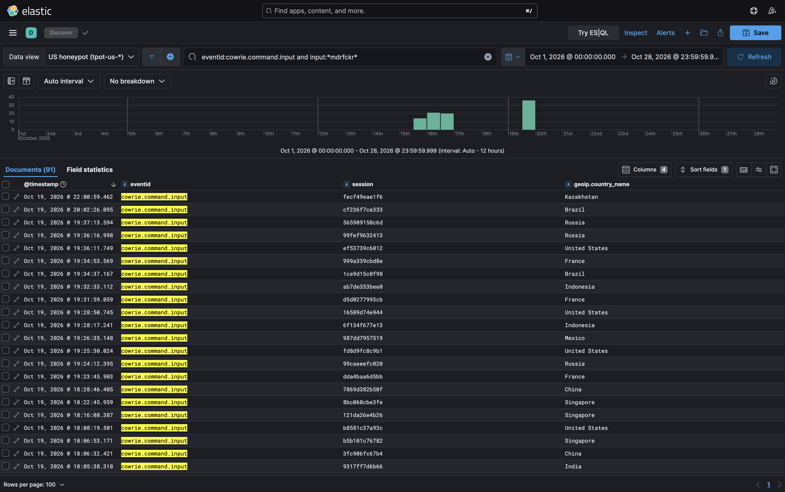<br>*Figure A15. United States, key-writing command: 91 sessions. [Open in Kibana][ev5-mdrfckr-us]* | 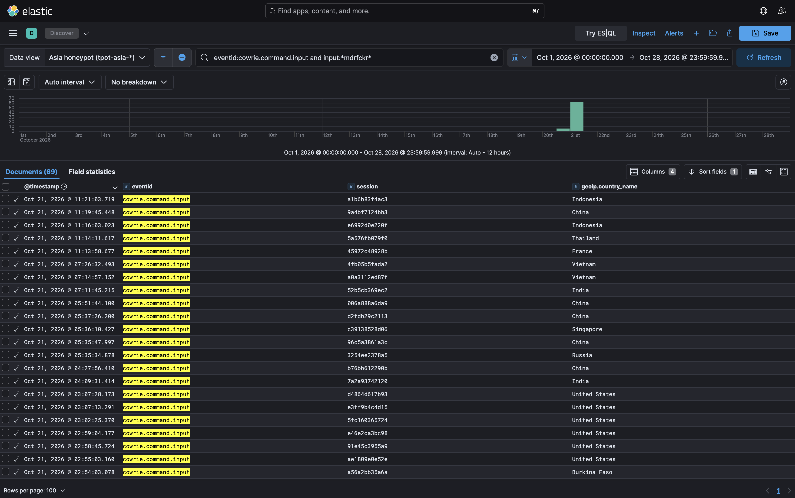<br>*Figure A16. Asia, key-writing command: 69 sessions. [Open in Kibana][ev5-mdrfckr-asia]* |
|  | 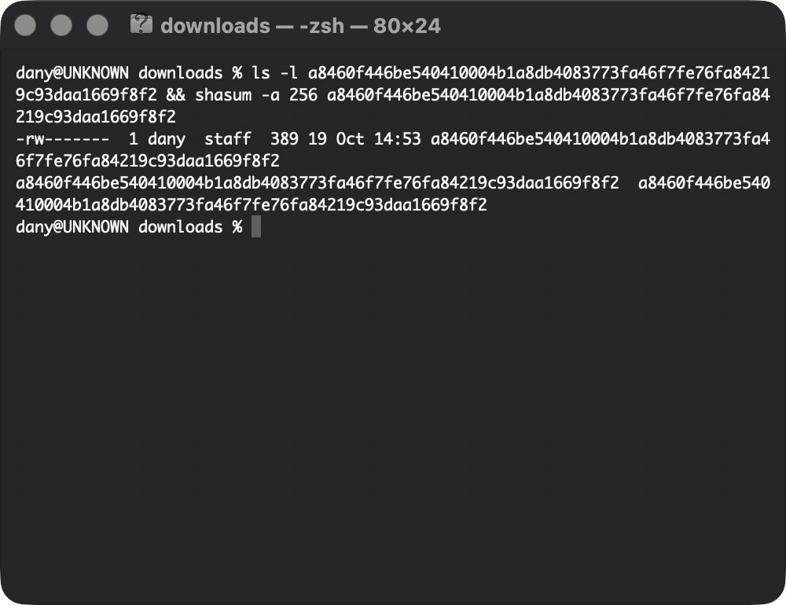<br>*Figure A17. Terminal, key file stored by the United States instance: 389 bytes, and its SHA-256 digest equals the file name.* |  |

### Evidence 6: The SSH client fingerprint

The fingerprint that the SANS diary lists for April 2026 is `03a80b21afa810682a776a7d42e5e6fb`. The query `hassh:03a80b21afa810682a776a7d42e5e6fb` returns 119 sessions in the United States and 171 in Asia, and none in Europe (Figures A18 to A20). These counts are the Sessions column of Table 5: they include the sessions that did not write the key.

| Europe | United States | Asia |
|---|---|---|
| 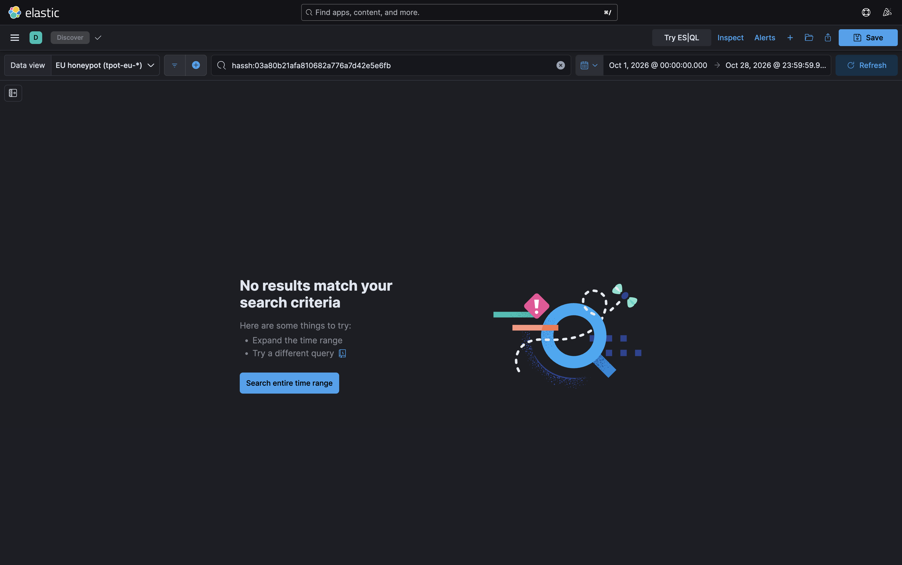<br>*Figure A18. Europe, SSH client fingerprint of April 2026: no results. [Open in Kibana][ev6-hassh-eu]* | 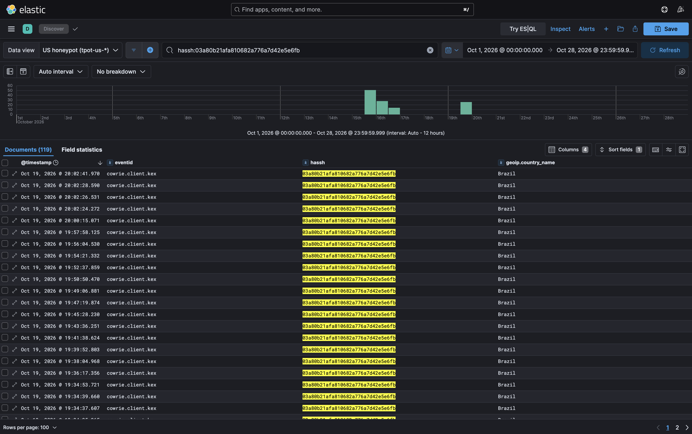<br>*Figure A19. United States, SSH client fingerprint of April 2026: 119 sessions. [Open in Kibana][ev6-hassh-us]* | 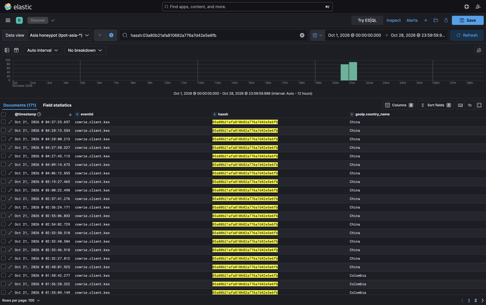<br>*Figure A20. Asia, SSH client fingerprint of April 2026: 171 sessions. [Open in Kibana][ev6-hassh-asia]* |

### Evidence 7: Services (Table 3)

Table 3 ranks the services of each instance by honeypot events. The ES|QL query printed under Table 3 counts the events by service and port and keeps the ten largest (Figures A21 to A23). The first row of each page is the largest service: Sentrypeer on port 5060 in Europe (126,290 events), RDPHoneypot on port 3389 in the United States (255,409) and Sentrypeer on port 5060 in Asia (31,639).

| Europe | United States | Asia |
|---|---|---|
| 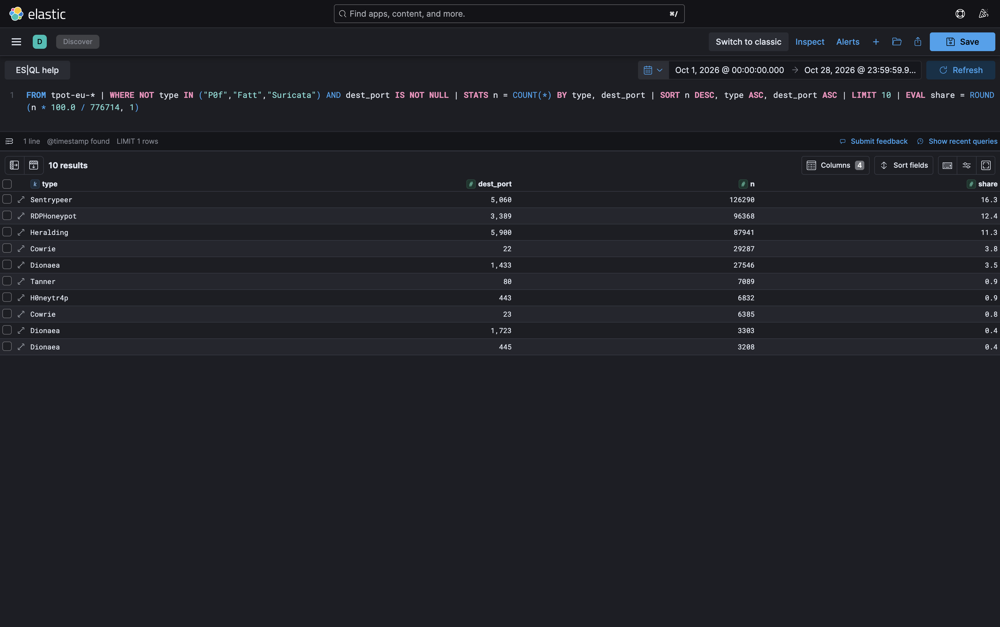<br>*Figure A21. Europe, the ten largest services (ES\|QL): Sentrypeer on port 5060 is the largest, with 126,290 events. [Open in Kibana][t5-eu]* | 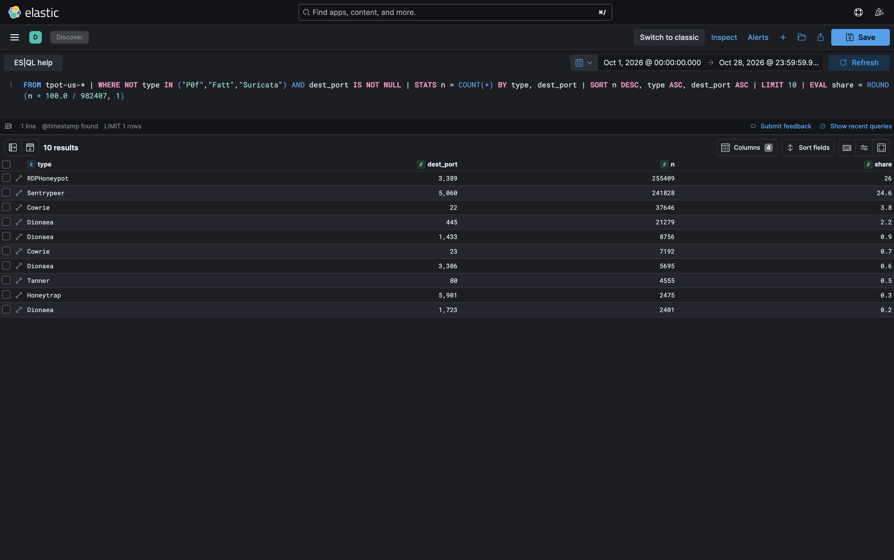<br>*Figure A22. United States, the ten largest services (ES\|QL): RDPHoneypot on port 3389 is the largest, with 255,409 events. [Open in Kibana][t5-us]* | 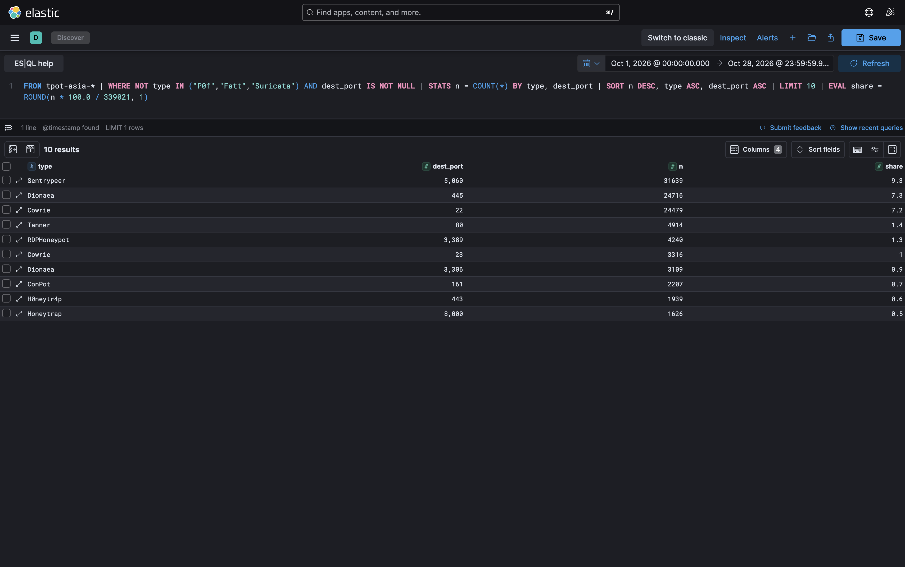<br>*Figure A23. Asia, the ten largest services (ES\|QL): Sentrypeer on port 5060 is the largest, with 31,639 events. [Open in Kibana][t5-asia]* |

### Evidence 8: One key-writing session (Table 4)

Table 4 reconstructs the first key-writing session of the United States instance, on 15 October. Figure A24 lists its 26 events in Kibana, from the connection to the end of the session. The ES|QL query printed under Table 4 selects the events of one session and shows the key write and the password change as `[key write]` and `[password change]`, so that neither the key nor the new password appears. The SHA-256 digest of the stored file is in the file-download event.

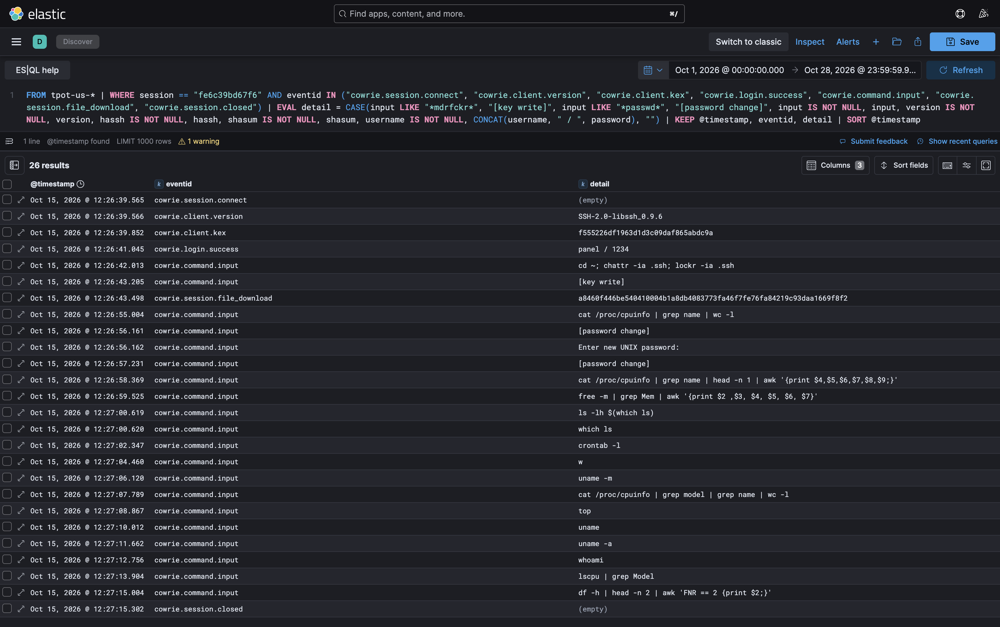

*Figure A24. United States, the 26 events of the session in Table 4 (ES|QL). The query masks the key and the new password. [Open in Kibana][s4-session]*

### Evidence 9: SSH client fingerprints and stored files (Table 5)

Table 5 counts the Cowrie sessions by SSH client fingerprint. The ES|QL query printed under Table 5 groups the sessions of one instance by fingerprint, for the three fingerprints of the table, and counts the sessions that logged in, typed commands and wrote the key. Figures A25 to A27 show the result: no session in Europe, three fingerprints in the United States with 1,140, 119 and 23 sessions, and two in Asia with 757 and 171. Figures A28 and A29 list the SHA-256 digests of the files that Cowrie stored, with the number of sessions for each. The digest that the SANS diary publishes for the key file (`a8460f44…`) leads both lists, with 86 sessions in the United States and 69 in Asia.

| Europe | United States | Asia |
|---|---|---|
| 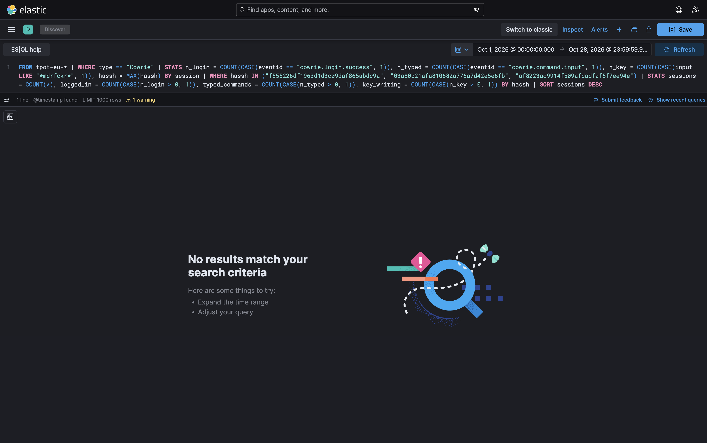<br>*Figure A25. Europe, sessions by SSH client fingerprint (ES\|QL): no results. [Open in Kibana][s5-fp-eu]* | 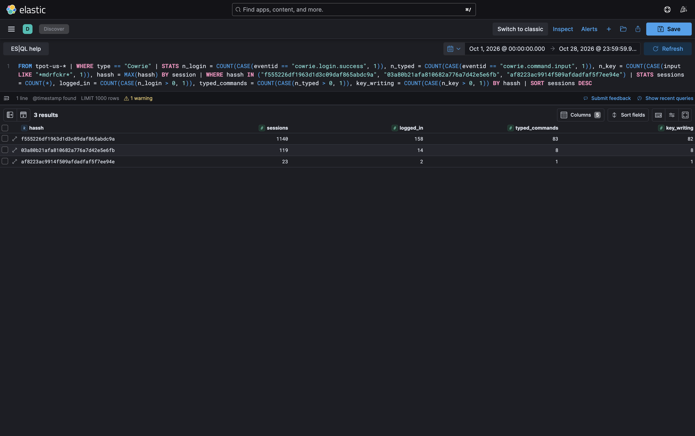<br>*Figure A26. United States, sessions by SSH client fingerprint (ES\|QL): three fingerprints with 1,140, 119 and 23 sessions. [Open in Kibana][s5-fp-us]* | 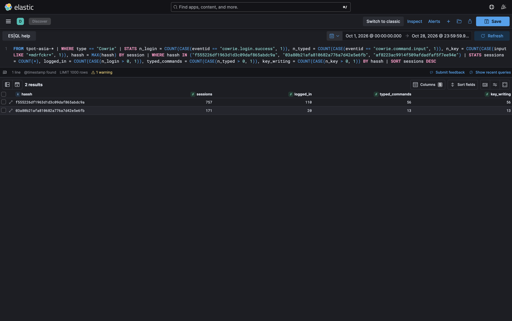<br>*Figure A27. Asia, sessions by SSH client fingerprint (ES\|QL): two fingerprints with 757 and 171 sessions. [Open in Kibana][s5-fp-asia]* |
|  | <br>*Figure A28. United States, stored files by SHA-256 digest (ES\|QL): the key file is in 86 sessions. [Open in Kibana][s5-file-us]* | 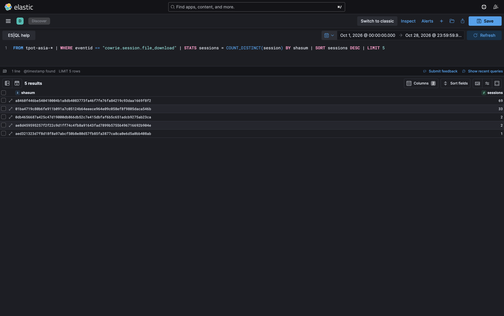<br>*Figure A29. Asia, stored files by SHA-256 digest (ES\|QL): the key file is in 69 sessions. [Open in Kibana][s5-file-asia]* |

### Evidence 10: One libredtail run and its paths (Tables 6 and 7)

Table 6 lists the 49 requests of one libredtail run. Figure A30 shows them in Kibana: the ES|QL query printed under Table 6 selects the requests of the Tanner honeypot of the European instance that carry the libredtail-http user agent, in a window of 50 seconds on 2 October, and shows the time, the method and the path, but no address. Figure A31 shows the 49 paths that the user agent requested on the Tanner honeypots of the three instances, with the number of requests and of source addresses for each path; each path came from 28 to 40 addresses. Figure A32 shows the sizes of the request bodies of the CVE-2024-4577 requests that H0neytr4p logged: 125 requests from 23 addresses had a body of 1,189 bytes, and two other sizes, 1,193 and 229 bytes, came from one address each. Figure A33 lists the 165 POST requests with the libredtail-http user agent on the European instance. Its KQL query:

```
headers.user-agent:"libredtail-http" and method:POST
```

|  |  |  |
|---|---|---|
| 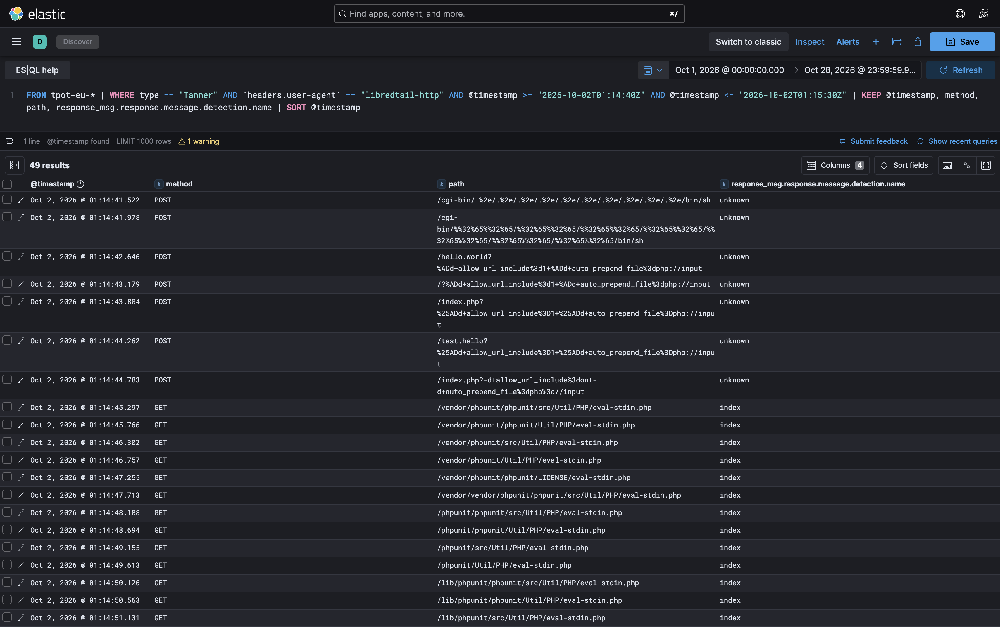<br>*Figure A30. Europe, the 49 requests of the libredtail run in Table 6 (ES\|QL). [Open in Kibana][p6-run]* | 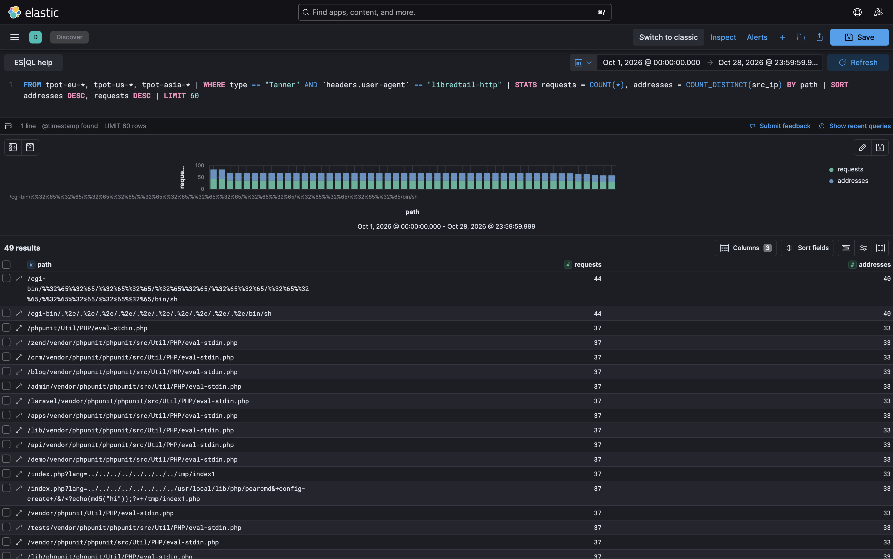<br>*Figure A31. All three instances, the 49 paths that the libredtail user agent requested on Tanner, with the number of requests and of addresses for each path (ES\|QL). [Open in Kibana][p7-paths]* | 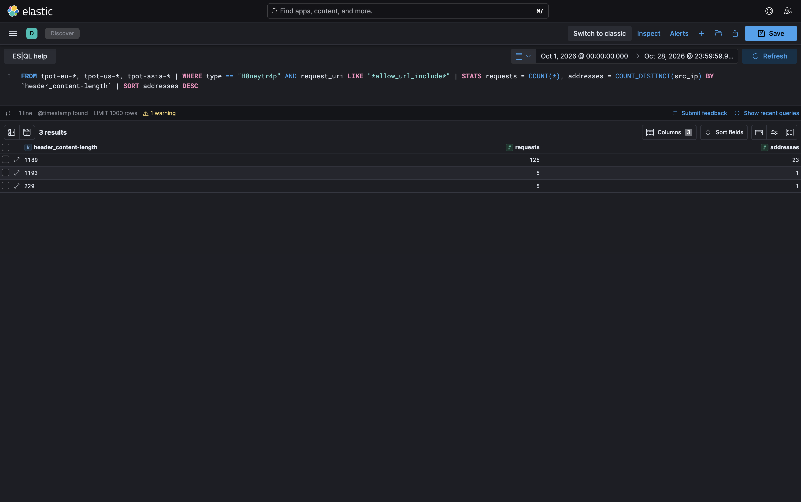<br>*Figure A32. All three instances, the sizes of the CVE-2024-4577 request bodies that H0neytr4p logged, with the number of requests and of addresses for each size (ES\|QL). [Open in Kibana][p7-bodylen]* |
| 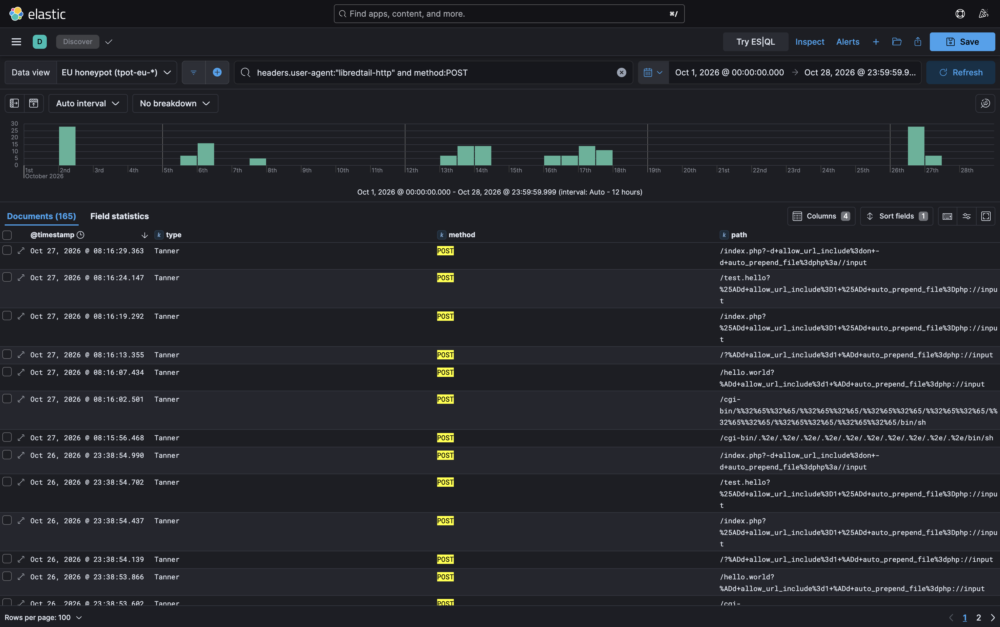<br>*Figure A33. Europe, POST requests with the libredtail-http user agent: 165. [Open in Kibana][p6-post-eu]* |  |  |

### Evidence 11: Sources and networks (Table D3)

Table D3 ranks the source countries and the autonomous systems by their share of the honeypot events of an instance. The ES|QL queries printed under Table D3 compute the shares; Figures A34 to A37 show the pages for Europe and the United States. The first row of each page is the largest source: the largest country is the United States (28.9% of the European and 29.8% of the United States events) and the largest autonomous system is Banatsync Srl (15.6% and 16.4%).

| Europe | United States |
|---|---|
| 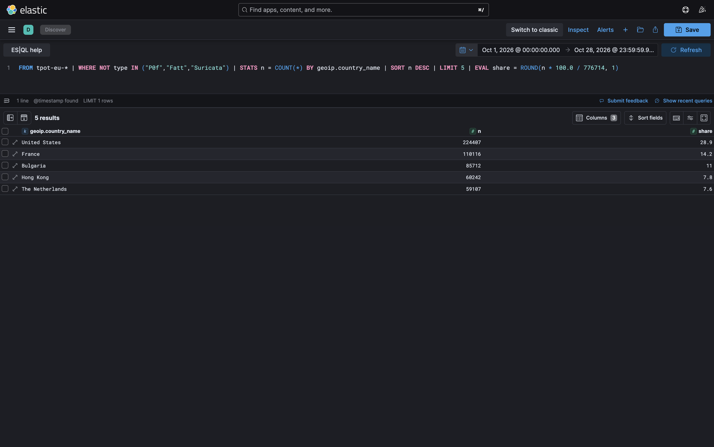<br>*Figure A34. Europe, the five largest source countries (ES\|QL): United States is the largest, with 28.9% of the honeypot events. [Open in Kibana][t4-country-eu]* | 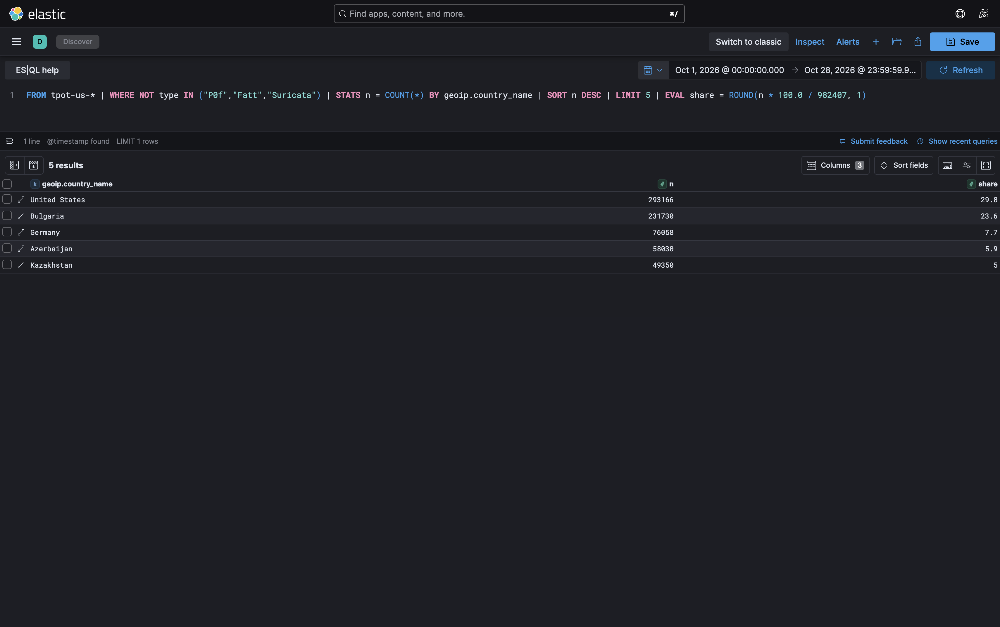<br>*Figure A35. United States, the five largest source countries (ES\|QL): United States is the largest, with 29.8% of the honeypot events. [Open in Kibana][t4-country-us]* |
| 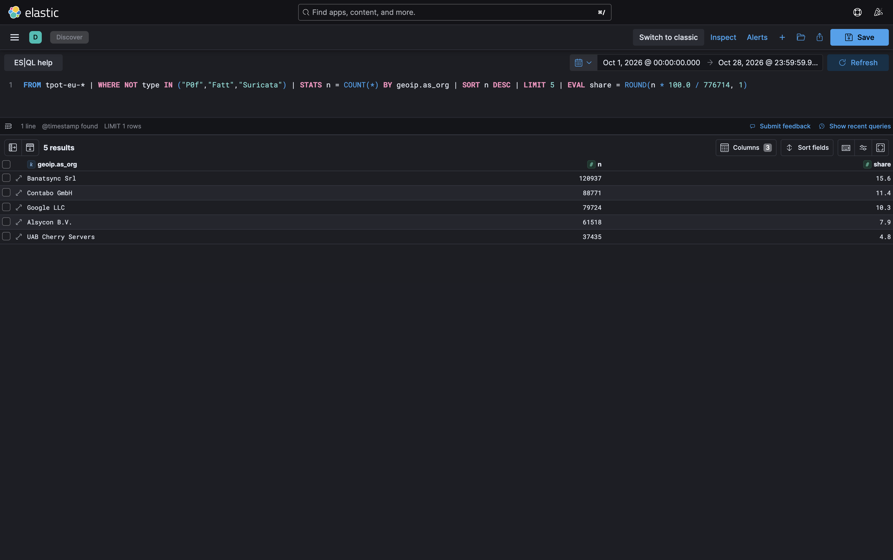<br>*Figure A36. Europe, the five largest autonomous systems (ES\|QL): Banatsync Srl is the largest, with 15.6% of the honeypot events. [Open in Kibana][t4-as-eu]* | <br>*Figure A37. United States, the five largest autonomous systems (ES\|QL): Banatsync Srl is the largest, with 16.4% of the honeypot events. [Open in Kibana][t4-as-us]* |

### Evidence 12: Passwords and commands (Tables D4 and D5)

Tables D4 and D5 list the most common Cowrie password pairs and typed commands. The ES|QL queries printed under the two tables count them for each instance; the password page leaves out pairs with an empty password, and the command page shows the key-writing command as `[key write]`, so that the key does not appear. Figures A38 to A40 show the password pairs and Figures A41 to A43 the commands. The most common pair is `root / root` in Europe (124 attempts), `enable / linuxshell` in the United States (253) and `345gs5662d34 / 345gs5662d34` in Asia (66). The most common command is `system` in Europe (168 times), `sh` in the United States (438) and `uname -a` in Asia (73).

| Europe | United States | Asia |
|---|---|---|
| 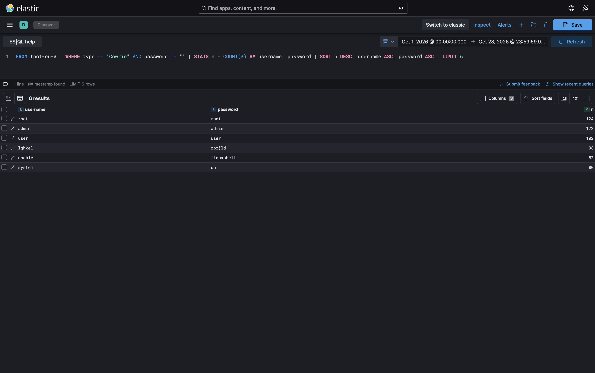<br>*Figure A38. Europe, the most common password pairs (ES\|QL): root / root is the most common, with 124 attempts. [Open in Kibana][t6-pairs-eu]* | 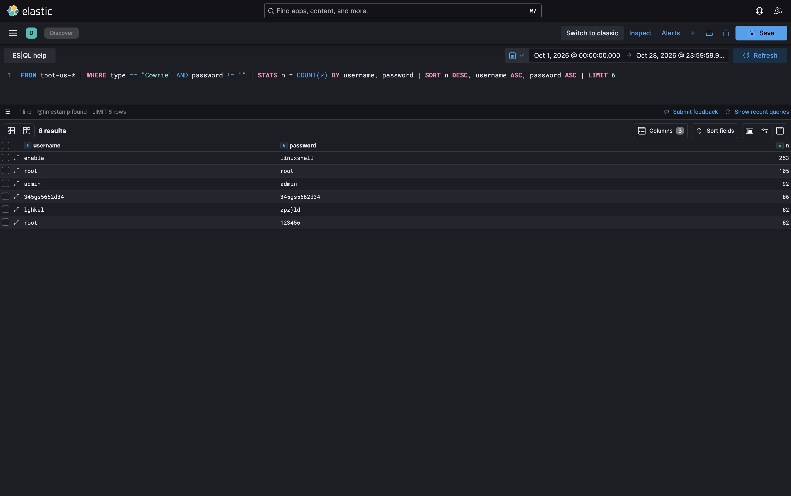<br>*Figure A39. United States, the most common password pairs (ES\|QL): enable / linuxshell is the most common, with 253 attempts. [Open in Kibana][t6-pairs-us]* | 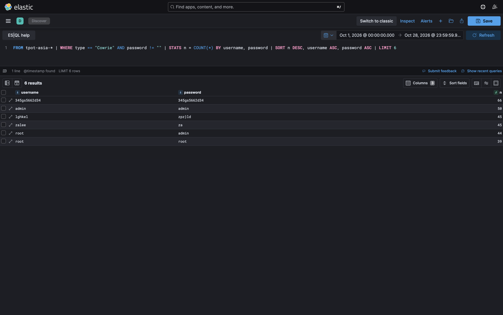<br>*Figure A40. Asia, the most common password pairs (ES\|QL): 345gs5662d34 / 345gs5662d34 is the most common, with 66 attempts. [Open in Kibana][t6-pairs-asia]* |
| 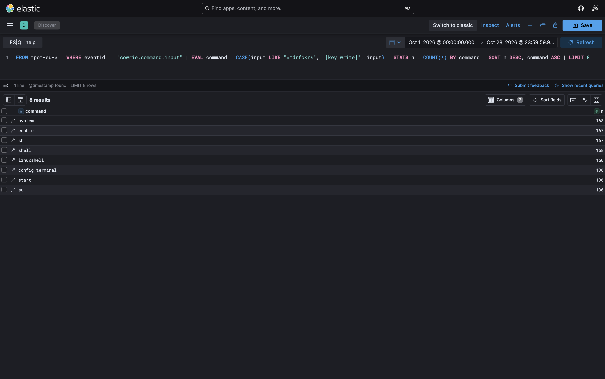<br>*Figure A41. Europe, the most common typed commands (ES\|QL): system is the most common, typed 168 times. [Open in Kibana][t6-cmd-eu]* | 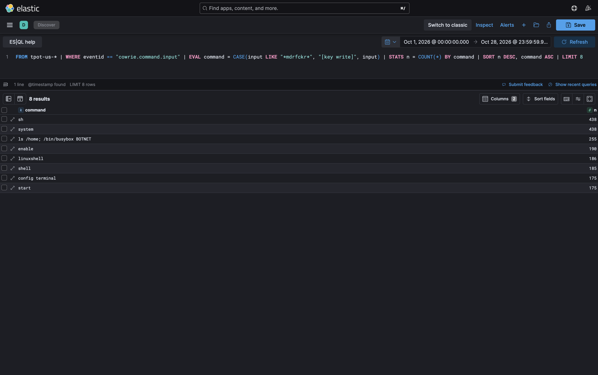<br>*Figure A42. United States, the most common typed commands (ES\|QL): sh is the most common, typed 438 times. [Open in Kibana][t6-cmd-us]* | 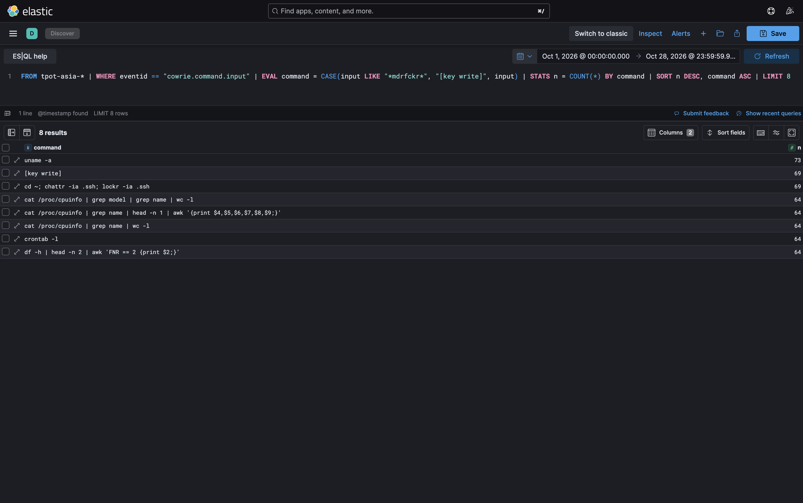<br>*Figure A43. Asia, the most common typed commands (ES\|QL): uname -a is the most common, typed 73 times. [Open in Kibana][t6-cmd-asia]* |

### Evidence 13: Suricata alerts (Table D6)

Table D6 lists the most common attack signatures and the CVE-named alerts of Suricata. The ES|QL queries printed under Table D6 leave out the engine notices, whose names start with SURICATA. Figures A44 to A46 show the signatures and Figures A47 to A49 the alerts that name a CVE. The first signature is GPL INFO VNC server response in Europe (204,597 alerts), ET INFO RDP connection request in the United States (177,038) and GPL ICMP PING in Asia (21,431); the first CVE is CVE-2024-14007 (209), CVE-2022-27255 (633) and CVE-2019-11500 (62).

| Europe | United States | Asia |
|---|---|---|
| <br>*Figure A44. Europe, the most common attack signatures (ES\|QL): GPL INFO VNC server response is the most common, with 204,597 alerts. [Open in Kibana][t7-sig-eu]* | 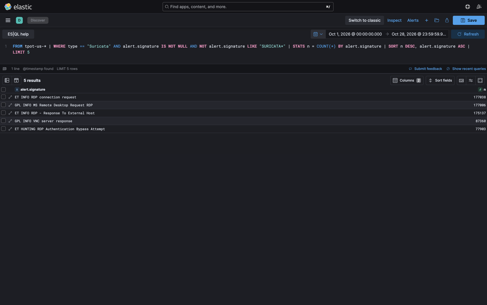<br>*Figure A45. United States, the most common attack signatures (ES\|QL): ET INFO RDP connection request is the most common, with 177,038 alerts. [Open in Kibana][t7-sig-us]* | 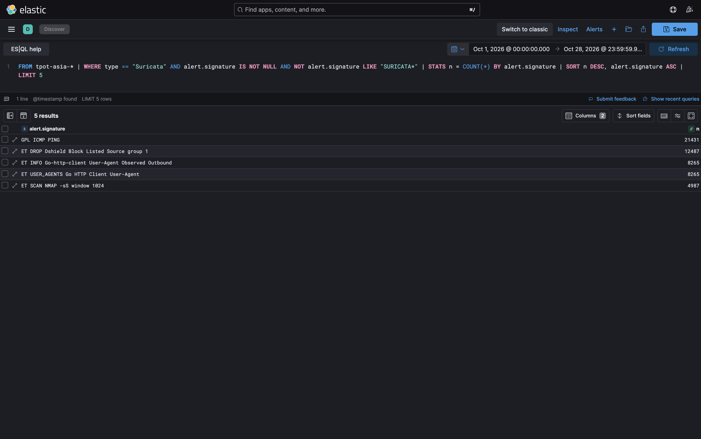<br>*Figure A46. Asia, the most common attack signatures (ES\|QL): GPL ICMP PING is the most common, with 21,431 alerts. [Open in Kibana][t7-sig-asia]* |
| 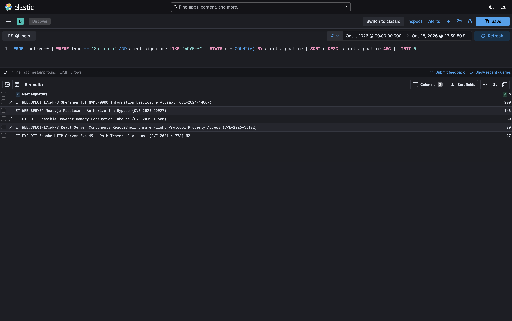<br>*Figure A47. Europe, the most common CVE-named alerts (ES\|QL): CVE-2024-14007 is the most common, with 209 alerts. [Open in Kibana][t7-cve-eu]* | 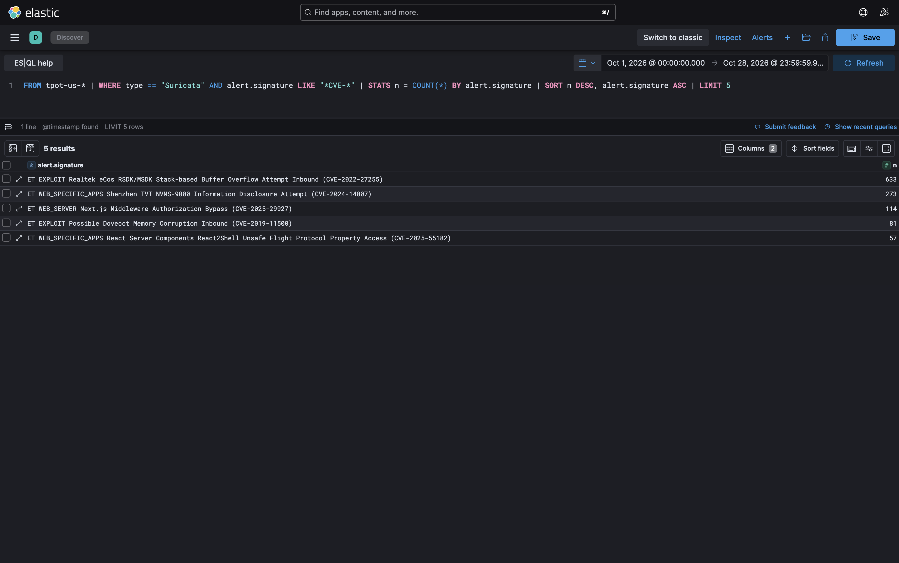<br>*Figure A48. United States, the most common CVE-named alerts (ES\|QL): CVE-2022-27255 is the most common, with 633 alerts. [Open in Kibana][t7-cve-us]* | <br>*Figure A49. Asia, the most common CVE-named alerts (ES\|QL): CVE-2019-11500 is the most common, with 62 alerts. [Open in Kibana][t7-cve-asia]* |

### Evidence 14: PHP probes (Table D7)

Table D7 counts the requests of the four web honeypots by probe family. Figures A50 to A73 show the Kibana page behind each count, in the order of the rows of the table. The first row counts requests whose path, request URI or URL contains `.php`; the other rows count the signature of their probe in the same three fields, so a request can appear in more than one row. The phpinfo row of the whole window is in Evidence 3. The two rows for 26 to 28 October use the time range of those days. The queries, for the European data view (the other instances change the data view):

```
PHP-targeted requests
type:(Tanner or H0neytr4p or Honeyaml or Wordpot) and (path:*.php* or request_uri:*.php* or url:*.php*)

PHPUnit eval-stdin.php requests (CVE-2017-9841)
type:(Tanner or H0neytr4p or Honeyaml or Wordpot) and (path:*eval-stdin* or request_uri:*eval-stdin* or url:*eval-stdin*)

PHP-CGI payload requests (CVE-2024-4577)
type:(Tanner or H0neytr4p or Honeyaml or Wordpot) and (path:*allow_url_include* or request_uri:*allow_url_include* or url:*allow_url_include*)

phpMyAdmin requests
type:(Tanner OR H0neytr4p OR Honeyaml OR Wordpot) AND (path:/.*([pP][hH][pP][mM][yY][aA][dD][mM][iI][nN]|\/[pP][mM][aA]\/).*/ OR request_uri:/.*([pP][hH][pP][mM][yY][aA][dD][mM][iI][nN]|\/[pP][mM][aA]\/).*/ OR url:/.*([pP][hH][pP][mM][yY][aA][dD][mM][iI][nN]|\/[pP][mM][aA]\/).*/)

WordPress login and XML-RPC requests
type:(Tanner or H0neytr4p or Honeyaml or Wordpot) and (path:*wp-login.php* or path:*xmlrpc.php* or request_uri:*wp-login.php* or request_uri:*xmlrpc.php* or url:*wp-login.php* or url:*xmlrpc.php*)

.env file requests
type:(Tanner or H0neytr4p or Honeyaml or Wordpot) and (path:*.env* or request_uri:*.env* or url:*.env*)

.env file requests, 26 to 28 October
type:(Tanner or H0neytr4p or Honeyaml or Wordpot) and (path:*.env* or request_uri:*.env* or url:*.env*)

phpinfo requests, 26 to 28 October
type:(Tanner OR H0neytr4p OR Honeyaml OR Wordpot) AND (path:/.*([pP][hH][pP][iI][nN][fF][oO]|[iI][nN][fF][oO]\.[pP][hH][pP]).*/ OR request_uri:/.*([pP][hH][pP][iI][nN][fF][oO]|[iI][nN][fF][oO]\.[pP][hH][pP]).*/ OR url:/.*([pP][hH][pP][iI][nN][fF][oO]|[iI][nN][fF][oO]\.[pP][hH][pP]).*/)
```

In Figures A50, A52 and A62 to A64 the Wordpot rows list the external address of the instance in the `url` column, and black bars cover these values. The pages that the links open do not show the column.

| Europe | United States | Asia |
|---|---|---|
| <br>*Figure A50. Europe, PHP-targeted requests: 2,824. The `url` values of the Wordpot rows are masked. [Open in Kibana][t8-php-eu]* | <br>*Figure A51. United States, PHP-targeted requests: 1,764. [Open in Kibana][t8-php-us]* | <br>*Figure A52. Asia, PHP-targeted requests: 1,156. The `url` values of the Wordpot rows are masked. [Open in Kibana][t8-php-asia]* |
| <br>*Figure A53. Europe, PHPUnit eval-stdin.php requests (CVE-2017-9841): 1,204. [Open in Kibana][t8-eval-eu]* | <br>*Figure A54. United States, PHPUnit eval-stdin.php requests (CVE-2017-9841): 791. [Open in Kibana][t8-eval-us]* | <br>*Figure A55. Asia, PHPUnit eval-stdin.php requests (CVE-2017-9841): 373. [Open in Kibana][t8-eval-asia]* |
| <br>*Figure A56. Europe, PHP-CGI payload requests (CVE-2024-4577): 153. [Open in Kibana][t8-cgi-eu]* | <br>*Figure A57. United States, PHP-CGI payload requests (CVE-2024-4577): 99. [Open in Kibana][t8-cgi-us]* | <br>*Figure A58. Asia, PHP-CGI payload requests (CVE-2024-4577): 45. [Open in Kibana][t8-cgi-asia]* |
| <br>*Figure A59. Europe, phpMyAdmin requests: 166. [Open in Kibana][t8-pma-eu]* | <br>*Figure A60. United States, phpMyAdmin requests: 158. [Open in Kibana][t8-pma-us]* | <br>*Figure A61. Asia, phpMyAdmin requests: 82. [Open in Kibana][t8-pma-asia]* |
| <br>*Figure A62. Europe, WordPress login and XML-RPC requests: 51. The `url` values of the Wordpot rows are masked. [Open in Kibana][t8-wp-eu]* | <br>*Figure A63. United States, WordPress login and XML-RPC requests: 35. The `url` values of the Wordpot rows are masked. [Open in Kibana][t8-wp-us]* | <br>*Figure A64. Asia, WordPress login and XML-RPC requests: 48. The `url` values of the Wordpot rows are masked. [Open in Kibana][t8-wp-asia]* |
| <br>*Figure A65. Europe, .env file requests: 3,094. [Open in Kibana][t8-env-eu]* | <br>*Figure A66. United States, .env file requests: 1,194. [Open in Kibana][t8-env-us]* | <br>*Figure A67. Asia, .env file requests: 1,971. [Open in Kibana][t8-env-asia]* |
| <br>*Figure A68. Europe, .env file requests, 26 to 28 October: 853. [Open in Kibana][t8-env-late-eu]* | <br>*Figure A69. United States, .env file requests, 26 to 28 October: 809. [Open in Kibana][t8-env-late-us]* | <br>*Figure A70. Asia, .env file requests, 26 to 28 October: 544. [Open in Kibana][t8-env-late-asia]* |
| <br>*Figure A71. Europe, phpinfo requests, 26 to 28 October: 207. [Open in Kibana][t8-phpinfo-late-eu]* | <br>*Figure A72. United States, phpinfo requests, 26 to 28 October: 305. [Open in Kibana][t8-phpinfo-late-us]* | <br>*Figure A73. Asia, phpinfo requests, 26 to 28 October: 188. [Open in Kibana][t8-phpinfo-late-asia]* |

### Evidence 15: Credentials and commands dashboard (Figure 3)

Figure A74 shows the Kibana dashboard behind Figure 3, with its time range. Each of its six panels runs one ES|QL query on the data of one instance; the queries are printed under Figure 3, and Figures A38 to A43 show the same counts as separate pages.


*Figure A74. Kibana dashboard with the six panels of Figure 3, 1 to 28 October 2026. [Open in Kibana][dash-6]*

# Appendix B: Commands used to collect the data

These commands created the instances, exported the data from the VMs and ran the analysis. Values in angle brackets stand for values of the author's setup: `<vm-ip>` is the external IP address of one VM, `<os-user>` the Linux user that ran the installer, `<admin-ip>` the address used for administration and `<region>` one of `eu`, `us` and `asia`.

### B1 Create each instance

A Google Cloud VM with the e2-standard-4 machine type (4 vCPUs, 16 GB of memory) and a 128 GB boot disk. Two firewall rules applied through a network tag: `tpot-admin-access` allows TCP 64295 and 64297 from `<admin-ip>/32` only, and `tpot-honeypot-catchall` allows TCP 1-64000 and UDP 1-64000 from anywhere. On the VM, the mail server was stopped, T-Pot was installed with the Hive type (`h`) and the VM was restarted. The installer's clock-synchronisation task fails on a VM without a hardware clock (`hwclock: not found`), and the playbook continues.

```
sudo systemctl stop exim4
sudo systemctl disable exim4
env bash -c "$(curl -sL https://github.com/telekom-security/tpotce/raw/master/install.sh)"
sudo reboot
```

### B2 Connect and record the instance

Administration is on port 64295, not 22, because Cowrie holds port 22.

```
ssh -i ~/.ssh/google_compute_engine -p 64295 <os-user>@<vm-ip>
docker ps --format '{{.Names}}' | sort                 # honeypots and tools that run
git -C ~/tpotce describe --tags --always               # T-Pot version
docker ps --format '{{.Names}}: {{.Status}}' | head -3 # container uptime
timedatectl status | grep -i synchronized              # clock check
curl -s 'http://127.0.0.1:64298/_cat/indices?v'        # Elasticsearch indices (read only)
curl -s 'http://127.0.0.1:64298/logstash-*/_search?size=1&pretty'
```

### B3 Export the events

`export_es.py` (Appendix C) was copied to the VM and tested on one finished day, where the counted and written numbers must match. The full export ran inside `tmux`, so that it kept running when the SSH connection dropped. The end date is exclusive. The Asian instance started on 15 October. The folder was then copied to the host.

```
scp -i ~/.ssh/google_compute_engine -P 64295 analysis/export_es.py <os-user>@<vm-ip>:~/
python3 ~/export_es.py --start 2026-10-25 --end 2026-10-26 --out ~/tpot-test
tmux new -s export
python3 ~/export_es.py --start 2026-10-01 --end 2026-10-29 --out ~/tpot-export
tmux attach -t export
scp -i ~/.ssh/google_compute_engine -P 64295 -r <os-user>@<vm-ip>:~/tpot-export ~/tpot-data/<region>/
```

### B4 Export the raw files

The honeypot folders hold the files that the events refer to. They were archived with their rotated archives, hashed on the VM and on the host, and extracted into a new, empty directory. Nothing was run from it.

```
cd ~/tpotce/data && du -sh cowrie/downloads cowrie/log/tty dionaea/binaries dionaea/bistreams honeytrap/attacks
cd ~/tpotce/data && tar -czf ~/tpot-raw-files.tgz cowrie/downloads cowrie/downloads.tgz* cowrie/log/tty dionaea/binaries dionaea/binaries.tgz* \
    dionaea/bistreams dionaea/bistreams.tgz* honeytrap/attacks honeytrap/attacks.tgz* honeytrap/downloads
sha256sum ~/tpot-raw-files.tgz
tar -tzf ~/tpot-raw-files.tgz | wc -l
scp -i ~/.ssh/google_compute_engine -P 64295 <os-user>@<vm-ip>:~/tpot-raw-files.tgz ~/tpot-data/<region>/
shasum -a 256 ~/tpot-data/<region>/tpot-raw-files.tgz
mkdir ~/tpot-data/<region>/raw && tar -xzf ~/tpot-data/<region>/tpot-raw-files.tgz -C ~/tpot-data/<region>/raw
```

### B5 Analyse the exports and load them into Kibana

The addresses to leave out, one per line, are in `exclude-ips.txt`. A local Elasticsearch 8.17 and Kibana 8.17 hold the exports in the indices `tpot-eu-*`, `tpot-us-*` and `tpot-asia-*`. The short links in the report are Kibana short URLs.

```
python3 analysis/analyse_instance.py ~/tpot-data/<region>/final/tpot-export ~/tpot-data/<region>/final/results --exclude-ips ~/tpot-data/eu/exclude-ips.txt
python3 analysis/php_probes.py ~/tpot-data/<region>/final/tpot-export ~/tpot-data/<region>/final/results --exclude-ips ~/tpot-data/eu/exclude-ips.txt
python3 analysis/ssh_sessions.py ~/tpot-data/investigations eu=~/tpot-data/eu/final/tpot-export us=~/tpot-data/us/final/tpot-export asia=~/tpot-data/asia/final/tpot-export --exclude-ips ~/tpot-data/eu/exclude-ips.txt
python3 analysis/php_sequences.py ~/tpot-data/investigations eu=~/tpot-data/eu/final/tpot-export us=~/tpot-data/us/final/tpot-export asia=~/tpot-data/asia/final/tpot-export --exclude-ips ~/tpot-data/eu/exclude-ips.txt
python3 analysis/load_local_es.py ~/tpot-data/<region>/final/tpot-export --prefix tpot-<region> --exclude-ips ~/tpot-data/eu/exclude-ips.txt
python3 analysis/make_figures.py ~/tpot-data/eu/final/results ~/tpot-data/us/final/results figures --asia ~/tpot-data/asia/final/results --investigations ~/tpot-data/investigations
curl -s -X POST http://127.0.0.1:5601/api/short_url -H 'kbn-xsrf: true' -H 'Content-Type: application/json' \
    -d '{"locatorId": "LEGACY_SHORT_URL_LOCATOR", "params": {"url": "<Discover path>"}}'
```

# Appendix C: Scripts

Table C1 says what each script reads, does and writes. They use only the Python 3 standard library, except `make_figures.py`, which needs matplotlib. Appendix B shows how each one was run.

| Script | What it does |
|---|---|
| [`export_es.py`](analysis/export_es.py) | Runs on each VM. Counts the events of one UTC day in T-Pot's Elasticsearch, pages through them with a point in time and `search_after`, and writes them to one gzipped JSON-lines file for that day. It only reads. It writes the daily files and `manifest.json` with the expected and the written count of each day. |
| [`analyse_instance.py`](analysis/analyse_instance.py) | Reads the daily files of one instance and keeps sensor records, web-interface records, excluded addresses and honeypot events apart. Counts the honeypot events by hour, type, country, network, port, credential, command, download, web request, user agent and Suricata signature. Writes CSV tables and `summary.json` (Tables 1 to 3 and D1 to D6). |
| [`ssh_sessions.py`](analysis/ssh_sessions.py) | Groups the Cowrie events of all instances into sessions and finds those in which a typed command contained the key comment. For each it records the client fingerprint, the stored file hash, the commands and the duration, and it measures how well each fingerprint, the hash and the unlock command pick out these sessions. Writes five CSV and JSON files, among them one example session with the key and the new password masked (Tables 4 and 5). |
| [`php_sequences.py`](analysis/php_sequences.py) | Groups the requests with the libredtail-http user agent into runs for each address and honeypot, takes the most common 49-request sequence on Tanner as the script, and tests whether each run follows it in order. It also compares the CVE-2024-4577 request bodies by hash. Writes the runs, one example run and a summary (Tables 6 and 7). |
| [`php_probes.py`](analysis/php_probes.py) | Counts the web honeypot requests whose path, request URI or URL contains `.php`, and those of seven probe families (PHPUnit, PHP-CGI, phpMyAdmin, WordPress, phpinfo, `.env` and ThinkPHP), with the number of source addresses, for the whole window and for 26 to 28 October (Table D7). |
| [`load_local_es.py`](analysis/load_local_es.py) | Loads the daily files into a local Elasticsearch, one index for each UTC day, with a template that maps strings as keywords and the location as a geo point. Document ids are kept, so a second load does not duplicate events. Web-interface records and excluded addresses are left out. Kibana reads these indices. |
| [`make_figures.py`](analysis/make_figures.py) | Draws six figures with matplotlib from the tables of the three instances and of the two investigations: the hourly events (Figure 1), the services (Figure 2), the key-writing sessions (Figure 4), the libredtail runs (Figure 5), the share by local hour (Figure D1) and the unique source addresses by country (Figure D2). |

*Table C1. The scripts of the project: what each one does and writes.*

# Appendix D: Supplementary results

Each table has a line below it with the search queries of the Kibana pages that show the same data and a pointer to their screenshots in Appendix A. Counts and shares cover each instance's whole recording window.

### D1 Recording gaps

| Gap | Length | Evidence in the logs | Action |
|---|---|---|---|
| 2 Oct 19:00 to 3 Oct 11:00 | 16h | No logs kept before 13 Oct | Not recorded |
| 4 Oct 07:00 to 5 Oct 12:00 | 29h | No logs kept before 13 Oct | Not recorded |
| 8 Oct 05:00 to 12 Oct 22:00 | 113h | No logs kept before 13 Oct | Stopped and started, 12 Oct 22:27 to 22:35 |
| 14 Oct 14:17 to 15:30 | ~1h | Watchdog failure at 14:08; kernel log ends at 14:17 | Stopped and started, 15:13 to 15:30 |
| 15 Oct 19:00 to 16 Oct 04:55 | ~10h | Watchdog failures at 17:46 and 18:05 on 15 Oct | Restarted by the VM itself at 04:52 |
| 19 Oct 16:00 to 26 Oct 15:20 | 167h | Watchdog failure at 15:42 on 19 Oct; journal ends at 16:38 | Stopped and started, 26 Oct 15:11 to 15:15 |
| 28 Oct 00:00 to 17:00 | 17h | No events; the VM started again at about 17:13 | Restarted by hand, 28 Oct |

*Table D1. Recording gaps of the European instance (UTC).*

**Evidence.** The gaps show in the histogram of the European Kibana page (search query `not type:(P0f or Fatt or Suricata)`) and in the hourly chart (Appendix A, [Evidence 1](#evidence-1-honeypot-events-per-instance) and [Evidence 2](#evidence-2-recording-gaps-and-hourly-volume)). The log lines come from the European VM and are not in Kibana.

### D2 Timing by local hour

| Measure | Europe | United States |
|---|---|---|
| Share of honeypot events, 09:00 to 17:00 local time | 42.6% | 37.0% |
| Share of honeypot events, 00:00 to 05:59 local time | 22.8% | 17.5% |

*Table D2. Share of honeypot events by local hour in the 160 overlapping hours.*


*Figure D1. Share of honeypot events by local hour, in the overlapping hours.*

Bursts of several thousand honeypot events an hour appear in both regions, most clearly on 6 to 8 October. Europe has a daytime concentration: 42.6% of its honeypot events fall between 09:00 and 17:00 local time, against one third if events were spread evenly over the day. The United States peaks between 06:00 and 08:00 local time. Neither region follows a strict working-day pattern, and the bursts suggest campaigns rather than a daily cycle.

### D3 Sources and networks

| Rank | Europe: country | Share | US: country | Share | Europe: AS | Share | US: AS | Share |
|---|---|---|---|---|---|---|---|---|
| 1 | United States | 28.9% | United States | 29.8% | Banatsync Srl | 15.6% | Banatsync Srl | 16.4% |
| 2 | France | 14.2% | Bulgaria | 23.6% | Contabo GmbH | 11.4% | MEVSPACE sp. z o.o. | 13.9% |
| 3 | Bulgaria | 11.0% | Germany | 7.7% | Google LLC | 10.3% | UAB Cherry Servers | 12.0% |
| 4 | Hong Kong | 7.8% | Azerbaijan | 5.9% | Alsycon B.V. | 7.9% | Google LLC | 7.5% |
| 5 | The Netherlands | 7.6% | Kazakhstan | 5.0% | UAB Cherry Servers | 4.8% | IONOS SE | 5.1% |

*Table D3. Top five countries and autonomous systems (AS), by share of honeypot events.*

**Evidence.** Kibana Discover pages (ES|QL) with the same ranking for Europe and the United States, as shares of the honeypot events in Table 1. Screenshots: [Appendix A, Evidence 11](#evidence-11-sources-and-networks-table-d3). ES|QL query for the European countries; the other pages change the index pattern, the field (`geoip.as_org` for the autonomous systems) and the total (982407 for the United States):

```
FROM tpot-eu-* | WHERE NOT type IN ("P0f","Fatt","Suricata") | STATS n = COUNT(*) BY geoip.country_name | SORT n DESC | LIMIT 5 | EVAL share = ROUND(n * 100.0 / 776714, 1)
```


*Figure D2. Unique source addresses by country, for the top ten countries in each region.*

**Result:** The European instance was reached from 121 countries and 17,283 unique addresses, and the United States instance from 119 countries and 15,810. The United States was the largest source of unique addresses in both regions, at about 7,000 each (Figure D2). The top three networks produced 37% of European honeypot events and 42% of United States events. Of the sources, 9,153 addresses reached both regions. They make up 53.0% of the European and 57.9% of the United States sources, and they sent 51.5% of the European and 44.4% of the United States honeypot events. A further 5,904 addresses reached all three regions. Such shared addresses point to scanners that visit several regions, which fits broad internet-wide scanning [6].

**Interpretation:** Many of the top networks are hosting providers, so the sources are probably rented servers rather than home devices. A GeoIP country shows where an address block is registered, not where the operator is.

### D4 Credentials and typed commands

| Rank | Europe: pair | Attempts | US: pair | Attempts | Asia: pair | Attempts |
|---|---|---|---|---|---|---|
| 1 | root:root | 124 | enable:linuxshell | 253 | 345gs5662d34:345gs5662d34 | 66 |
| 2 | admin:admin | 122 | root:root | 105 | admin:admin | 50 |
| 3 | user:user | 102 | admin:admin | 92 | lghkel:zpz}ld | 45 |
| 4 | lghkel:zpz}ld | 98 | 345gs5662d34:345gs5662d34 | 86 | zalee:za | 45 |
| 5 | enable:linuxshell | 82 | root:123456 | 82 | root:admin | 44 |

*Table D4. Most common Cowrie password pairs (username:password). Counts are from each region's top 100 lists. Pairs with an empty password are left out.*

| Rank | Europe: command | Count | US: command | Count | Asia: command | Count |
|---|---|---|---|---|---|---|
| 1 | system | 168 | system | 438 | uname -a | 73 |
| 2 | enable | 167 | sh | 438 | key write (Section 3.2) | 69 |
| 3 | sh | 167 | BusyBox probe (ls /home; /bin/busybox BOTNET) | 255 | cd and chattr on .ssh | 69 |
| 4 | shell | 158 | enable | 190 | CPU check (cat /proc/cpuinfo) | 64 |
| 5 | linuxshell | 150 | linuxshell | 186 | memory check (free -m) | 64 |

*Table D5. Most common Cowrie typed commands. Counts are from each region's top 100 lists.*

**Evidence.** Kibana Discover pages (ES|QL queries) for the password pairs and for the typed commands, one for each instance. Screenshots: [Appendix A, Evidence 12](#evidence-12-passwords-and-commands-tables-d4-and-d5). The queries for Europe follow; the other pages change the index pattern. The command query shows the key-writing command as `[key write]`, so that the key does not appear on the page.

```
FROM tpot-eu-* | WHERE type == "Cowrie" AND password != "" | STATS n = COUNT(*) BY username, password | SORT n DESC, username ASC, password ASC | LIMIT 6
```

```
FROM tpot-eu-* | WHERE eventid == "cowrie.command.input" | EVAL command = CASE(input LIKE "*mdrfckr*", "[key write]", input) | STATS n = COUNT(*) BY command | SORT n DESC, command ASC | LIMIT 8
```

**Result:** Typed commands in Europe and the United States are mostly short probes of Telnet-style shells, and the BusyBox probe appears 255 times in the United States. Asia's most common commands are system profiling, which the key-writing sessions also ran (Section 3.2). Within the Cowrie entries of each region's top 100 list, default-style pairs (for example root:root, admin:admin and root:123456) account for 29% of attempts in Europe, 25% in the United States and 19% in Asia.

**Interpretation:** The frequent pairs resemble the default credentials that Antonakakis et al. describe [5]. Several pairs recur across regions: lghkel:zpz}ld in all three, enable:linuxshell in Europe and the United States, and 345gs5662d34 in the United States and Asia. Shared pairs suggest shared credential lists rather than independent guessing.

### D5 Downloads

Europe recorded seven download URLs and nine SHA-256 hashes, the United States two URLs and six hashes, and Asia one URL and five hashes. Three hashes appear in both Europe and the United States, two in Europe and Asia, and four in the United States and Asia. The URLs are omitted because they point to live hosts, and no file was executed. The shared hashes show that the same payloads reached several regions, which fits campaigns that scan widely. The key file of Section 3.2 is one of the hashes that the United States and Asia share.

### D6 Suricata alerts

| Region | Most common attack signatures | CVE-named alerts |
|---|---|---|
| Europe | VNC server response (204,597); ICMP ping (83,197); VNC server without authentication (74,527) | CVE-2024-14007 (209); CVE-2025-29927 (146); CVE-2019-11500 (89) |
| United States | RDP connection request (177,038); MS Remote Desktop request (177,006); RDP response to external host (175,137) | CVE-2022-27255 (633); CVE-2024-14007 (273); CVE-2025-29927 (114) |
| Asia | ICMP ping (21,431); DShield block-listed source (12,487); Go HTTP client user agent (8,265) | CVE-2019-11500 (62); CVE-2025-55182 (56); CVE-2024-14007 (39) |

*Table D6. Suricata alerts: the most common attack signatures and the CVE-named alerts in each region. Alert counts are in brackets.*

**Evidence.** Kibana Discover pages (ES|QL queries) for the attack signatures and for the CVE-named alerts, one for each instance. Screenshots: [Appendix A, Evidence 13](#evidence-13-suricata-alerts-table-d6). The queries for Europe follow; the other pages change the index pattern. The signature query leaves out the engine notices, whose names start with SURICATA.

```
FROM tpot-eu-* | WHERE type == "Suricata" AND alert.signature IS NOT NULL AND NOT alert.signature LIKE "SURICATA*" | STATS n = COUNT(*) BY alert.signature | SORT n DESC, alert.signature ASC | LIMIT 5
```

```
FROM tpot-eu-* | WHERE type == "Suricata" AND alert.signature LIKE "*CVE-*" | STATS n = COUNT(*) BY alert.signature | SORT n DESC, alert.signature ASC | LIMIT 5
```

**Result:** Between 84% and 94% of Suricata alerts are engine notices, such as truncated packets and stream gaps, so Table D6 lists attack signatures only. Four CVE identifiers appear in all three regions: CVE-2024-14007 (a surveillance-system product), CVE-2025-29927 (Next.js middleware), CVE-2019-11500 (Dovecot) and CVE-2025-55182 (React Server Components). The United States produced the most CVE alerts, led by CVE-2022-27255, a stack-based buffer overflow in Realtek's eCos SDK. The remote-access alerts relate to remote services (T1021) and the exploit attempts to public-facing applications (T1190) [7].

### D7 PHP probe counts

Table D7 counts the requests that match each probe in the four web honeypots. The first row counts requests whose path, request URI or URL contains `.php`. The other rows count each probe's signature in the same fields, so a request can appear in more than one row.

| Probe family | Europe | US | Asia |
|---|---|---|---|
| All PHP-targeted requests | 2,824 (120) | 1,764 (91) | 1,156 (52) |
| PHPUnit eval-stdin.php (CVE-2017-9841) | 1,204 (33) | 791 (22) | 373 (11) |
| PHP-CGI payload (CVE-2024-4577) | 153 (28) | 99 (19) | 45 (9) |
| phpMyAdmin paths | 166 (5) | 158 (4) | 82 (4) |
| WordPress login and XML-RPC | 51 (46) | 35 (32) | 48 (19) |
| phpinfo pages | 273 (11) | 349 (15) | 487 (12) |
| .env files | 3,094 (32) | 1,194 (24) | 1,971 (15) |
| .env files, 26–28 October | 853 (5) | 809 (6) | 544 (7) |
| phpinfo pages, 26–28 October | 207 (7) | 305 (7) | 188 (8) |

*Table D7. Web honeypot requests by probe family, with source addresses in brackets. The last two rows cover 26 to 28 October only.*

**Evidence.** Each count has a Kibana Discover page with the same query; the screenshots are in [Appendix A, Evidence 3](#evidence-3-phpinfo-requests) and [Evidence 14](#evidence-14-php-probes-table-d7). KQL query of the first row, for the web honeypots; the other rows replace `.php` with `eval-stdin`, `allow_url_include` or `.env`, and the WordPress row matches `wp-login.php` and `xmlrpc.php` in each of the three fields. The phpMyAdmin and phpinfo rows use the Lucene language with the pattern of Appendix A, Evidence 3 (the needles are `phpmyadmin` and `/pma/`, and `phpinfo` and `info.php`):

```
type:(Tanner or H0neytr4p or Honeyaml or Wordpot) and (path:*.php* or request_uri:*.php* or url:*.php*)
```

**Result:** Of the exploit probes, the PHPUnit `eval-stdin.php` probe was the largest in every region. The flaw affects PHPUnit releases before 4.8.28 and 5.x before 5.6.3 [12], and Tanner logged the same 37 request paths in each region. Every PHP-CGI payload for CVE-2024-4577 carried the `libredtail-http` user agent. Tanner labelled 96 to 98% of its PHP-targeted requests `index`, its default response, so the logs show attempts rather than successful exploits.

The largest `.env` bursts in Europe and Asia came earlier: four addresses sent 1,482 requests on 2 October in Europe, 84% of them from one address, and six addresses sent 1,225 on 19 October in Asia. phpMyAdmin paths came in bursts from few addresses, with 79 of the 166 European requests on 19 October, whereas WordPress login probes came from many addresses (46 for 51 European requests). From 26 to 28 October, `.env` requests were the largest family in every region, from five to seven addresses each.

[t1-eu]: http://127.0.0.1:5601/goto/56fa5ac0-fdc6-4f58-aa7e-d2c5850e02b1
[t1-us]: http://127.0.0.1:5601/goto/ed89404b-2468-42a8-9592-52b878c6ba21
[t1-asia]: http://127.0.0.1:5601/goto/e1b065a5-def7-4d2c-ba47-130f127d7149
[ev3-phpinfo-eu]: http://127.0.0.1:5601/goto/31a6219b-16c5-4692-ae7c-f3ca1f91d88a
[ev3-phpinfo-us]: http://127.0.0.1:5601/goto/16597852-a4e6-4e9a-a5c3-1ec056ac3540
[ev3-phpinfo-asia]: http://127.0.0.1:5601/goto/061a7773-ad42-4137-bce2-82ce5193e2ea
[ev4-libredtail-eu]: http://127.0.0.1:5601/goto/33bfd38f-3946-4557-aacc-a7934b3bfa87
[ev4-libredtail-us]: http://127.0.0.1:5601/goto/a1ddfcaa-81eb-4a0d-811e-1a5cbf7394d7
[ev4-libredtail-asia]: http://127.0.0.1:5601/goto/e0234ca6-31f6-4631-ab4f-8e96dea53b0e
[ev5-mdrfckr-eu]: http://127.0.0.1:5601/goto/a626b7dd-b265-4435-95d1-f1e4d728c507
[ev5-mdrfckr-us]: http://127.0.0.1:5601/goto/511fb592-0449-4de6-98c1-36d665651512
[ev5-mdrfckr-asia]: http://127.0.0.1:5601/goto/56c5445c-659a-41b9-8bf4-2ca094eb8760
[ev6-hassh-eu]: http://127.0.0.1:5601/goto/2ce52261-dc02-4a8d-b5a8-6a55639daceb
[ev6-hassh-us]: http://127.0.0.1:5601/goto/c8949a42-da7c-45dd-9caa-e04316407aa0
[ev6-hassh-asia]: http://127.0.0.1:5601/goto/41ca0d9e-4da3-4b57-a48c-122ba1b0615f
[t8-php-eu]: http://127.0.0.1:5601/goto/7b3482f7-92f6-490a-a78c-280e9a690285
[t8-php-us]: http://127.0.0.1:5601/goto/9e0a87e9-c2d2-4485-95b8-0136a3edd8f3
[t8-php-asia]: http://127.0.0.1:5601/goto/8a176e58-bc58-49d5-9d73-cd5b6e993add
[t8-eval-eu]: http://127.0.0.1:5601/goto/fd70c481-f803-4f19-9ad2-5be28b931982
[t8-eval-us]: http://127.0.0.1:5601/goto/26feaf38-4c7f-40b7-b8bc-eaf253402e24
[t8-eval-asia]: http://127.0.0.1:5601/goto/08766fbb-df8c-4bc7-8672-6900e5cd4929
[t8-cgi-eu]: http://127.0.0.1:5601/goto/34625b04-c59b-426a-a984-f0f485063c78
[t8-cgi-us]: http://127.0.0.1:5601/goto/a086f1d3-6cff-4201-a710-6df4ba56449d
[t8-cgi-asia]: http://127.0.0.1:5601/goto/54068600-0005-4474-9b8c-2c21c822daa6
[t8-pma-eu]: http://127.0.0.1:5601/goto/aa8f144b-3398-4e40-9d0e-4fb525ea9828
[t8-pma-us]: http://127.0.0.1:5601/goto/c54426ae-c089-4b21-bb49-a61aed681215
[t8-pma-asia]: http://127.0.0.1:5601/goto/2e15e66d-b47f-4fbe-8bd7-ac54dd519a7d
[t8-wp-eu]: http://127.0.0.1:5601/goto/dafb2bd5-9079-428f-a9de-50404858e363
[t8-wp-us]: http://127.0.0.1:5601/goto/95380ae8-ac79-4af2-8dac-91e221c11f9b
[t8-wp-asia]: http://127.0.0.1:5601/goto/a726c145-eeb2-406b-8672-7291acdf422b
[t8-env-eu]: http://127.0.0.1:5601/goto/64b2c061-8036-4fbe-9633-d3578578be8d
[t8-env-us]: http://127.0.0.1:5601/goto/298b65c4-e612-4dff-bf60-788cca95a13e
[t8-env-asia]: http://127.0.0.1:5601/goto/d25fafe5-5e37-4719-8210-c1f79f47ef66
[t8-env-late-eu]: http://127.0.0.1:5601/goto/aafb045a-a290-4ac0-a579-07cb1550ad6c
[t8-env-late-us]: http://127.0.0.1:5601/goto/699144c9-c965-4eac-bd33-a2b6ec85d4bb
[t8-env-late-asia]: http://127.0.0.1:5601/goto/dc8c4ed2-c5a6-4f4d-8c45-7cefb5113426
[t8-phpinfo-late-eu]: http://127.0.0.1:5601/goto/ddc1d3fe-e057-4348-a248-57d0b00cf4d9
[t8-phpinfo-late-us]: http://127.0.0.1:5601/goto/10ee6b1b-c96a-4b6b-952a-f96a242557ee
[t8-phpinfo-late-asia]: http://127.0.0.1:5601/goto/81cc6e76-4cc9-4bee-abc7-f03c6afbe48a
[t4-country-eu]: http://127.0.0.1:5601/goto/6fc6e311-fa33-4725-b67a-bdc94fc2b483
[t4-as-eu]: http://127.0.0.1:5601/goto/a9b35d54-148d-43bf-8e67-10dbdf3c5f70
[t4-country-us]: http://127.0.0.1:5601/goto/2128a784-3ee2-4e4d-9911-46dec842b0a8
[t4-as-us]: http://127.0.0.1:5601/goto/5fc813ca-368a-45f0-8321-315059db6f26
[t5-eu]: http://127.0.0.1:5601/goto/9bf8986f-6aff-47e4-9d71-0589a6009ca0
[t6-pairs-eu]: http://127.0.0.1:5601/goto/6b644357-7df8-4bd5-ae77-899a553e5c67
[t6-cmd-eu]: http://127.0.0.1:5601/goto/8192c483-a010-41cb-b9ea-13324f7390b1
[t7-sig-eu]: http://127.0.0.1:5601/goto/5e766ba3-8943-4efa-803d-449132908982
[t7-cve-eu]: http://127.0.0.1:5601/goto/d32dfb5a-5abc-437c-8bac-36d486149caa
[t5-us]: http://127.0.0.1:5601/goto/e407ab53-decc-465f-9c83-fd9f98481b3f
[t6-pairs-us]: http://127.0.0.1:5601/goto/be553c9f-bd25-4c65-a719-ae02453c17c7
[t6-cmd-us]: http://127.0.0.1:5601/goto/12494cb6-7de3-47b0-b595-682fb142154a
[t7-sig-us]: http://127.0.0.1:5601/goto/df3e01a3-914f-4c51-925f-d396b90a657c
[t7-cve-us]: http://127.0.0.1:5601/goto/67be06c4-0df7-46f3-ab8e-0981cd23fda5
[t5-asia]: http://127.0.0.1:5601/goto/1ef4736f-ad56-49f4-a97a-80dc3b20bcf7
[t6-pairs-asia]: http://127.0.0.1:5601/goto/26258190-8cc4-4247-9e1e-fc8959b27365
[t6-cmd-asia]: http://127.0.0.1:5601/goto/e2de2379-65e1-4f2d-ab0a-8af0a398b8c0
[t7-sig-asia]: http://127.0.0.1:5601/goto/be8b62ee-a892-4ae0-bc97-0365eccfca30
[t7-cve-asia]: http://127.0.0.1:5601/goto/ab131604-ae1a-4a37-9bb7-2557b2c82c54
[a7-timeline]: http://127.0.0.1:5601/goto/263ae3ed-0265-440b-ae84-2167793b734b
[s4-session]: http://127.0.0.1:5601/goto/aa69996d-1581-4f53-a072-713b76268779
[s5-fp-eu]: http://127.0.0.1:5601/goto/7e1f9eaf-1533-449c-be76-05af82bda778
[s5-fp-us]: http://127.0.0.1:5601/goto/774763d5-74a2-419e-8e8a-6e25e201657d
[s5-fp-asia]: http://127.0.0.1:5601/goto/5d0ae292-834c-4537-b9bd-4401dabd2f0f
[s5-file-us]: http://127.0.0.1:5601/goto/ed48f6de-fc6c-4aba-b646-70c313aa1751
[s5-file-asia]: http://127.0.0.1:5601/goto/e50647f6-009b-4e9c-a0e1-8122c8adb6da
[p6-run]: http://127.0.0.1:5601/goto/a25069e9-09d4-487c-9b38-7cf3ce23f260
[p7-paths]: http://127.0.0.1:5601/goto/85e27853-0984-4704-ad11-9bb2a5525de8
[p7-bodylen]: http://127.0.0.1:5601/goto/3a15354d-e26e-492b-a758-3ca21e4fe5d2
[p6-post-eu]: http://127.0.0.1:5601/goto/6b4d188f-caff-4171-a21f-264bada90d68
[es-count-eu]: http://127.0.0.1:9200/tpot-eu-*/_count?q=NOT+type:%28P0f+OR+Fatt+OR+Suricata+OR+NGINX%29&pretty
[es-count-us]: http://127.0.0.1:9200/tpot-us-*/_count?q=NOT+type:%28P0f+OR+Fatt+OR+Suricata+OR+NGINX%29&pretty
[es-count-asia]: http://127.0.0.1:9200/tpot-asia-*/_count?q=NOT+type:%28P0f+OR+Fatt+OR+Suricata+OR+NGINX%29&pretty
[dash-6]: http://127.0.0.1:5601/goto/239028ce-cd05-4dcc-beb4-4a224bb639c2
