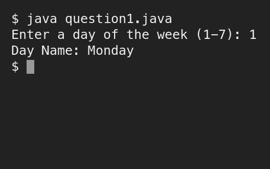
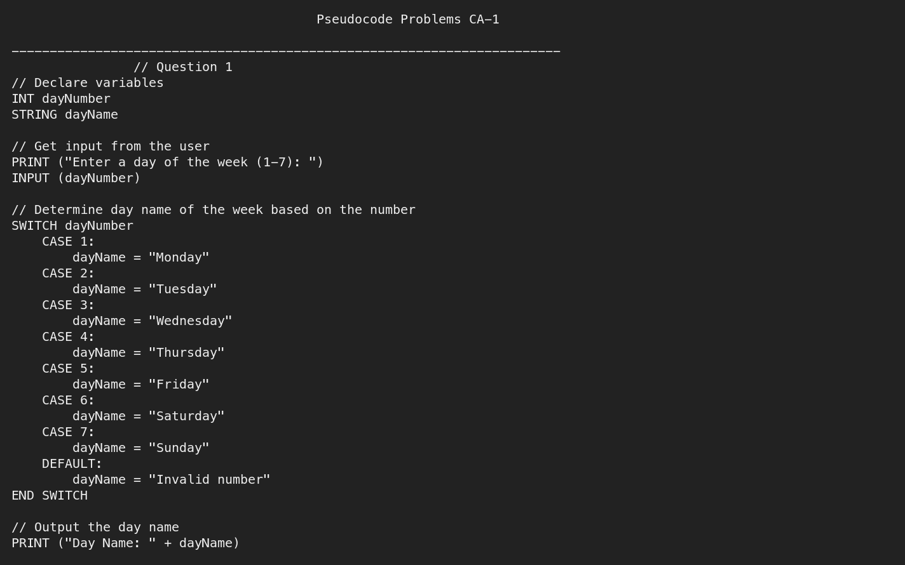
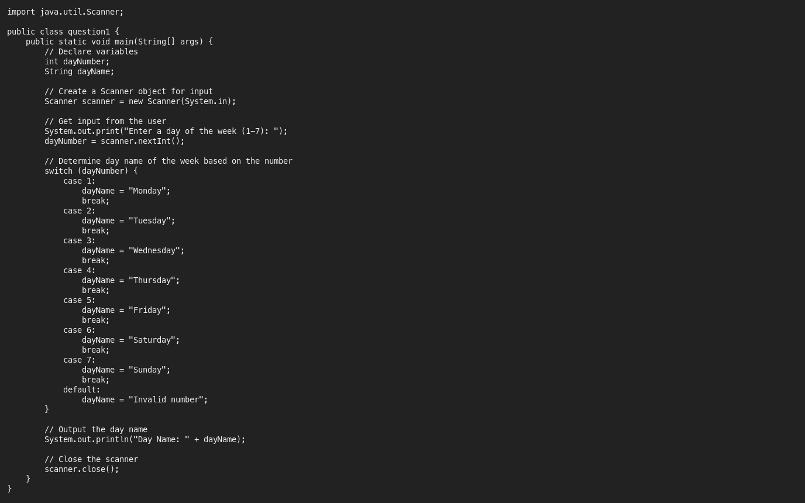

# Assessment 1: CA 1, pseudocode problems

**Module:** Algorithmic Problem Solving (`COMP H1034`)  
**Semester:** 1 (Year 1), folder `sem01`  
**Type:** test (in-lab practical test), individual  
**Weight:** 20%  
**Deadline:** the lab session of week 6, 9 November 2023  
**Result:** —  
**On main:** [`sem01/algorithmic_problem_solving/assessment/01/`](https://github.com/DanyilT/projects-in-university/tree/main/sem01/algorithmic_problem_solving/assessment/01) (the solution and this README)  
**Branch:** —  
**Repository:** —

[Module README](../../README.md)

## What this assessment is for

CA 1 is the first in-lab practical test of the module (20%), held in the lab session of week 6. It has two questions on one task: question 1 asks for a pseudocode program that reads a number from 1 to 7 and outputs the name of the day of the week, with "Invalid number" for any other value, and question 2 asks for the same program in Java. The paper was not kept, so the questions are taken from the notes from the test.

The solution is one pseudocode file and one Java file. The header comment of the Java file names lab group 8 and the date of the test, 09/11/2023.



*question1.java execution in the terminal: input 1, output Day Name: Monday*

## Files

| File | What it contains | Screenshot |
|---|---|---|
| [`README.md`](README.md) | This README. | — |
| [`submission/pseudocode.txt`](submission/pseudocode.txt) | The solution of question 1: pseudocode that declares `dayNumber` and `dayName`, asks for a day of the week from 1 to 7, selects the name with a SWITCH (CASE 1 for Monday to CASE 7 for Sunday, DEFAULT for "Invalid number") and prints "Day Name: " with the name. | <br>*The pseudocode file of question 1: the variable declarations, the input, the SWITCH with its seven cases, the DEFAULT and the output line.* |
| [`submission/question1.java`](submission/question1.java) | The solution of question 2: the class `question1` reads the number with a Scanner, uses a switch statement with the same cases and the same default, and prints "Day Name: " with the name. The header comment names the author, lab group 8 and the date. | <br>*The Java code of question 2 without its header comment: the Scanner, the switch statement and the output line.* |

## How to run

[`submission/question1.java`](submission/question1.java) needs a JDK. From the folder [`submission/`](submission/):

```sh
javac question1.java
java question1
```

The program prints `Enter a day of the week (1-7): `, reads the number and prints the day name (`Day Name: Monday` for 1, `Day Name: Invalid number` for 0 or 9).
