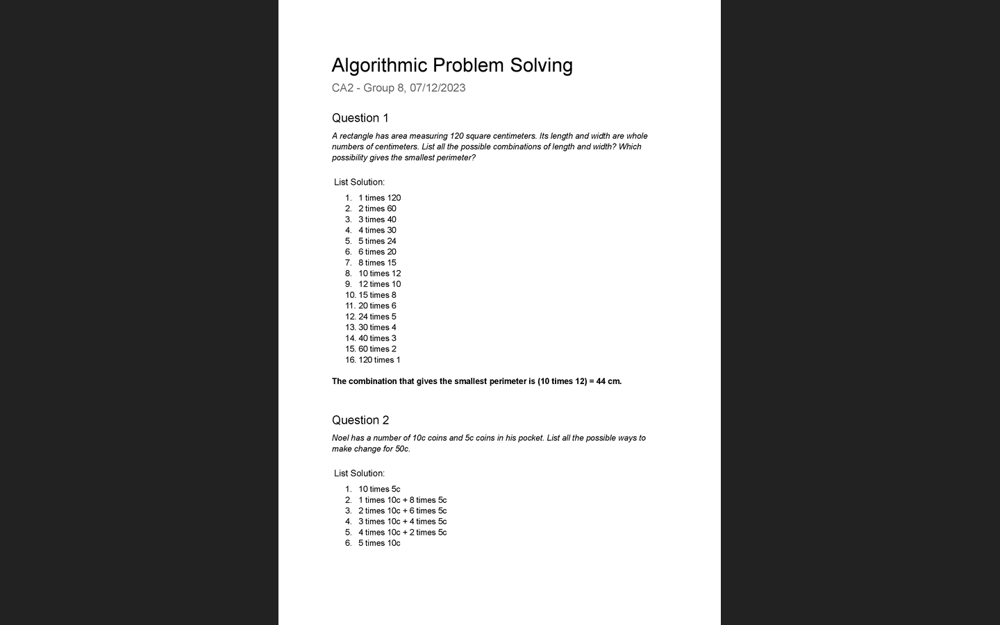

# Assessment 2: CA 2, diagrams and lists

**Module:** Algorithmic Problem Solving (`COMP H1034`)  
**Semester:** 1 (Year 1), folder `sem01`  
**Type:** test (in-lab practical test), individual  
**Weight:** 40%  
**Deadline:** the lab session of week 10, 7 December 2023  
**Result:** —  
**On main:** [`sem01/algorithmic_problem_solving/assessment/02/`](https://github.com/DanyilT/projects-in-university/tree/main/sem01/algorithmic_problem_solving/assessment/02) (the solution and this README)  
**Branch:** —  
**Repository:** —

[Module README](../../README.md)

## What this assessment is for

CA 2 is the second in-lab practical test of the module (40%), held in the lab session of week 10. It has two questions that are solved with systematic lists and diagrams, the methods of weeks 8 and 9. Question 1: a rectangle has an area of 120 square centimetres and whole-number sides; list all the combinations of length and width and say which one gives the smallest perimeter. Question 2: a person has 10c and 5c coins; list all the ways to make change for 50c. The paper was not kept, so the questions are taken from the notes from the test.

The solution is a one-page document with a list for each question. Question 1 has 16 combinations, from 1 times 120 to 120 times 1, and the answer is 10 times 12 with a perimeter of 44 cm. Question 2 has 6 ways, from ten 5c coins to five 10c coins.

## Files

| File | What it contains | Screenshot |
|---|---|---|
| [`README.md`](README.md) | This README. | — |
| [`submission/solution.pdf`](submission/solution.pdf) | The solution (1 page), titled "Algorithmic Problem Solving" with the line "CA2 - Group 8, 07/12/2023": the two questions, each with its list solution. |  *The CA 2 solution PDF: the 16 length and width combinations (10 times 12 gives the smallest perimeter, 44 cm) and the 6 ways to make 50c.* |
