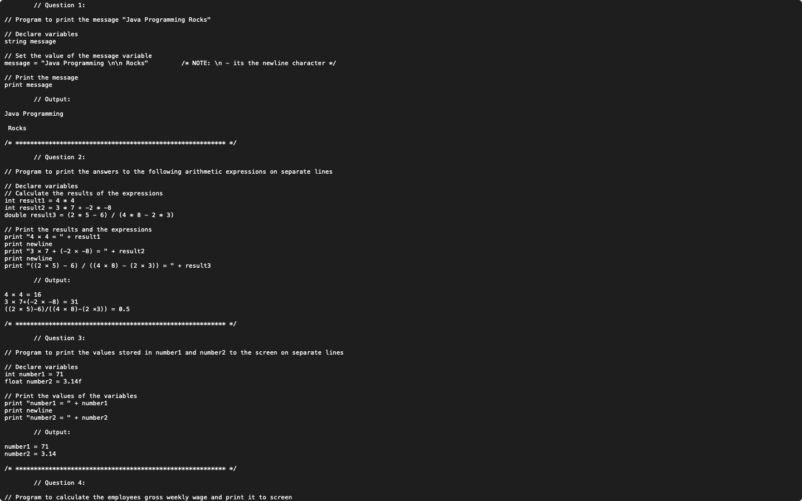

# Week 01 — Pseudocode: printing, arithmetic, variables and f(x)

**Module:** Algorithmic Problem Solving (`COMP H1034`)  
**Semester:** 1 (Year 1), folder `sem01`

[Module README](../README.md)

## What this week is for

Pseudocode lab 1: five problems. Print two lines of text; print the results of three arithmetic expressions; store two values in variables and print them; work out a gross weekly wage from an hourly rate (€9.80) and the hours worked (42); evaluate f(x) = x² + 3x − 5 at x = 4 and x = 6.

> [!WARNING]
> [`lab/solution/algorithmic_problem_solving_week01_lab_solution.txt`](lab/solution/algorithmic_problem_solving_week01_lab_solution.txt): Some printed results are wrong: f(4) = 9 and f(6) = 37 (correct: 23 and 49); 3 × 7 + (−2 × −8) = 31 (correct: 37); ((2 × 5) − 6) / ((4 × 8) − (2 × 3)) = 0.5 (correct: 4/26 ≈ 0.154).

## Files

| File | What it contains | Screenshot |
|---|---|---|
| [`README.md`](README.md) | This README. | — |
| [`lab/algorithmic_problem_solving_week01_lab.pdf`](lab/algorithmic_problem_solving_week01_lab.pdf) | The lab sheet (2 pages) with the five pseudocode questions. | — |
| [`lab/solution/algorithmic_problem_solving_week01_lab_solution.txt`](lab/solution/algorithmic_problem_solving_week01_lab_solution.txt) | Pseudocode answers to questions 1–5. |  *Editor view of the week 1 pseudocode solution.* |
