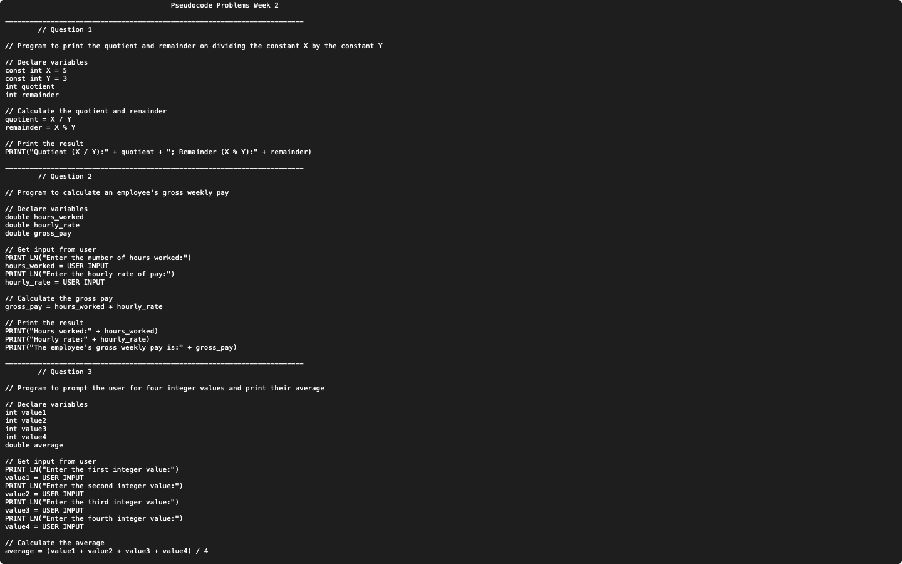

# Week 02 — Pseudocode: quotient, remainder, pay, averages and volume

**Module:** Algorithmic Problem Solving (`COMP H1034`)  
**Semester:** 1 (Year 1), folder `sem01`

[Module README](../README.md)

## What this week is for

Pseudocode lab 2: four problems. The quotient and remainder of 5 ÷ 3; the gross weekly pay from hours worked and an hourly rate; the average of four integers entered by the user; the volume of a cylinder from its radius and height (V = π r² h).

## Files

| File | What it contains | Screenshot |
|---|---|---|
| [`README.md`](README.md) | This README. | — |
| [`lab/algorithmic_problem_solving_week02_lab.pdf`](lab/algorithmic_problem_solving_week02_lab.pdf) | The lab sheet (2 pages) with the four questions. | — |
| [`lab/solution/algorithmic_problem_solving_week02_lab_solution.txt`](lab/solution/algorithmic_problem_solving_week02_lab_solution.txt) | Pseudocode answers to questions 1–4. |  *Editor view of the week 2 pseudocode solution.* |
