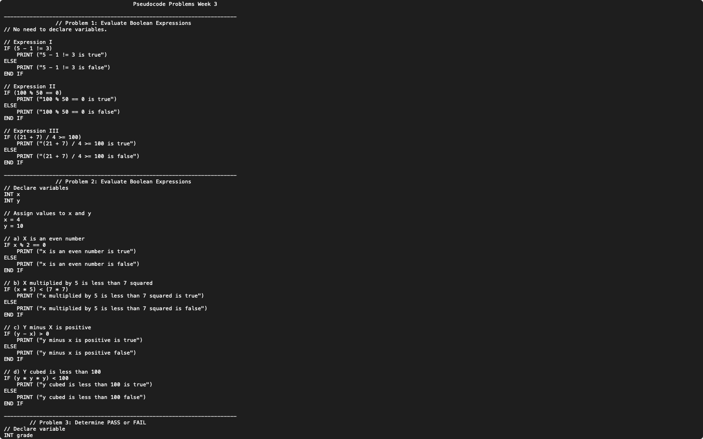

# Week 03 — Pseudocode: Boolean expressions, PASS or FAIL and month names

**Module:** Algorithmic Problem Solving (`COMP H1034`)  
**Semester:** 1 (Year 1), folder `sem01`

[Module README](../README.md)

## What this week is for

Pseudocode lab 3: conditions and Boolean expressions, in four problems. Print true or false for three expressions (problem 1); declare x and y and write four Boolean checks about them (problem 2); print PASS or FAIL for a grade, with 40 as the pass mark (problem 3); turn a month number into the month name (problem 4).

## Files

| File | What it contains | Screenshot |
|---|---|---|
| [`README.md`](README.md) | This README. | — |
| [`lab/algorithmic_problem_solving_week03_lab.pdf`](lab/algorithmic_problem_solving_week03_lab.pdf) | The lab sheet (2 pages): problems 1 and 2 (Boolean expressions in Java), problem 3 (PASS or FAIL at 40) and problem 4 (month number to name). | — |
| [`lab/solution/algorithmic_problem_solving_week03_lab_solution.txt`](lab/solution/algorithmic_problem_solving_week03_lab_solution.txt) | Pseudocode answers to problems 1–4. |  *Editor view of the week 3 pseudocode solution (Problems 1–2 and the start of Problem 3).* |
