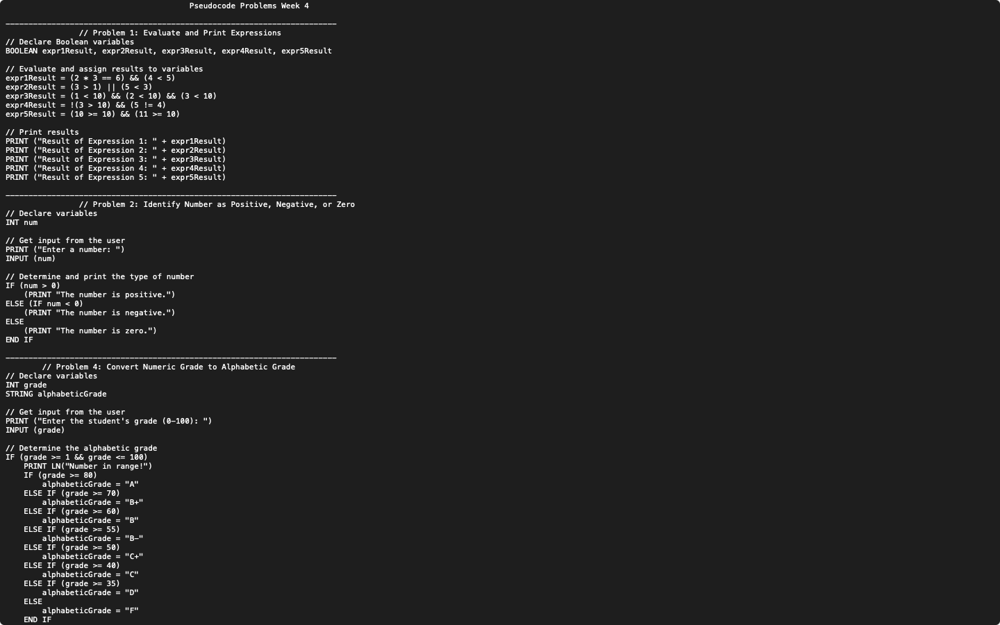

# Week 04 — Pseudocode: Boolean expressions, signs, grades and triangles

**Module:** Algorithmic Problem Solving (`COMP H1034`)  
**Semester:** 1 (Year 1), folder `sem01`

[Module README](../README.md)

## What this week is for

Pseudocode lab 4: logical expressions and conditions. The sheet has problems 1, 2, 4 and 5; there is no problem 3. Problem 1 uses Boolean expressions with variables, problem 2 prints whether a number is positive, negative or zero, problem 4 turns a grade from 0 to 100 into a letter grade with a band table, and problem 5 decides whether three lengths make a triangle.

## Files

| File | What it contains | Screenshot |
|---|---|---|
| [`README.md`](README.md) | This README. | — |
| [`lab/algorithmic_problem_solving_week04_lab.pdf`](lab/algorithmic_problem_solving_week04_lab.pdf) | The lab sheet (3 pages): problems 1, 2, 4 and 5. The sheet has no problem 3. | — |
| [`lab/solution/algorithmic_problem_solving_week04_lab_solution.txt`](lab/solution/algorithmic_problem_solving_week04_lab_solution.txt) | Answers to problems 1, 2, 4 and 5. |  *Editor view of the week 4 pseudocode solution (Problems 1, 2 and 4).* |
