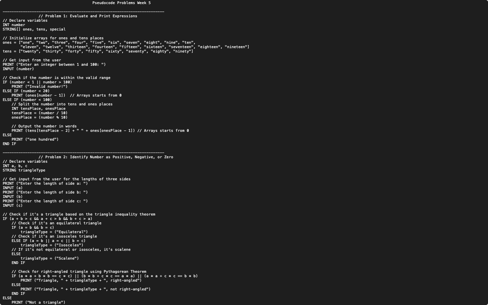

# Week 05 — Pseudocode: numbers in words and triangle types

**Module:** Algorithmic Problem Solving (`COMP H1034`)  
**Semester:** 1 (Year 1), folder `sem01`

[Module README](../README.md)

## What this week is for

Pseudocode lab 5: two programs. The first reads a number from 1 to 100 and prints it in words, with "Invalid number!" outside that range. The second reads three lengths and prints the type of triangle (scalene, isosceles or equilateral) and whether it is right-angled.

## Files

| File | What it contains | Screenshot |
|---|---|---|
| [`README.md`](README.md) | This README. | — |
| [`lab/algorithmic_problem_solving_week05_lab.pdf`](lab/algorithmic_problem_solving_week05_lab.pdf) | The lab sheet (3 pages): question 1 (a number from 1 to 100 in words) and question 2 (the triangle type and whether it is right-angled). | — |
| [`lab/solution/algorithmic_problem_solving_week05_lab_solution.txt`](lab/solution/algorithmic_problem_solving_week05_lab_solution.txt) | Answers to problem 1 (number in words) and problem 2 (triangle type). |  *Editor view of the week 5 pseudocode solution (Problems 1 and 2).* |
