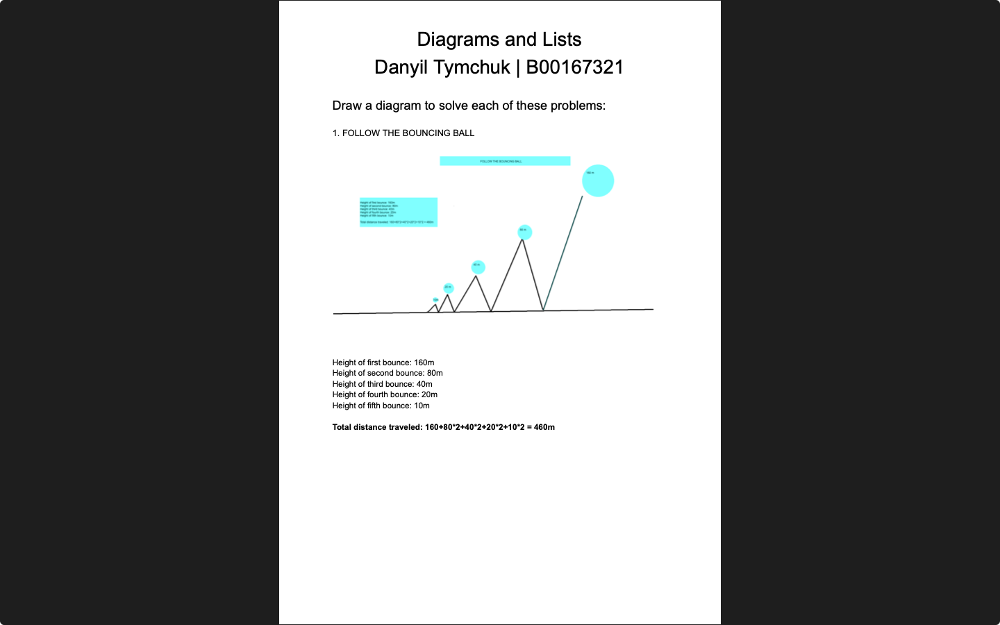

# Week 08 — Diagrams and lists

**Module:** Algorithmic Problem Solving (`COMP H1034`)  
**Semester:** 1 (Year 1), folder `sem01`

[Module README](../README.md)

## What this week is for

Lab on diagrams and lists as problem-solving tools. The sheet has five diagram problems (a bouncing ball, a worm on a wall, a race, handshakes, a rock climb), five systematic-list problems (cards and comics, a tennis round robin, the orders of concert calls, four even numbers that add up to 24, two numbers with a product of 360) and three classic puzzles, of which the sheet asks for any two. The solution draws the bouncing ball and gives written answers to the rest.

> [!WARNING]
> [`lab/solution/algorithmic_problem_solving_week08_lab_report.pdf`](lab/solution/algorithmic_problem_solving_week08_lab_report.pdf): Several answers are wrong or incomplete. One example: the rock-climb time is wrong, because 1030 seconds is about 17.2 minutes, not 7.16 minutes.

## Files

| File | What it contains | Screenshot |
|---|---|---|
| [`README.md`](README.md) | This README. | — |
| [`lab/algorithmic_problem_solving_week08_lab.pdf`](lab/algorithmic_problem_solving_week08_lab.pdf) | The lab sheet (3 pages): five diagram problems, five systematic-list problems and three classic problems (solve any two). | — |
| [`lab/solution/algorithmic_problem_solving_week08_lab_report.pdf`](lab/solution/algorithmic_problem_solving_week08_lab_report.pdf) | Solution (9 pages): a drawn bouncing-ball diagram (460 m), then written answers to the other problems. |  *Page 1 of the week 8 solution PDF: "Follow the Bouncing Ball" diagram, total 460 m.* |
