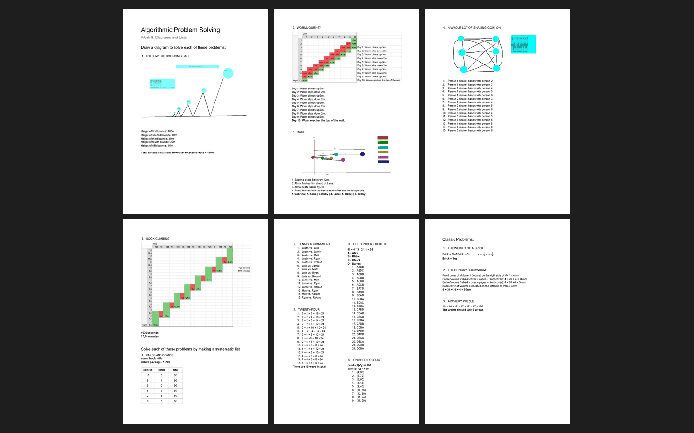

# Week 08 — Diagrams and lists

**Module:** Algorithmic Problem Solving (`COMP H1034`)  
**Semester:** 1 (Year 1), folder `sem01`

[Module README](../README.md)

## What this week is for

Lab on diagrams and lists as problem-solving tools. The sheet has five diagram problems (a bouncing ball, a worm on a wall, a race, handshakes, a rock climb), five systematic-list problems (cards and comics, a tennis round robin, the orders of concert calls, four even numbers that add up to 24, two numbers with a product of 360) and three classic puzzles, of which the sheet asks for any two. The solution has a diagram for each of the five diagram problems and gives the lists and the answers to all three classic puzzles.

*All 6 pages of the week 8 solution PDF: the five diagram problems (bouncing ball, worm, race, handshakes, rock climbing), the lists (cards and comics, tennis tournament, concert tickets, twenty-four, finished product) and the classic problems (the weight of a brick, the hungry bookworm, the archery puzzle).*

## Files

| File | What it contains |
|---|---|
| [`README.md`](README.md) | This README. |
| [`lab/algorithmic_problem_solving_week08_lab.pdf`](lab/algorithmic_problem_solving_week08_lab.pdf) | The lab sheet (3 pages): five diagram problems, five systematic-list problems and three classic problems (solve any two). |
| [`lab/solution/algorithmic_problem_solving_week08_lab_report.pdf`](lab/solution/algorithmic_problem_solving_week08_lab_report.pdf) | Solution (6 pages): a diagram for each of the five diagram problems (the bouncing ball with a total of 460 m, the worm, the race, the handshakes, the rock climb), the five lists and the three classic puzzles (the weight of a brick, the hungry bookworm, the archery puzzle). |
