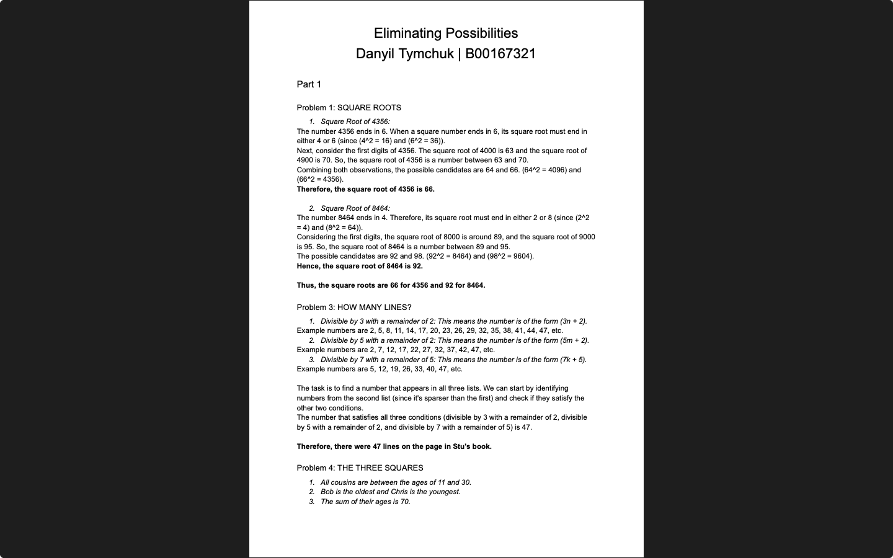

# Week 09 — Practical: eliminate possibilities and logic

**Module:** Algorithmic Problem Solving (`COMP H1034`)  
**Semester:** 1 (Year 1), folder `sem01`

[Module README](../README.md)

## What this week is for

Practical on eliminating possibilities and logic. Part 1: the square roots of 4356 and 8464, the number of lines on a page, and the ages of three cousins. Part 2: four logic puzzles (the fishing trip, the volleyball team, the athletes and the experts). The classic puzzle is the turkey price. The solution covers all three parts.

> [!WARNING]
> [`lab/solution/algorithmic_problem_solving_week09_lab_report.pdf`](lab/solution/algorithmic_problem_solving_week09_lab_report.pdf): Two logic answers are wrong: the athletes answer (Russ Hicks) contradicts the first clue, and the experts answer puts Bridget in air pollution, which the fourth clue rules out.

## Files

| File | What it contains | Screenshot |
|---|---|---|
| [`README.md`](README.md) | This README. | — |
| [`lab/algorithmic_problem_solving_week09_lab.pdf`](lab/algorithmic_problem_solving_week09_lab.pdf) | The lab sheet (3 pages): square roots, lines on a page, three cousins, the fishing trip, the volleyball team, the athletes, the experts and the turkey price. | — |
| [`lab/solution/algorithmic_problem_solving_week09_lab_report.pdf`](lab/solution/algorithmic_problem_solving_week09_lab_report.pdf) | Solution (6 pages): part 1 (square roots, lines and ages), part 2 (logic puzzles) and part 3 (turkey price). |  *Page 1 of the week 9 solution PDF: square roots 66 and 92, 47 lines, the statement of the three-squares problem.* |
