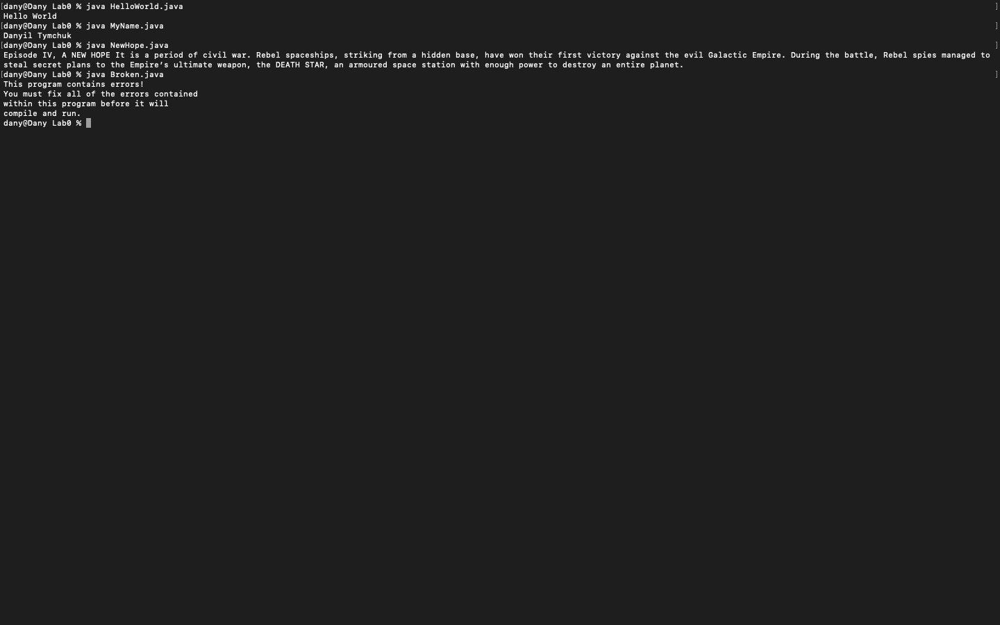
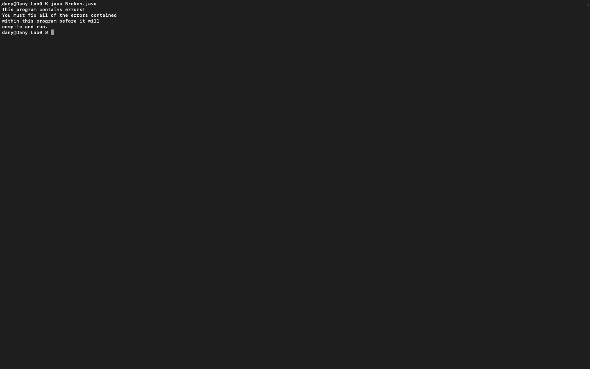
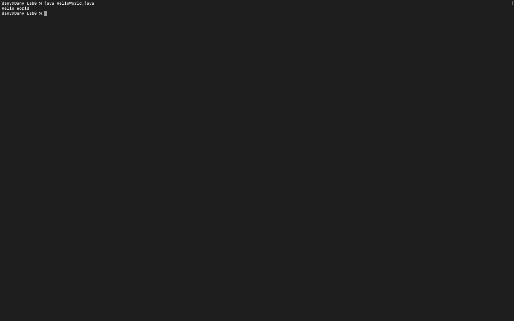
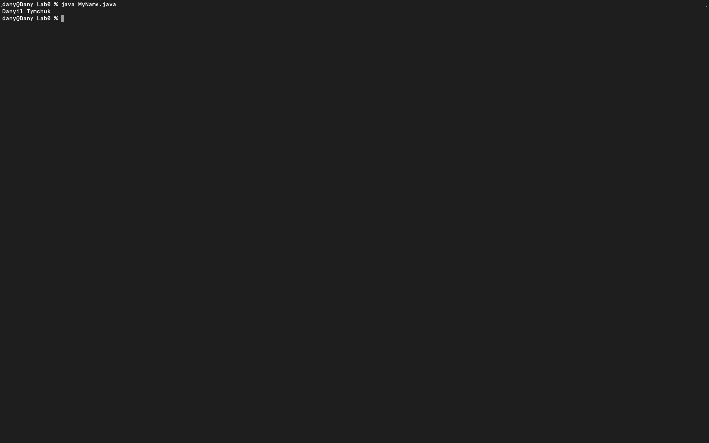
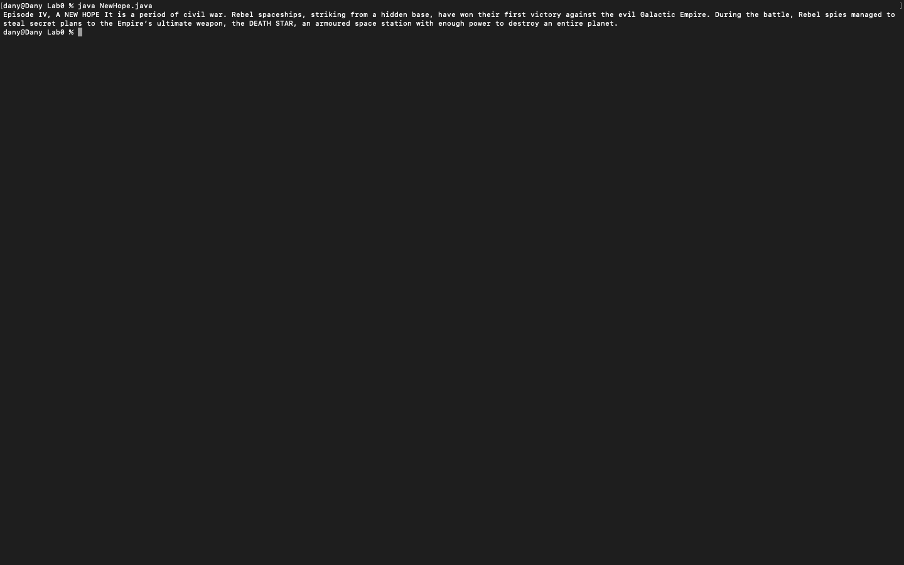

# Week 00 — Exercise sheet 0: HelloWorld, MyName, NewHope and Broken.java

**Module:** Fundamentals of Programming 1 (`COMP 1032`)  
**Semester:** 1 (Year 1), folder `sem01`

[Module README](../README.md)

## What this week is for

Exercise sheet 0: the first tools. HelloWorld, MyName and NewHope are written, compiled and run from the command line with javac and java, and Broken.java is a deliberately broken file whose errors are fixed.

> [!WARNING]
> - [`lab/solution/HelloWorld.java`](lab/solution/HelloWorld.java): Prints Hello World without the exclamation mark of the sheet's example (Hello World!).
> - [`lab/solution/NewHope.java`](lab/solution/NewHope.java): Prints the opening text on one line; the sheet asks for a blank line between the title and the paragraph, which the solution does not have.

## Screenshots

*Terminal capture running HelloWorld, MyName, NewHope and Broken.*

## Files

| File | What it contains | Screenshot |
|---|---|---|
| [`README.md`](README.md) | This README. | — |
| [`lab/fundamentals_of_programming_1_week00_lab.pdf`](lab/fundamentals_of_programming_1_week00_lab.pdf) | The lab sheet (1 page): HelloWorld, MyName, NewHope and fixing Broken.java. | — |
| [`lab/solution/Broken.java`](lab/solution/Broken.java) | Fixed version of Broken.java (the original file is not kept). It prints four lines saying the program contains errors, and it compiles and runs as stored. |  *Terminal capture: Broken prints its four-line message.* |
| [`lab/solution/HelloWorld.java`](lab/solution/HelloWorld.java) | Prints Hello World. |  *Terminal capture: HelloWorld prints `Hello World`.* |
| [`lab/solution/MyName.java`](lab/solution/MyName.java) | Prints the name Danyil Tymchuk. |  *Terminal capture: MyName prints the name.* |
| [`lab/solution/NewHope.java`](lab/solution/NewHope.java) | Prints the opening text on one line. |  *Terminal capture: NewHope prints the text on one line.* |
