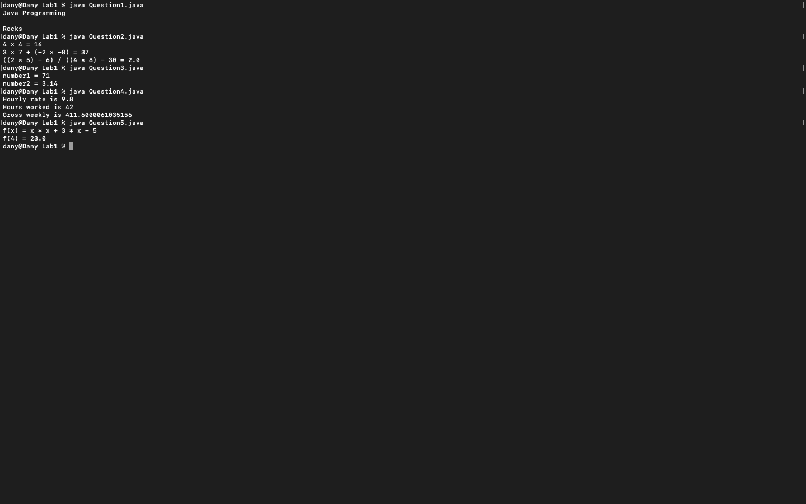

# Week 01 — Exercise sheet 1: output, arithmetic, variables and f(x)

**Module:** Fundamentals of Programming 1 (`COMP 1032`)  
**Semester:** 1 (Year 1), folder `sem01`

[Module README](../README.md)

## What this week is for

Exercise sheet 1: five questions on text output, arithmetic results, two variables, an hourly wage and f(x).

> [!WARNING]
> - [`lab/solution/Question2.java`](lab/solution/Question2.java): The third result is wrong: the code uses 30 where the expression needs 2 × 3 = 6, so it prints 2.0 instead of 4/26 ≈ 0.154.
> - [`lab/solution/Question4.java`](lab/solution/Question4.java): The wage prints as 411.6000061035156 (floating-point rounding) rather than 411.6.

## Screenshots

*Terminal capture running all five week 1 programs.*

## Files

| File | What it contains | Screenshot |
|---|---|---|
| [`README.md`](README.md) | This README. | — |
| [`lab/fundamentals_of_programming_1_week01_lab.pdf`](lab/fundamentals_of_programming_1_week01_lab.pdf) | The lab sheet (2 pages) with five questions: text output, arithmetic lines, two variables, an hourly wage and f(x). | — |
| [`lab/solution/Question1.java`](lab/solution/Question1.java) | Prints Java Programming, a blank line, then Rocks. |  *Terminal capture: Question1 output.* |
| [`lab/solution/Question2.java`](lab/solution/Question2.java) | Prints the results of three arithmetic expressions: 4 × 4, 3 × 7 + (−2 × −8) and ((2 × 5) − 6) / ((4 × 8) − (2 × 3)). |  *Terminal capture: Question2 output.* |
| [`lab/solution/Question3.java`](lab/solution/Question3.java) | Prints number1 = 71 and number2 = 3.14. |  *Terminal capture: Question3 output.* |
| [`lab/solution/Question4.java`](lab/solution/Question4.java) | Prints the hourly rate, the hours and the gross weekly wage. |  *Terminal capture: Question4 output, showing 411.6000061035156.* |
| [`lab/solution/Question5.java`](lab/solution/Question5.java) | Prints f(x) = x * x + 3 * x - 5 and f(4) = 23.0, which is correct. |  *Terminal capture: Question5 output.* |
