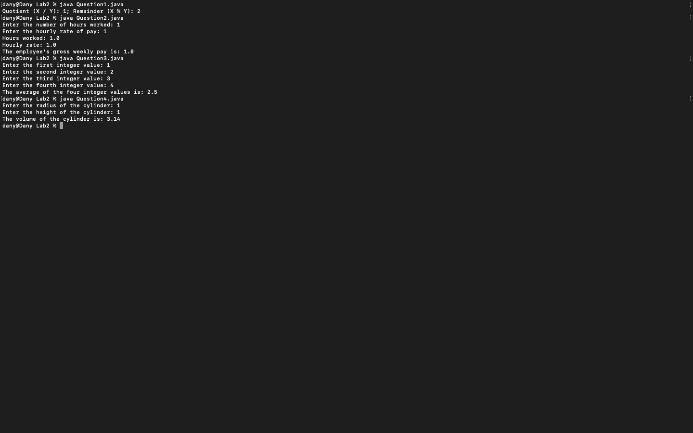
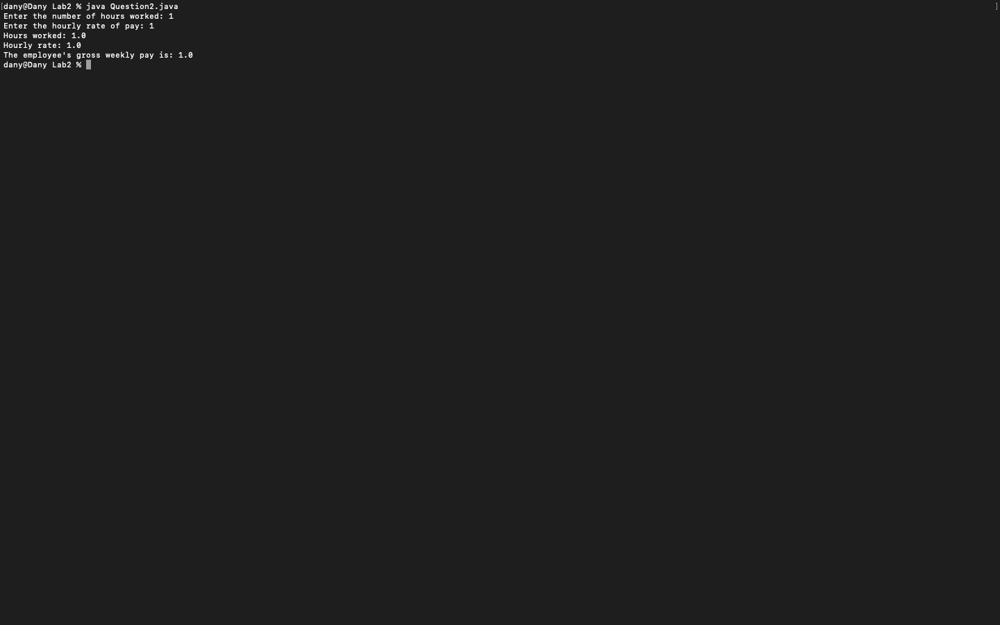

# Week 02 — Exercise sheet 2: division, pay, averages and volume

**Module:** Fundamentals of Programming 1 (`COMP 1032`)  
**Semester:** 1 (Year 1), folder `sem01`

[Module README](../README.md)

## What this week is for

Exercise sheet 2: four programs. The quotient and remainder of 5 ÷ 3; the gross weekly pay from hours and an hourly rate; the average of four integers; the volume of a cylinder.

> [!WARNING]
> - [`lab/solution/Question1.java`](lab/solution/Question1.java): The output format differs from the sheet: it prints Quotient (X / Y): 1; Remainder (X % Y): 2, where the sheet asks for one line in the form X / Y = 1 and X % Y = 2.
> - [`lab/solution/Question2.java`](lab/solution/Question2.java): It asks for the hours worked first and the hourly rate second, but the sheet's sample asks for the hourly rate first, so the prompts and the output lines differ from the sample.

## Screenshots

*Terminal capture running all four week 2 programs (inputs 1 and 1 for Questions 2 and 4).*

## Files

| File | What it contains | Screenshot |
|---|---|---|
| [`README.md`](README.md) | This README. | — |
| [`lab/fundamentals_of_programming_1_week02_lab.pdf`](lab/fundamentals_of_programming_1_week02_lab.pdf) | The lab sheet (2 pages) with four questions: the quotient and remainder of 5 ÷ 3, gross weekly pay, the average of four integers, and the volume of a cylinder. | — |
| [`lab/solution/Question1.java`](lab/solution/Question1.java) | Prints the quotient and remainder as Quotient (X / Y): 1; Remainder (X % Y): 2. |  *Terminal capture: Question1 output.* |
| [`lab/solution/Question2.java`](lab/solution/Question2.java) | Asks for the hours worked first, then the hourly rate, and prints the hours, the rate and the gross weekly pay. |  *Terminal capture: Question2 run with inputs 1 and 1.* |
| [`lab/solution/Question3.java`](lab/solution/Question3.java) | Reads four integers into four variables and prints their average. |  *Terminal capture: Question3 run with 1, 2, 3 and 4.* |
| [`lab/solution/Question4.java`](lab/solution/Question4.java) | Reads a radius and a height and prints the cylinder volume. |  *Terminal capture: Question4 run with radius 1 and height 1.* |
