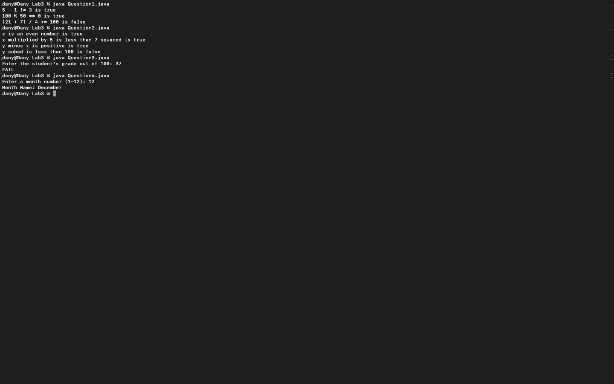
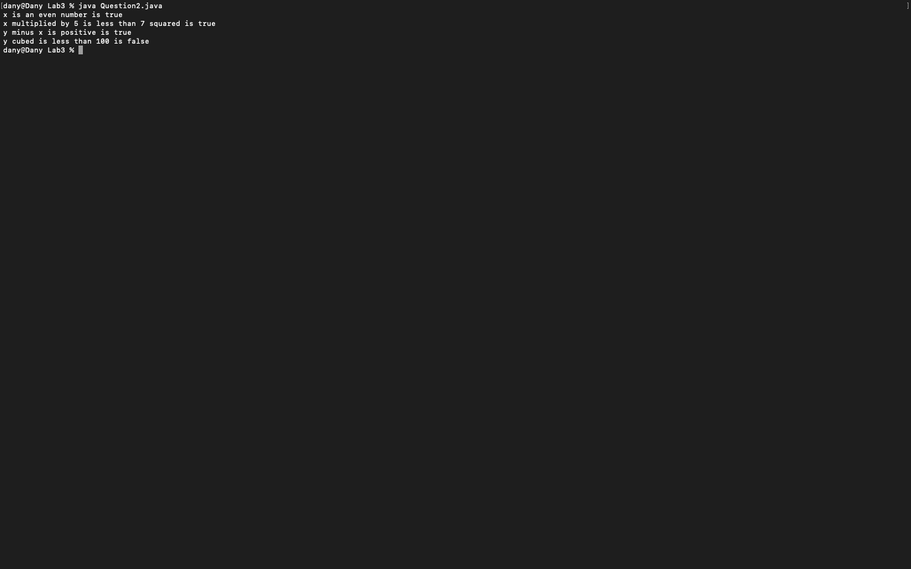
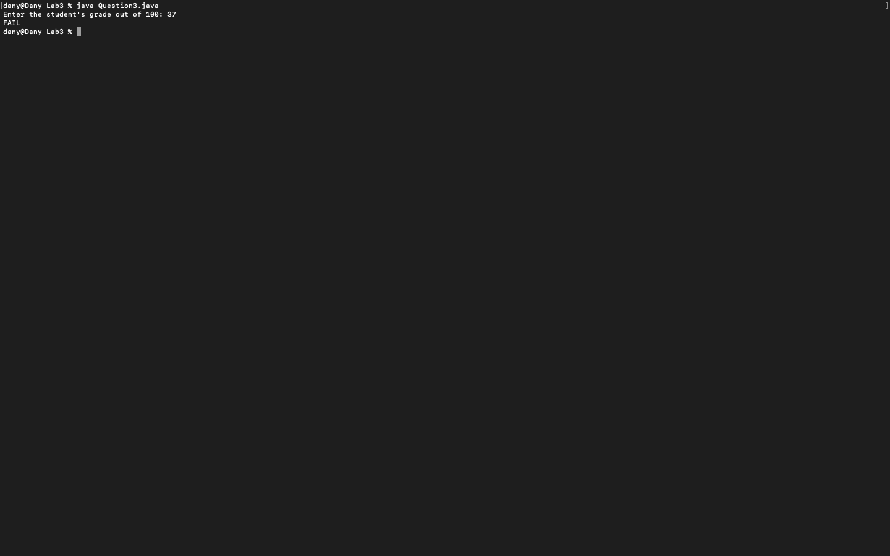
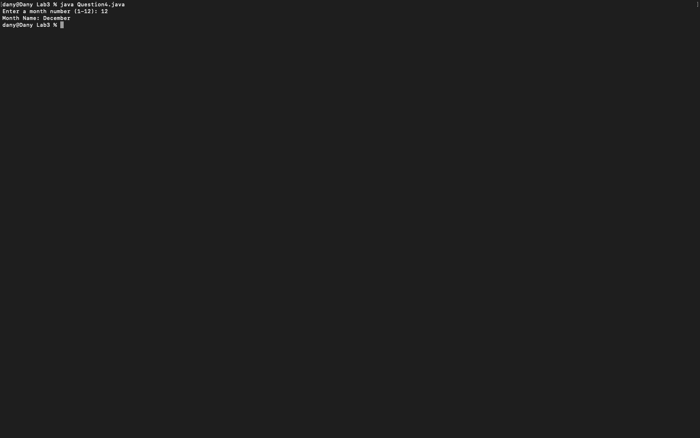

# Week 03 — Exercise sheet 3: Boolean values, PASS or FAIL and months

**Module:** Fundamentals of Programming 1 (`COMP 1032`)  
**Semester:** 1 (Year 1), folder `sem01`

[Module README](../README.md)

## What this week is for

Exercise sheet 3: Boolean expressions and conditions. The truth of three expressions, four Boolean checks on x and y, a PASS or FAIL result for a grade, and the month name for a month number.

> [!WARNING]
> [`lab/solution/Question1.java`](lab/solution/Question1.java): It uses if statements for each truth statement, which the sheet forbids for this question, so it does not follow the brief.

## Screenshots

*Terminal capture running all four week 3 programs (inputs 37 and 12).*

## Files

| File | What it contains | Screenshot |
|---|---|---|
| [`README.md`](README.md) | This README. | — |
| [`lab/fundamentals_of_programming_1_week03_lab.pdf`](lab/fundamentals_of_programming_1_week03_lab.pdf) | The lab sheet (2 pages): the truth of three expressions (printed, with no if statement), four Boolean checks on x and y, PASS or FAIL, and a month number to its name. | — |
| [`lab/solution/Question1.java`](lab/solution/Question1.java) | Prints the three truth statements. |  *Terminal capture: Question1 output.* |
| [`lab/solution/Question2.java`](lab/solution/Question2.java) | Prints the four statements about x = 4 and y = 10, using if and else. |  *Terminal capture: Question2 output.* |
| [`lab/solution/Question3.java`](lab/solution/Question3.java) | Reads a grade and prints PASS or FAIL for 40 and above. |  *Terminal capture: Question3 run with 37, printing `FAIL`.* |
| [`lab/solution/Question4.java`](lab/solution/Question4.java) | Reads a month number from 1 to 12 and prints the month name after the text Month Name:. |  *Terminal capture: Question4 run with 12, printing `December`.* |
