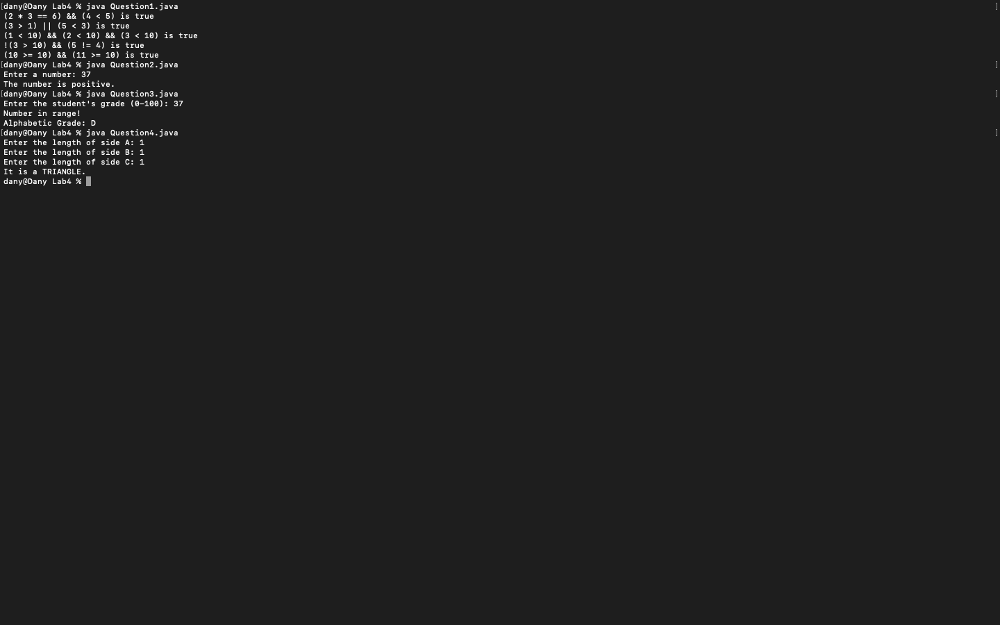
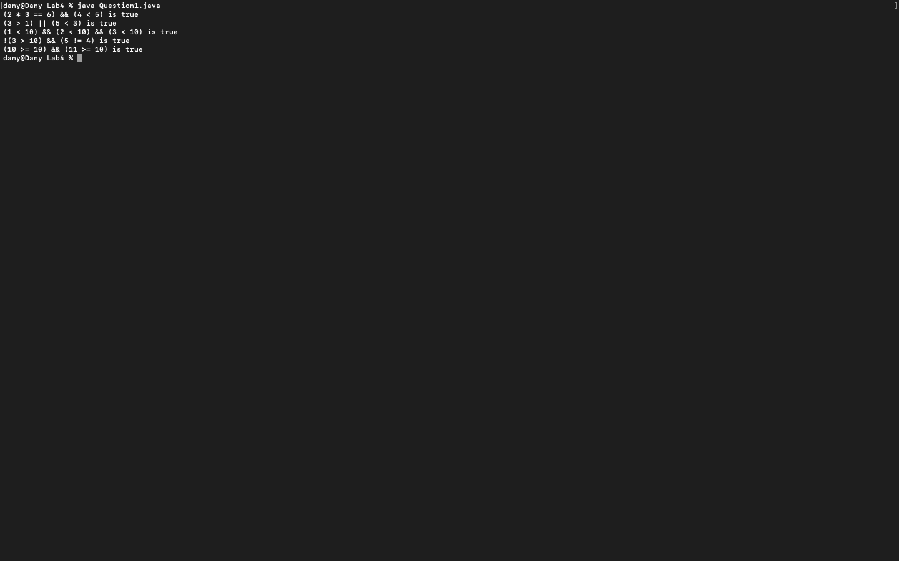
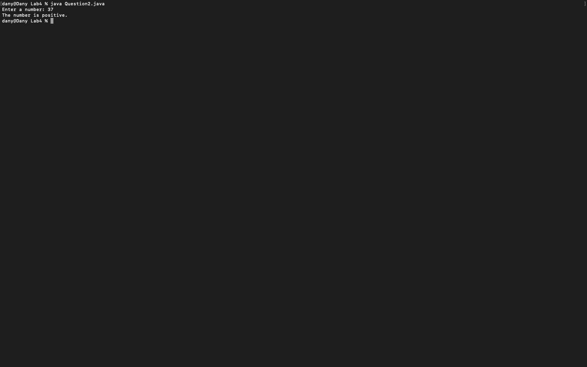
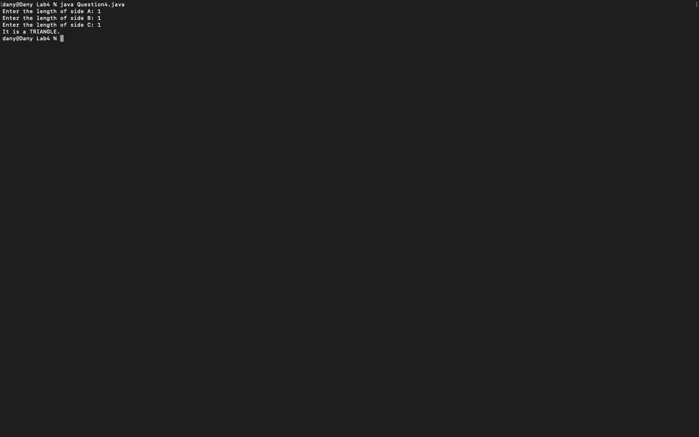

# Week 04 — Exercise sheet 4: Boolean variables, signs, grades and triangles

**Module:** Fundamentals of Programming 1 (`COMP 1032`)  
**Semester:** 1 (Year 1), folder `sem01`

[Module README](../README.md)

## What this week is for

Exercise sheet 4: Boolean variables, positive, negative or zero, grade bands and the triangle test. Five Boolean expressions are stored in variables, the sign of a number is printed, a grade from 0 to 100 becomes a letter grade, and three side lengths are checked as a triangle.

## Screenshots

*Terminal capture running all four week 4 programs (inputs 37, 1, 1, 1).*

## Files

| File | What it contains | Screenshot |
|---|---|---|
| [`README.md`](README.md) | This README. | — |
| [`lab/fundamentals_of_programming_1_week04_lab.pdf`](lab/fundamentals_of_programming_1_week04_lab.pdf) | The lab sheet (3 pages): Boolean variables, positive, negative or zero, grade bands and the triangle test. | — |
| [`lab/solution/Question1.java`](lab/solution/Question1.java) | Stores five Boolean expressions in variables and prints each one with its result. |  *Terminal capture: Question1 output.* |
| [`lab/solution/Question2.java`](lab/solution/Question2.java) | Reads an integer and prints The number is positive., negative. or zero. |  *Terminal capture: Question2 run with 37.* |
| [`lab/solution/Question3.java`](lab/solution/Question3.java) | Reads a grade from 0 to 100 and prints its letter grade from the band table. |  *Terminal capture: Question3 run with 37, printing grade D.* |
| [`lab/solution/Question4.java`](lab/solution/Question4.java) | Reads three side lengths and prints It is a TRIANGLE. or It is NOT A TRIANGLE. |  *Terminal capture: Question4 run with 1, 1 and 1.* |
