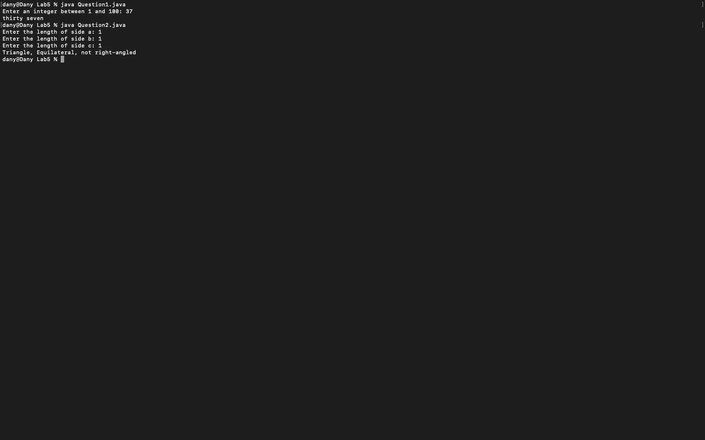
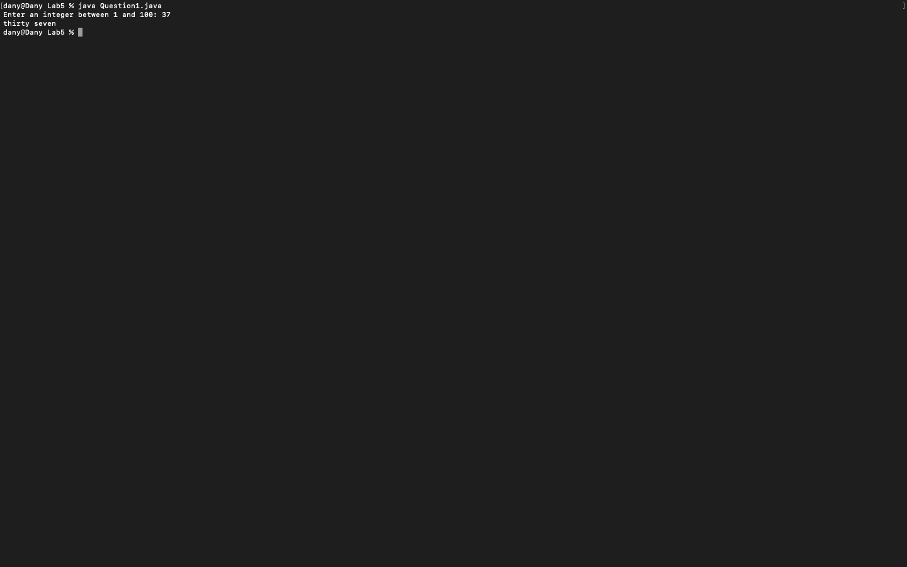
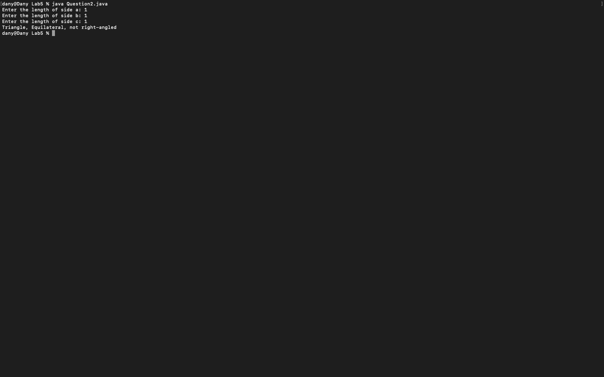

# Week 05 — Exercise sheet 5: numbers in words and triangle types

**Module:** Fundamentals of Programming 1 (`COMP 1032`)  
**Semester:** 1 (Year 1), folder `sem01`

[Module README](../README.md)

## What this week is for

Exercise sheet 5 (take-home): a number from 1 to 100 in words, and the type of triangle.

> [!CAUTION]
> [`lab/solution/Question1.java`](lab/solution/Question1.java): It has a bug: it crashes for multiples of ten below 100, such as 20, because the ones digit is zero.

## Screenshots

*Terminal capture running both week 5 programs (Question1 with 37, Question2 with 1, 1, 1).*

## Files

| File | What it contains | Screenshot |
|---|---|---|
| [`README.md`](README.md) | This README. | — |
| [`lab/fundamentals_of_programming_1_week05_lab.pdf`](lab/fundamentals_of_programming_1_week05_lab.pdf) | The lab sheet (1 page, take-home): a number from 1 to 100 in words, and the triangle type. The sheet names both programs Question1.java; the second program is in Question2.java. | — |
| [`lab/solution/Question1.java`](lab/solution/Question1.java) | Prints a number from 1 to 100 in words. |  *Terminal capture: Question1 run with 37, printing `thirty seven`.* |
| [`lab/solution/Question2.java`](lab/solution/Question2.java) | Reads three sides and prints the triangle type and whether it is right-angled, or Not a triangle. |  *Terminal capture: Question2 run with 1, 1, 1.* |
