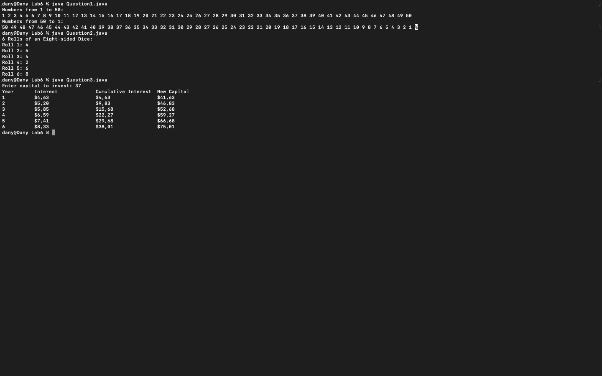
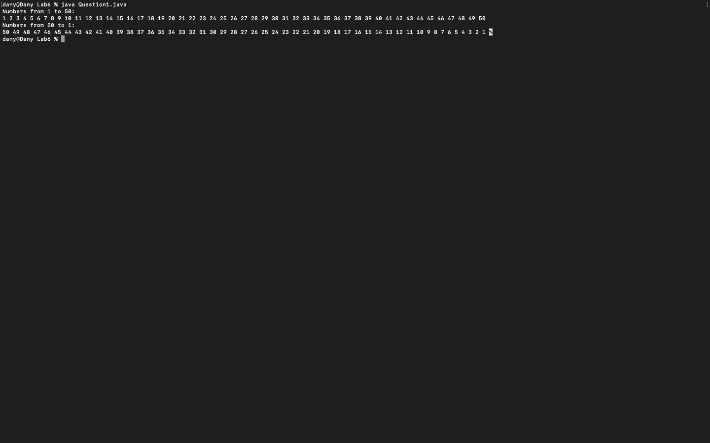
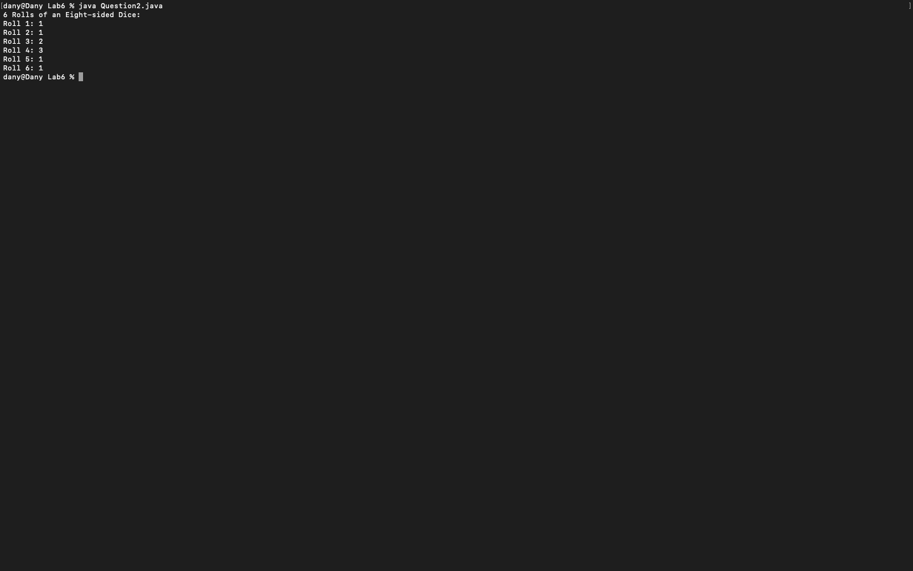
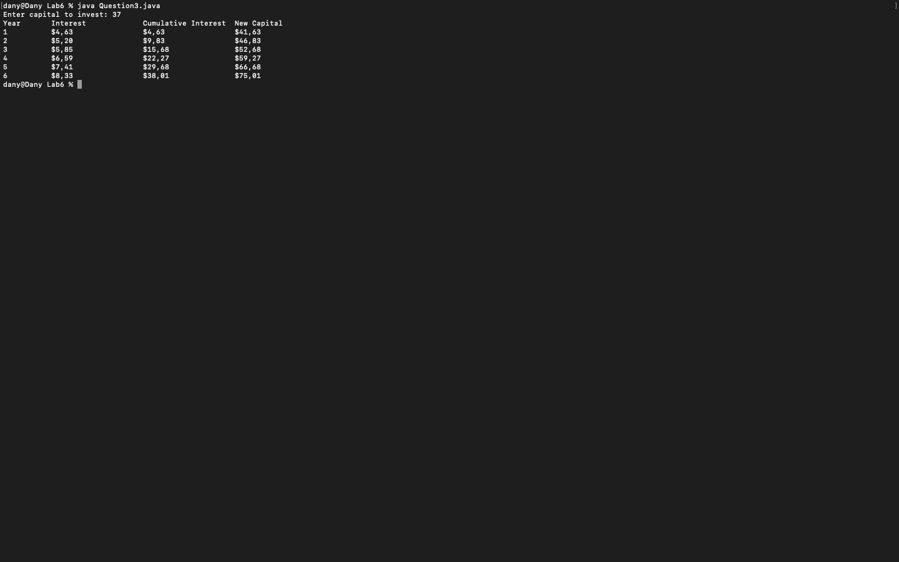

# Week 06 — Exercise sheet 6: loops, dice and compound interest

**Module:** Fundamentals of Programming 1 (`COMP 1032`)  
**Semester:** 1 (Year 1), folder `sem01`

[Module README](../README.md)

## What this week is for

Exercise sheet 6: two separate loops that count up to 50 and back down; an eight-sided dice rolled six times with Math.random; a six-year compound interest table printed to two decimal places.

## Screenshots

*Terminal capture running all three week 6 programs (capital 37).*

## Files

| File | What it contains | Screenshot |
|---|---|---|
| [`README.md`](README.md) | This README. | — |
| [`lab/fundamentals_of_programming_1_week06_lab.pdf`](lab/fundamentals_of_programming_1_week06_lab.pdf) | The lab sheet (2 pages): two loops, an eight-sided dice and compound interest. | — |
| [`lab/solution/Question1.java`](lab/solution/Question1.java) | Prints the numbers 1 to 50 and then 50 to 1, using two loops. |  *Terminal capture: Question1 output.* |
| [`lab/solution/Question2.java`](lab/solution/Question2.java) | Prints six rolls of an eight-sided dice, using Math.random and printf. |  *Terminal capture: Question2 output.* |
| [`lab/solution/Question3.java`](lab/solution/Question3.java) | Prints a yearly table of interest, cumulative interest and new capital for six years, with dollar signs. |  *Terminal capture: Question3 run with capital 37.* |
