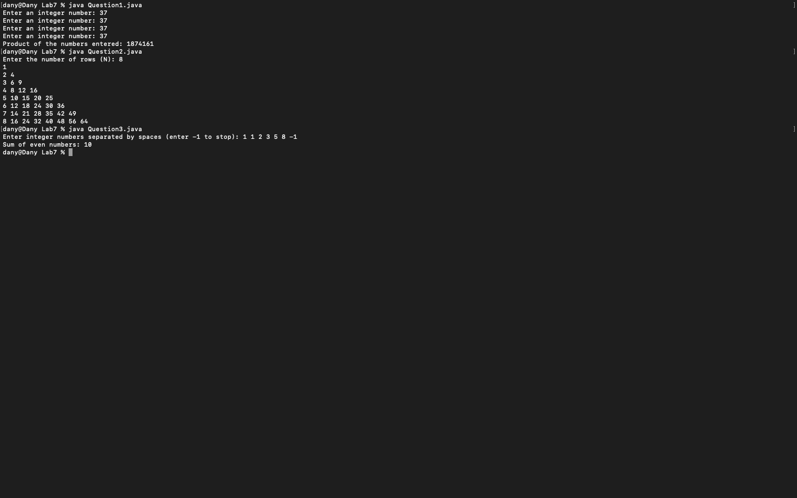
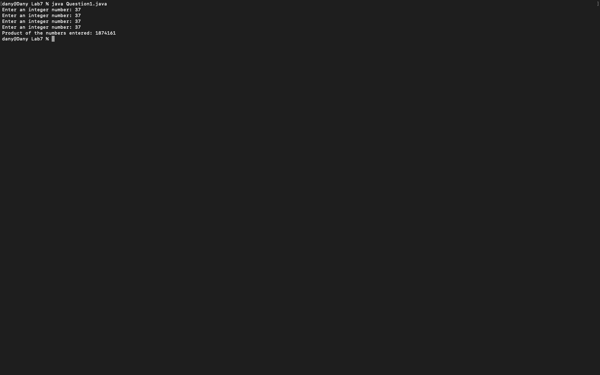
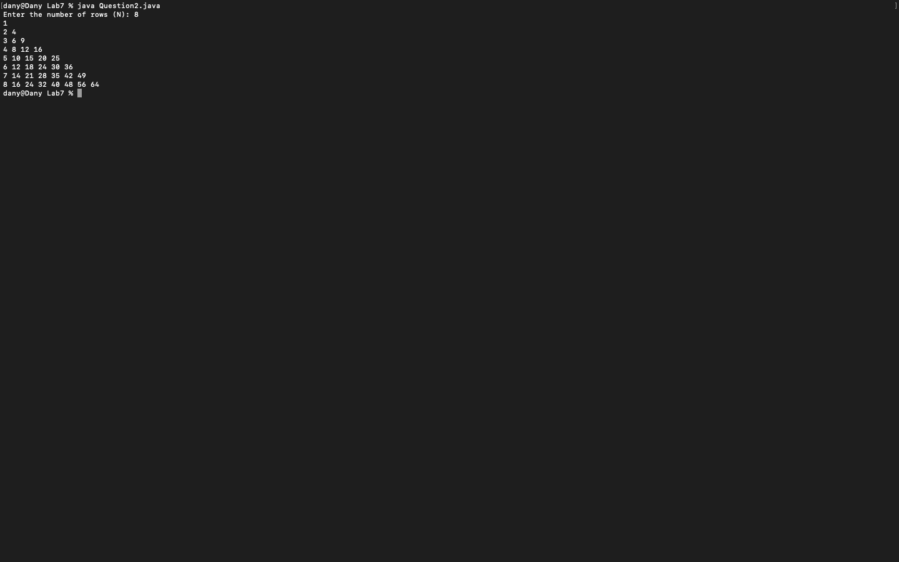
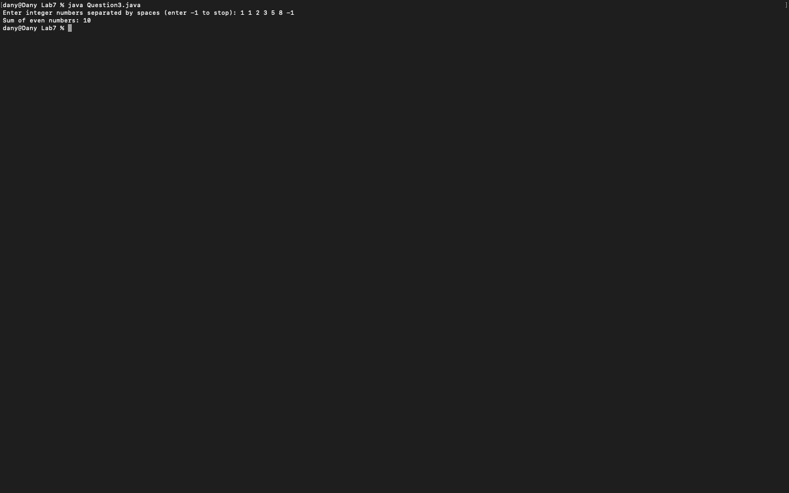

# Week 07 — Exercise sheet 7: while loops and patterns

**Module:** Fundamentals of Programming 1 (`COMP 1032`)  
**Semester:** 1 (Year 1), folder `sem01`

[Module README](../README.md)

## What this week is for

Exercise sheet 7: loops. Multiplying four numbers entered in a while loop; printing the first N rows of a product pattern; adding up the even numbers in a list that ends with -1.

## Screenshots

*Terminal capture running all three week 7 programs.*

## Files

| File | What it contains | Screenshot |
|---|---|---|
| [`README.md`](README.md) | This README. | — |
| [`lab/fundamentals_of_programming_1_week07_lab.pdf`](lab/fundamentals_of_programming_1_week07_lab.pdf) | The lab sheet (2 pages): a while-loop product, rows of a product pattern, and a sentinel sum of even numbers. | — |
| [`lab/solution/Question1.java`](lab/solution/Question1.java) | Reads four integers in a while loop and prints their product. |  *Terminal capture: Question1 run with four 37s (product 1874161).* |
| [`lab/solution/Question2.java`](lab/solution/Question2.java) | Reads N and prints the first N rows of the product pattern. |  *Terminal capture: Question2 run with N = 8.* |
| [`lab/solution/Question3.java`](lab/solution/Question3.java) | Reads a line of numbers, adds up the even numbers before the -1, and prints the sum. |  *Terminal capture: Question3 run with `1 1 2 3 5 8 -1` (sum 10).* |
