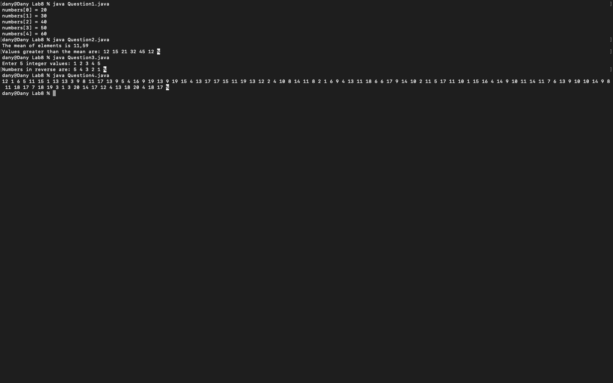
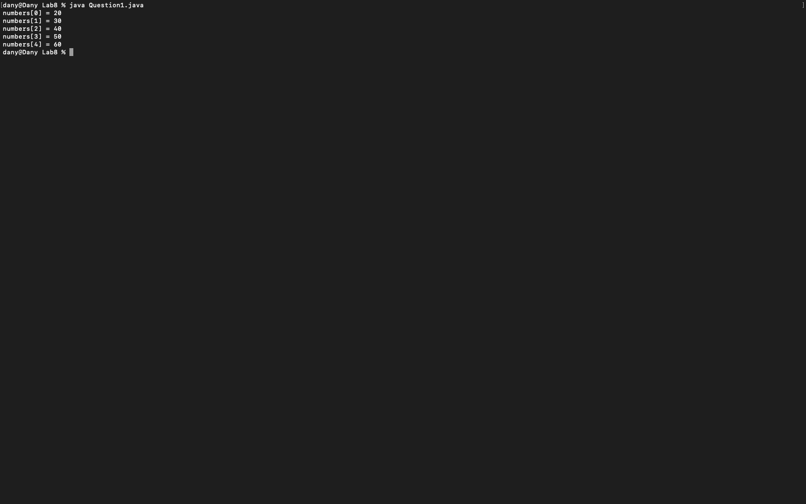
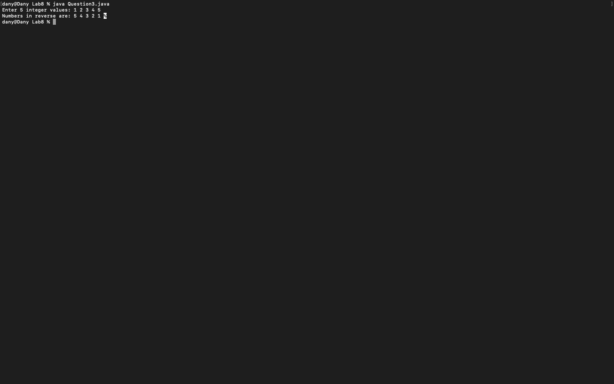
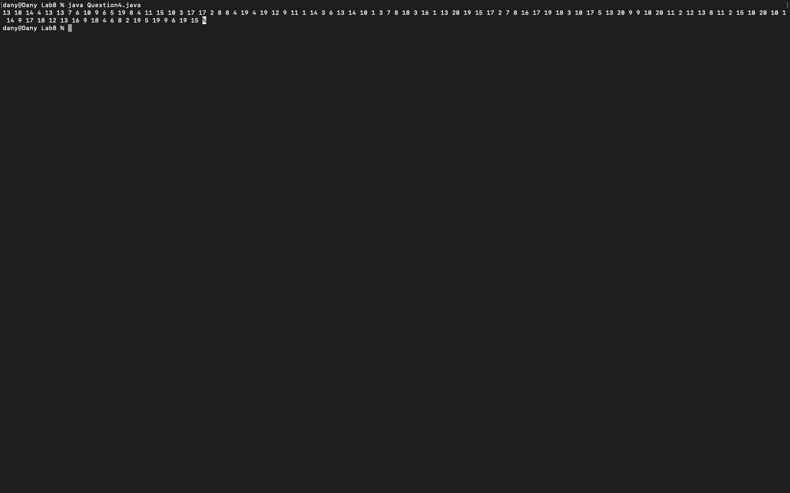

# Week 08 — Exercise sheet 8: arrays

**Module:** Fundamentals of Programming 1 (`COMP 1032`)  
**Semester:** 1 (Year 1), folder `sem01`

[Module README](../README.md)

## What this week is for

Exercise sheet 8: arrays. Printing an array with printf; the mean of a data set and the values above it; reversing five integers; filling a 100-element array with random numbers.

## Screenshots

*Terminal capture running all four week 8 programs.*

## Files

| File | What it contains | Screenshot |
|---|---|---|
| [`README.md`](README.md) | This README. | — |
| [`lab/fundamentals_of_programming_1_week08_lab.pdf`](lab/fundamentals_of_programming_1_week08_lab.pdf) | The lab sheet (2 pages): printing an array with printf, the mean and the values above it, reversing five integers, and a random array. | — |
| [`lab/solution/Question1.java`](lab/solution/Question1.java) | Prints the five array elements with five printf statements. |  *Terminal capture: Question1 output.* |
| [`lab/solution/Question2.java`](lab/solution/Question2.java) | Computes the mean of a fixed array and prints the values above it. |  *Terminal capture: Question2 output (the mean prints with a comma decimal separator).* |
| [`lab/solution/Question3.java`](lab/solution/Question3.java) | Reads five integers into an array and prints them in reverse. |  *Terminal capture: Question3 run with 1 2 3 4 5.* |
| [`lab/solution/Question4.java`](lab/solution/Question4.java) | Fills a 100-element array with random values from 1 to 20 and prints them. It needs Java 17 or later. |  *Terminal capture: Question4 output, 100 random values from 1 to 20.* |
