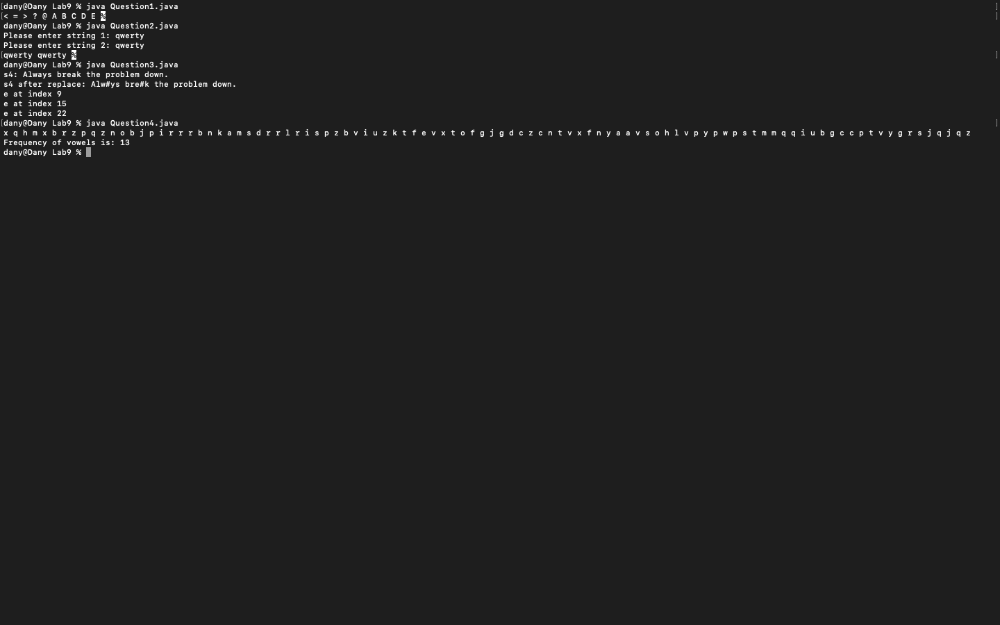
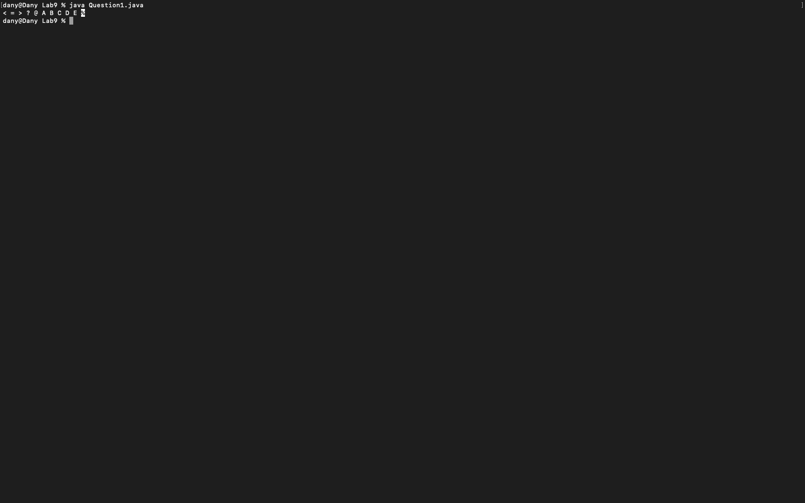
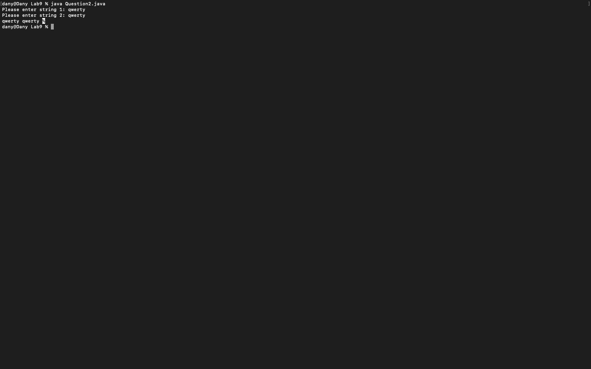
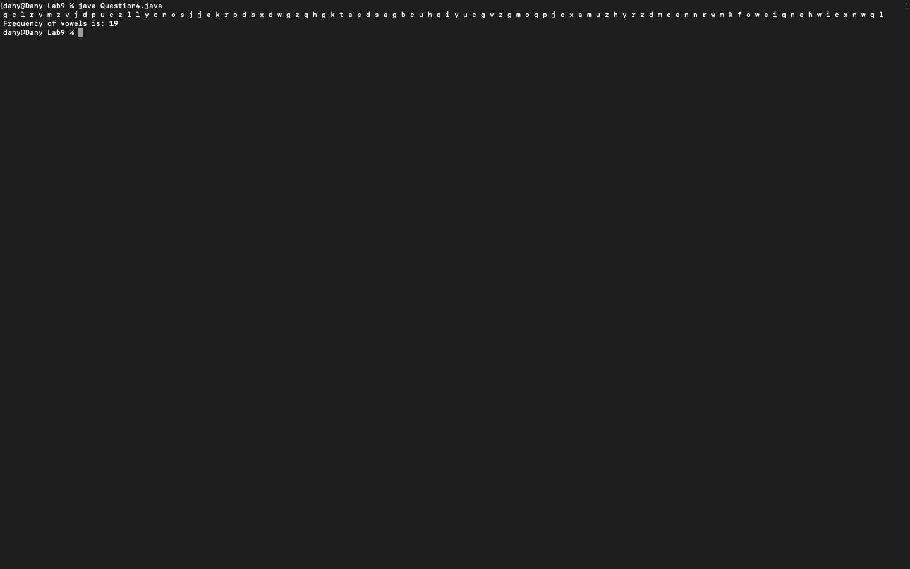

# Week 09 — Exercise sheet 9: ASCII, strings and letters

**Module:** Fundamentals of Programming 1 (`COMP 1032`)  
**Semester:** 1 (Year 1), folder `sem01`

[Module README](../README.md)

## What this week is for

Exercise sheet 9: characters and strings. Row 6 of the ASCII table; two strings in alphabetical order; joining three strings and replacing letters; the vowels among 100 random letters.

## Screenshots

*Terminal capture running all four week 9 programs.*

## Files

| File | What it contains | Screenshot |
|---|---|---|
| [`README.md`](README.md) | This README. | — |
| [`lab/fundamentals_of_programming_1_week09_lab.pdf`](lab/fundamentals_of_programming_1_week09_lab.pdf) | The lab sheet (2 pages): ASCII row 6, alphabetical order, string operations and a vowel count. | — |
| [`lab/solution/Question1.java`](lab/solution/Question1.java) | Prints ASCII row 6: < = > ? @ A B C D E. |  *Terminal capture: Question1 output.* |
| [`lab/solution/Question2.java`](lab/solution/Question2.java) | Reads two strings and prints them in alphabetical order. |  *Terminal capture: Question2 run with `qwerty` twice.* |
| [`lab/solution/Question3.java`](lab/solution/Question3.java) | Joins three strings, replaces each a with #, and prints the index of every e. |  *Terminal capture: Question3 output.* |
| [`lab/solution/Question4.java`](lab/solution/Question4.java) | Prints 100 random lowercase letters and the number of vowels among them. |  *Terminal capture: Question4 output with a vowel count of 19.* |
