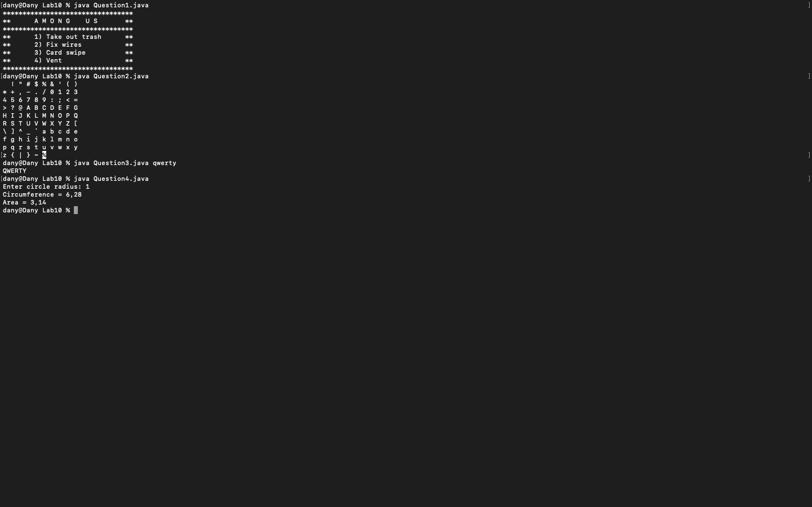
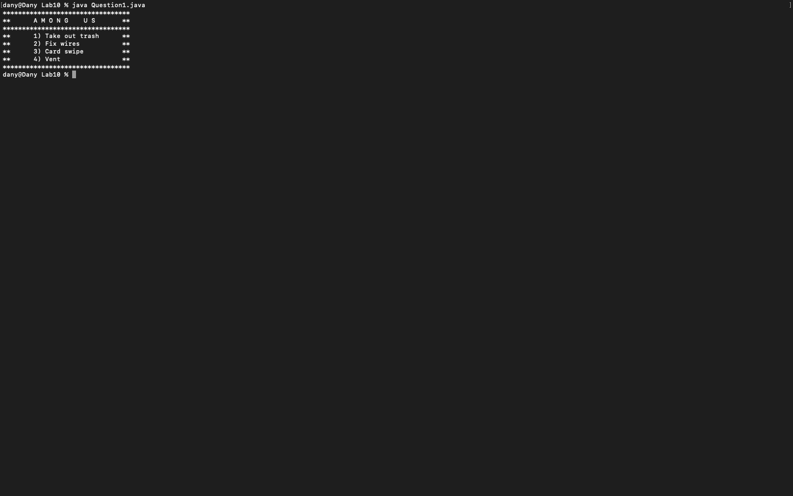
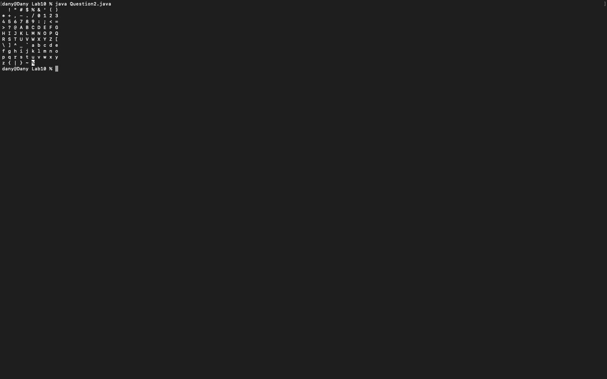
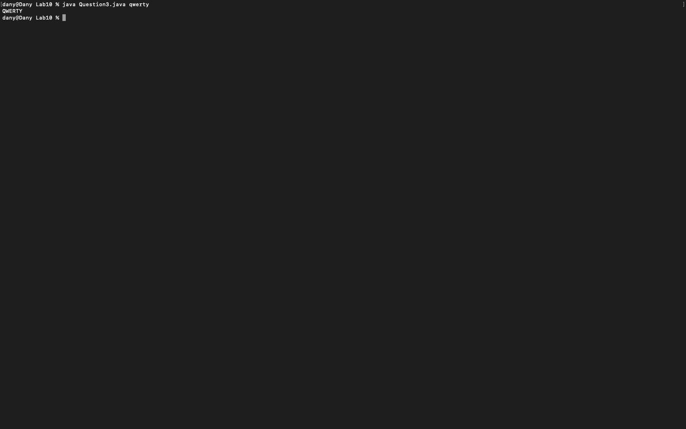
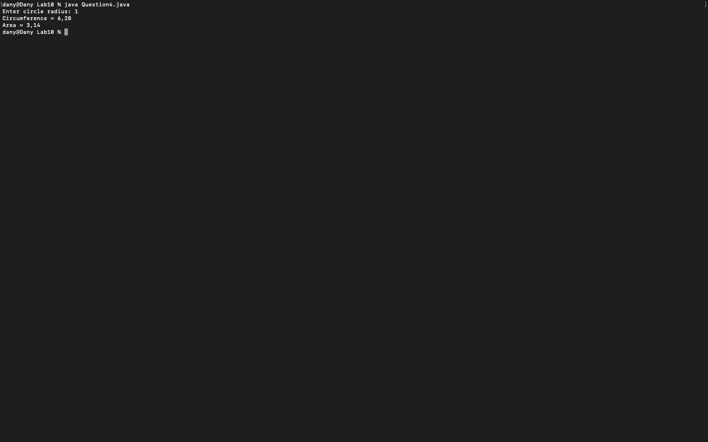

# Week 10 — Exercise sheet 10: procedures, ASCII table, arguments and circles

**Module:** Fundamentals of Programming 1 (`COMP 1032`)  
**Semester:** 1 (Year 1), folder `sem01`

[Module README](../README.md)

## What this week is for

Exercise sheet 10: methods. A menu procedure; a printAscii procedure; command-line arguments printed in uppercase; the circumference and area of a circle with functions. The sheet asks for each method to be tested from main.

## Screenshots

*Terminal capture running all four week 10 programs (radius 1, argument `qwerty`).*

## Files

| File | What it contains | Screenshot |
|---|---|---|
| [`README.md`](README.md) | This README. | — |
| [`lab/fundamentals_of_programming_1_week10_lab.pdf`](lab/fundamentals_of_programming_1_week10_lab.pdf) | The lab sheet (2 pages): a menu procedure, a printAscii procedure, uppercase command-line arguments and circle functions. | — |
| [`lab/solution/Question1.java`](lab/solution/Question1.java) | Prints the AMONG US menu box with four items. |  *Terminal capture: Question1 menu output.* |
| [`lab/solution/Question2.java`](lab/solution/Question2.java) | Prints the printable ASCII characters in rows of ten. |  *Terminal capture: Question2 ASCII table output.* |
| [`lab/solution/Question3.java`](lab/solution/Question3.java) | Prints each command-line argument in uppercase, one per line. |  *Terminal capture: Question3 run with `qwerty`, printing `QWERTY`.* |
| [`lab/solution/Question4.java`](lab/solution/Question4.java) | Reads a radius and prints the circumference and the area, using Math.PI. |  *Terminal capture: Question4 run with radius 1 (printed with a comma decimal separator).* |
