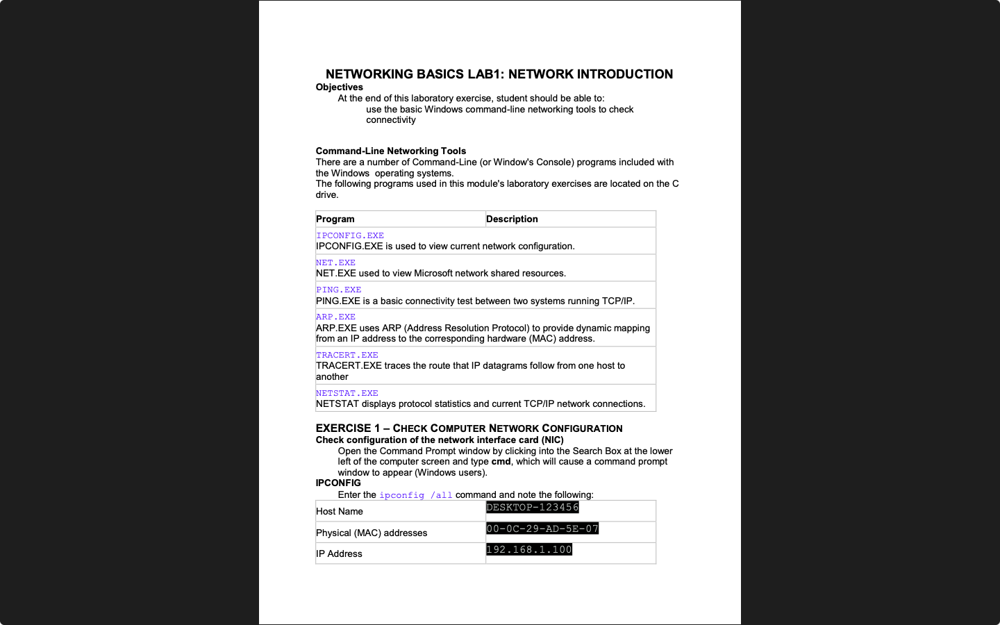

# Week 01 — Lab 1: Windows network tools

**Module:** Networking Basics (`COMP H1015`)  
**Semester:** 1 (Year 1), folder `sem01`

[Module README](../README.md)

## What this week is for

Lab 1 is a Windows lab. It checks the network configuration with ipconfig /all, tests connections with ping (localhost, a public IP address and a domain name), and traces routes with tracert and a web-based traceroute. The sheet has the answers written in: 127.0.0.1 for localhost, about 12 ms and TTL 59 for the public address, 16 hops to www.rte.ie and 14 hops to www.hea.net. Ping to Google fails on the college network because the firewall blocks ICMP.

## Screenshots

*Page 1 of the week 1 lab sheet: the Windows networking tools table and the IPCONFIG exercise.*

## Files

| File | What it contains |
|---|---|
| [`README.md`](README.md) | This README. |
| [`lab/networking_basics_week01_lab_network_introduction.pdf`](lab/networking_basics_week01_lab_network_introduction.pdf) | The lab sheet (5 pages): ipconfig, ping and tracert exercises. The answers are written in: 127.0.0.1; about 12 ms; TTL 59; 16 hops to www.rte.ie; 14 hops to www.hea.net; 17 routers to Princeton and 20 to an Australian site on the web traceroute. |
