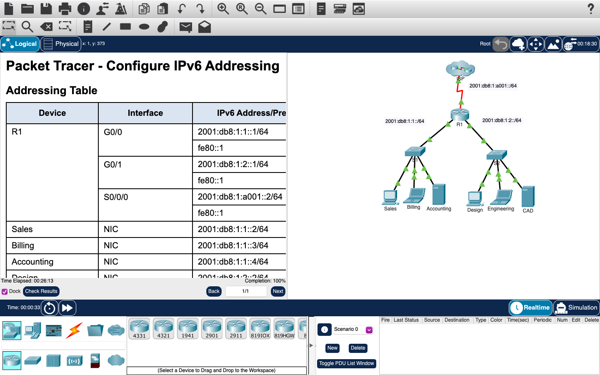

# Week 08 — Packet Tracer: IPv6 addressing

**Module:** Networking Basics (`COMP H1015`)  
**Semester:** 1 (Year 1), folder `sem01`

[Module README](../README.md)

## What this week is for

Lab 7 is a Cisco Packet Tracer activity on IPv6. It configures IPv6 on router R1, on the Accounting and CAD servers, and on the Sales, Billing, Engineering and Design clients, then checks that the clients can open the two web servers and ping the ISP. The Packet Tracer solution file is listed below.

## Screenshots

*Packet Tracer window for the IPv6 activity: topology (ISP, R1, S1, S2, clients and servers), addressing table, completion 100%.*

## Files

| File | What it contains |
|---|---|
| [`README.md`](README.md) | This README. |
| [`lab/networking_basics_week08_lab_configure_ipv6_addressing.pdf`](lab/networking_basics_week08_lab_configure_ipv6_addressing.pdf) | The Packet Tracer activity sheet (3 pages): configure IPv6 on R1, the servers and the clients, then verify. The addressing table uses 2001:db8:1:1::/64, 2001:db8:1:2::/64 and 2001:db8:1:a001::/64. This copy has no answers filled in. |
| [`lab/solution/networking_basics_week08_lab_configure_ipv6_addressing.pka`](lab/solution/networking_basics_week08_lab_configure_ipv6_addressing.pka) | Packet Tracer solution. Cisco saves Packet Tracer files in an encrypted format, so this file opens only in Cisco Packet Tracer; its contents are not shown in the repository. The task it solves is the PDF listed above. |
