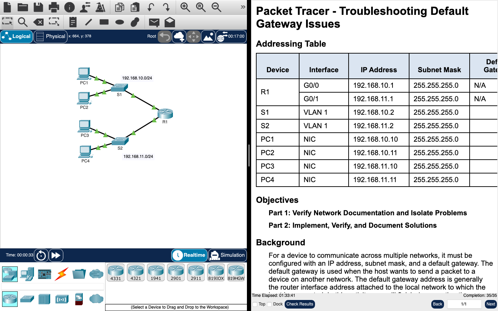

# Week 09 — Packet Tracer: default gateway troubleshooting

**Module:** Networking Basics (`COMP H1015`)  
**Semester:** 1 (Year 1), folder `sem01`

[Module README](../README.md)

## What this week is for

Lab 8 is a Cisco Packet Tracer activity on default gateway problems. The network has a router, two switches and four PCs on two subnets (192.168.10.0/24 and 192.168.11.0/24). The sheet asks for the addressing table to be completed, the connections to be tested, and the faults to be found and fixed. The testing table on the sheet is an example, with its first issue filled in. The Packet Tracer solution file is listed below.

## Screenshots

*Packet Tracer window for the default gateway activity: topology with two /24 LANs (R1, S1, S2, PC1–PC4), completion 35/35.*

## Files

| File | What it contains |
|---|---|
| [`README.md`](README.md) | This README. |
| [`lab/networking_basics_week09_lab_troubleshooting_default_gateway_issues.pdf`](lab/networking_basics_week09_lab_troubleshooting_default_gateway_issues.pdf) | The Packet Tracer activity sheet (4 pages): troubleshooting default gateway problems on 192.168.10.0/24 and 192.168.11.0/24. Its testing table is the sheet's example, with the first issue filled in; the other rows show the kind of fault to look for. |
| [`lab/solution/networking_basics_week09_lab_troubleshooting_default_gateway_issues.pka`](lab/solution/networking_basics_week09_lab_troubleshooting_default_gateway_issues.pka) | Packet Tracer solution. Cisco saves Packet Tracer files in an encrypted format, so this file opens only in Cisco Packet Tracer; its contents are not shown in the repository. The task it solves is the PDF listed above. |
