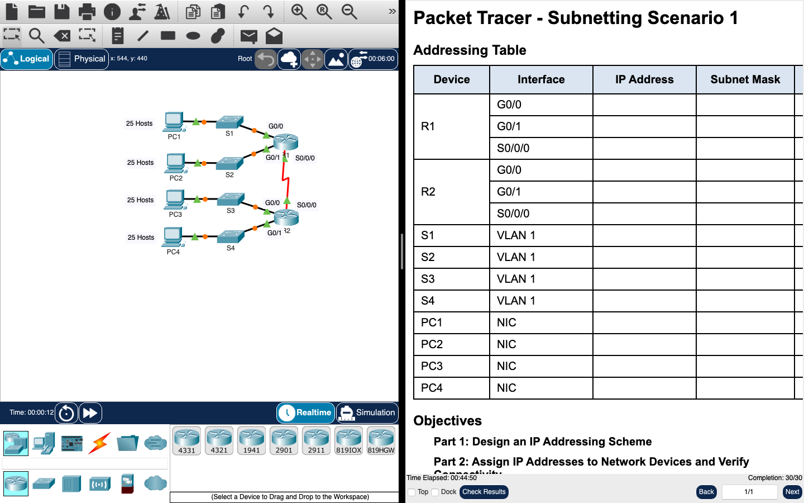

# Week 10 — Packet Tracer: subnetting scenario 1

**Module:** Networking Basics (`COMP H1015`)  
**Semester:** 1 (Year 1), folder `sem01`

[Module README](../README.md)

## What this week is for

Lab 9 is a Cisco Packet Tracer activity on subnetting. 192.168.100.0/24 is split into subnets that each hold at least 25 hosts, for four LANs and the link between two routers. The sheet has the design answers written in: 5 subnets needed, 3 bits borrowed, 8 subnets created and a /27 mask. The subnet table is filled in for subnets 0 to 5.

> [!WARNING]
> [`lab/networking_basics_week10_lab_subnetting_scenario_1.pdf`](lab/networking_basics_week10_lab_subnetting_scenario_1.pdf): One design answer is wrong: it gives 23 usable hosts per subnet, but a /27 gives 30 (2⁵ − 2). The sheet's own check says an answer below 25 means too many bits were borrowed. The assignment and documentation parts are blank in this copy.

## Screenshots

*Packet Tracer window for Subnetting Scenario 1: four 25-host LANs, two routers, addressing table with blank IP columns, completion 30/30.*

## Files

| File | What it contains |
|---|---|
| [`README.md`](README.md) | This README. |
| [`lab/networking_basics_week10_lab_subnetting_scenario_1.pdf`](lab/networking_basics_week10_lab_subnetting_scenario_1.pdf) | The Packet Tracer activity sheet (4 pages): subnet 192.168.100.0/24 into LANs of at least 25 hosts. Design answers written in: 5 subnets, 3 borrowed bits, 8 subnets and a /27 mask. The subnet table is filled in for subnets 0 to 5. |
| [`lab/solution/networking_basics_week10_lab_subnetting_scenario_1.pka`](lab/solution/networking_basics_week10_lab_subnetting_scenario_1.pka) | Packet Tracer solution. Cisco saves Packet Tracer files in an encrypted format, so this file opens only in Cisco Packet Tracer; its contents are not shown in the repository. The task it solves is the PDF listed above. |
