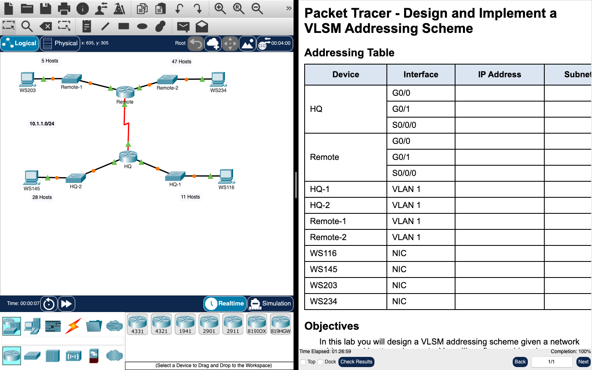

# Week 11 — Packet Tracer: VLSM addressing scheme

**Module:** Networking Basics (`COMP H1015`)  
**Semester:** 1 (Year 1), folder `sem01`

[Module README](../README.md)

## What this week is for

Lab 10 is a Cisco Packet Tracer activity on VLSM. One of three topologies is given: two routers (HQ and Remote), four LANs and a serial link, and the task is to design the subnets for 10.1.1.0/24. The requirement sentences in this copy still contain template placeholders such as [[S1Name]] and [[DisplayNet]]. The subnet table, from the largest LAN to the smallest, is 10.1.1.0/26 (Remote-2 LAN), 10.1.1.64/27 (HQ-2 LAN), 10.1.1.96/28 (HQ-1 LAN), 10.1.1.112/29 (Remote-1 LAN) and 10.1.1.120/30 (the WAN link). The Packet Tracer solution file is listed below.

## Screenshots

*Packet Tracer window for the VLSM activity: topology with host counts 5, 47, 28 and 11; addressing table with blank IP columns; completion 100%.*

## Files

| File | What it contains |
|---|---|
| [`README.md`](README.md) | This README. |
| [`lab/networking_basics_week11_lab_designing_and_implementing_a_vlsm_addressing_scheme.pdf`](lab/networking_basics_week11_lab_designing_and_implementing_a_vlsm_addressing_scheme.pdf) | The Packet Tracer activity sheet (4 pages): a VLSM design for 10.1.1.0/24, with the addressing table for one of three topologies. The requirement text still has placeholders such as [[DisplayNet]] and [[S1Name]]. Subnet table filled in: 10.1.1.0/26, 10.1.1.64/27, 10.1.1.96/28, 10.1.1.112/29 and 10.1.1.120/30. |
| [`lab/solution/networking_basics_week11_lab_designing_and_implementing_a_vlsm_addressing_scheme.pka`](lab/solution/networking_basics_week11_lab_designing_and_implementing_a_vlsm_addressing_scheme.pka) | Packet Tracer solution. Cisco saves Packet Tracer files in an encrypted format, so this file opens only in Cisco Packet Tracer; its contents are not shown in the repository. The task it solves is the PDF listed above. |
