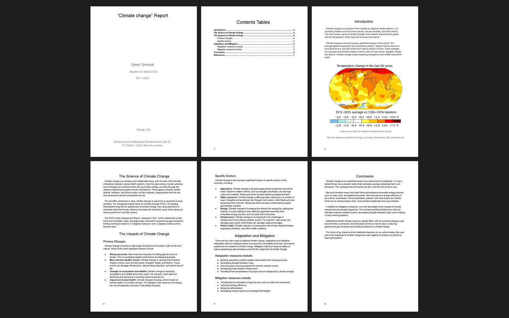
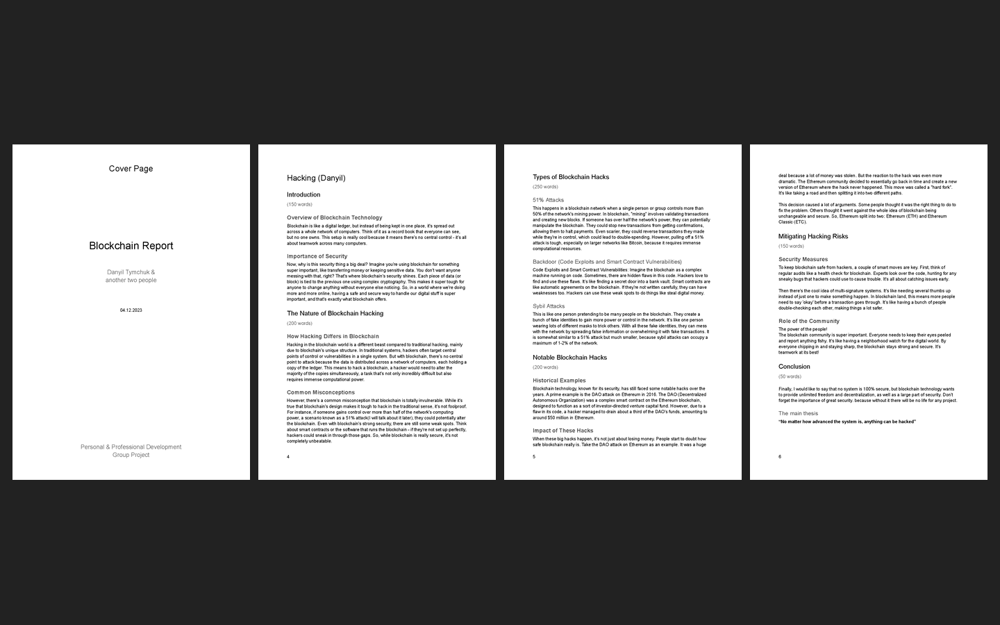
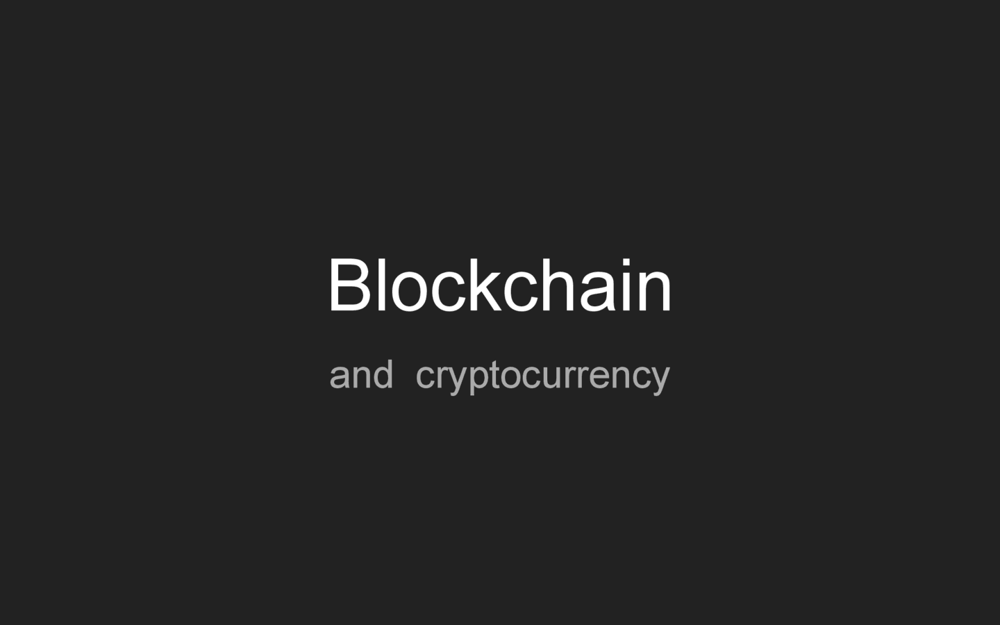

# Personal and Professional Development

**Module:** Personal and Professional Development (`COMP H1033`)  
**Semester:** 1 (Year 1), folder `sem01`  
**Lecturer:** Maria Brennan  
**Date:** September - December 2023  
**Credits:** 5 ECTS

## What this module is for

Personal and Professional Development covers presentations, communication skills and teamwork. It starts with an extended induction in week 1 (online preparation tasks about the student union, class representatives and equality, and a quiz). The main assessment is a group presentation (free subject): report and a presentation on blockchain technology, its applications and how to hack a blockchain. Lab 5 (week 8) is a climate change report of seven pages. Week 11 is an MCQ test, which is not in the repository. This folder has the climate change report, the blockchain report and presentation (the part on hacking a blockchain and the full group version of each, with the Google Docs and Google Slides links of the full versions) and screenshots of those files.

## Grades Breakdown

| Assessment Type | Weighting |
|---|---|
| idk | idk |

## Assessments

| File | What it contains |
|---|---|
| [`assessment/01/README.md`](assessment/01/README.md) | The README of Assessment 1: the group report and presentation on blockchain, the full versions and the part on hacking a blockchain, with the Google Docs and Slides links. |
| [`assessment/01/submission/blockchain_report.pdf`](assessment/01/submission/blockchain_report.pdf) | The report on how to hack a blockchain (9 pages): the part of the group report on hacking, with the nature of blockchain hacking and common misconceptions, the types of hacks (51% attacks, backdoors and smart contract vulnerabilities, Sybil attacks), notable hacks, ways to reduce the risks and a conclusion. |
| [`assessment/01/submission/blockchain_report.md`](assessment/01/submission/blockchain_report.md) | The Markdown version of that report, with a contents list and the word count of each section. |
| [`assessment/01/submission/blockchain_report_full.pdf`](assessment/01/submission/blockchain_report_full.pdf) | The full group report (16 pages): an introduction to blockchain and cryptocurrency, banking and Bitcoin, and the part on hacking, one part for each of the three group members. The report is also a Google Doc: [the document](https://docs.google.com/document/d/1p2yTl3g8FZukt0PnC3gJFIZgpt_Tp6_JgNVaiNahsGc). |
| [`assessment/01/submission/blockchain_presentation.pdf`](assessment/01/submission/blockchain_presentation.pdf) | The presentation on how to hack a blockchain (22 slides). |
| [`assessment/01/submission/blockchain_presentation_full.pdf`](assessment/01/submission/blockchain_presentation_full.pdf) | The full group presentation (34 slides) with the parts of the other two group members. It is also a Google Slides file with the speaker notes: [the presentation](https://docs.google.com/presentation/d/146YP41qGQr0zgnRQ5mwN7r1qBBPFG8eqp-MDiRtQkBU) and [its published version](https://docs.google.com/presentation/d/e/2PACX-1vQLF03k8tQTv3LlpjKFoTIOenAaKcXmIVAnXqfevpMx8LHHLDmouoAaK-yaI2X0yPuuTE0YjSGz9Xhf/pub). |

## All weeks

| Week | Title | Files | Screenshot |
|---|---|---|---|
| Week 1 | Extended induction: week 1 instructions | None. | — |
| [Week 8](week08/) | Lab 5: climate change report | [`lab/solution/personal_and_professional_development_week08_lab_report.pdf`](week08/lab/solution/personal_and_professional_development_week08_lab_report.pdf) |  |
| Week 11 | MCQ test | None. | — |

---

## Weeks
- [Weeks](#weeks)
    - [Week 8 (Lab 5)](#week-8-lab-5-climate-change-report): Climate Change Report
    - [Week 11](#week-11-mcq-test): MCQ Test
- [Continuous Assessment (CA)](#continuous-assessment-ca)
    - [Blockchain](#blockchain)
        - [Report](#report)
        - [Presentation](#presentation)

### [Week 8 (Lab 5)](./week08/lab/): Climate Change Report
**Date:** November 6, 2023  
[Report](./week08/lab/solution/personal_and_professional_development_week08_lab_report.pdf)

### Week 11: MCQ Test
> Was MCQ test, idk about what exactly... Probably some bullshit...

## [Continuous Assessment](./assessment/) (CA)

### [Blockchain](./assessment/01/)
Presentation about blockchain and how to hack a blockchain. Includes a .pdf for easier reading; the annotations are in the Google Slides file of the full presentation.  
**Note:** _'How to Hack a Blockchain'_ — was my part of the report/presentation.

#### [Report](./assessment/01/submission/)
**Date:** December 7, 2023  

- [blockchain_report.md](./assessment/01/submission/blockchain_report.md): The markdown file for the report. Markdown version of [pdf file](./assessment/01/submission/blockchain_report.pdf).
- [blockchain_report.pdf](./assessment/01/submission/blockchain_report.pdf): A report on blockchain technology, its applications, and how to hack a blockchain.
- [blockchain_report_full.pdf](./assessment/01/submission/blockchain_report_full.pdf): A full version of the report including two other group members' contributions. It is also a Google Doc: [the document](https://docs.google.com/document/d/1p2yTl3g8FZukt0PnC3gJFIZgpt_Tp6_JgNVaiNahsGc).

#### [Presentation](./assessment/01/submission/)
**Date:** December 11, 2023  

- [blockchain_presentation.pdf](./assessment/01/submission/blockchain_presentation.pdf): A presentation on blockchain technology, its applications, and how to hack a blockchain.
- [blockchain_presentation_full.pdf](./assessment/01/submission/blockchain_presentation_full.pdf): A full version of the presentation including two other group members' contributions. It is also a Google Slides file with the annotations: [the presentation](https://docs.google.com/presentation/d/146YP41qGQr0zgnRQ5mwN7r1qBBPFG8eqp-MDiRtQkBU) and [its published version](https://docs.google.com/presentation/d/e/2PACX-1vQLF03k8tQTv3LlpjKFoTIOenAaKcXmIVAnXqfevpMx8LHHLDmouoAaK-yaI2X0yPuuTE0YjSGz9Xhf/pub).
