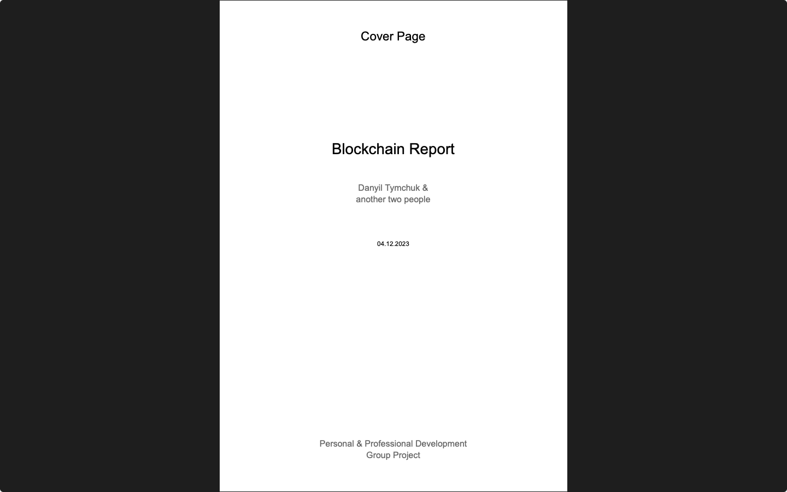
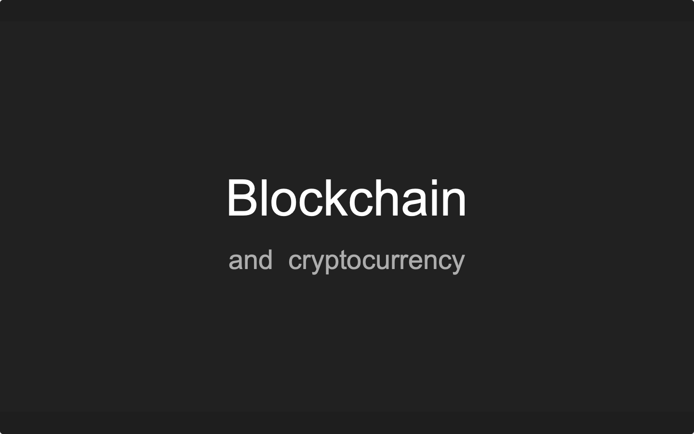

# Personal and Professional Development

**Module:** Personal and Professional Development (`COMP H1033`)  
**Semester:** 1 (Year 1), folder `sem01`  
**Lecturer:** Maria Brennan  
**Date:** September - December 2023  
**Credits:** 5 ECTS  
**Matching project branch:** [`presentation/year01/module-personal_and_professional_development/blockchain-report-and-presentation`](https://github.com/DanyilT/projects-in-university/tree/presentation/year01/module-personal_and_professional_development/blockchain-report-and-presentation) (the group blockchain report and presentation; this folder links to it)

## What this module is for

Personal and Professional Development covers presentations, communication skills and teamwork. It starts with an extended induction in week 1 (online preparation tasks about the student union, class representatives and equality, and a quiz). The main assessment is a group presentation (free subject): report and a presentation on blockchain technology, its applications and how to hack a blockchain. Lab 5 (week 8) is a climate change report of seven pages. Week 11 is an MCQ test, which is not in the repository. This folder has the climate change report, the links to the blockchain report and presentation on their branch, and screenshots of those files. The blockchain files themselves are on the branch.

## Grades Breakdown

| Assessment Type | Weighting |
|---|---|
| idk | idk |

## All weeks

| Week | Title | Files | Screenshot |
|---|---|---|---|
| Week 1 | Extended induction: week 1 instructions | None. | — |
| [Week 8](week08/) | Lab 5: climate change report | [`lab/solution/personal_and_professional_development_week08_lab_report.pdf`](week08/lab/solution/personal_and_professional_development_week08_lab_report.pdf) |  |
| Week 11 | MCQ test | None. | — |

## Assessments and other files

| File | What it contains |
|---|---|
| [`assessment/01/submission/presentation_link.txt`](assessment/01/submission/presentation_link.txt) | Two lines: a GitHub link to the presentation folder on the branch, and the branch name. |
| [`assessment/01/submission/report_link.txt`](assessment/01/submission/report_link.txt) | Two lines: a GitHub link to the report folder on the branch, and the branch name. |

---

## Weeks
- [Weeks](#weeks)
    - [Week 8 (Lab 5)](#week-8-lab-5-climate-change-report): Climate Change Report
    - [Week 11](#week-11-mcq-test): MCQ Test
- [Continuous Assessment (CA)](#continuous-assessment-ca)
    - [Blockchain](#blockchain)
        - [Report](#report)
        - [Presentation](#presentation)

### [Week 8 (Lab 5)](./week08/lab/): Climate Change Report
**Date:** November 6, 2023  
[Report](./week08/lab/solution/personal_and_professional_development_week08_lab_report.pdf)

### Week 11: MCQ Test
> Was MCQ test, idk about what exactly... Probably some bullshit...

## [Continuous Assessment](./assessment/) (CA)

### [Blockchain](./assessment/01/)
> [!NOTE]  
> The submitted files (report + presentation) are located in the `presentation/year01/module-personal_and_professional_development/blockchain-report-and-presentation` branch.

Presentation about blockchain and how to hack a blockchain. Includes a .pdf for easier reading and a .pptx with annotations.  
**Note:** _'How to Hack a Blockchain'_ — was my part of the report/presentation.

#### [Report](./assessment/01/submission/report_link.txt)
**Date:** December 7, 2023  

- [blockchain_report.md](https://github.com/DanyilT/projects-in-university/tree/presentation/year01/module-personal_and_professional_development/blockchain-report-and-presentation/report/blockchain_report.md): The markdown file for the report. Markdown version of [pdf file](https://github.com/DanyilT/projects-in-university/tree/presentation/year01/module-personal_and_professional_development/blockchain-report-and-presentation/report/blockchain_report.pdf).
- [blockchain_report.pdf](https://github.com/DanyilT/projects-in-university/tree/presentation/year01/module-personal_and_professional_development/blockchain-report-and-presentation/report/blockchain_report.pdf): A report on blockchain technology, its applications, and how to hack a blockchain.
- [blockchain_report_full.pdf](https://github.com/DanyilT/projects-in-university/tree/presentation/year01/module-personal_and_professional_development/blockchain-report-and-presentation/report/blockchain_report_full.pdf): A full version of the report including two other group members' contributions.

#### [Presentation](./assessment/01/submission/presentation_link.txt)
**Date:** December 11, 2023  

- [blockchain_presentation.pdf](https://github.com/DanyilT/projects-in-university/tree/presentation/year01/module-personal_and_professional_development/blockchain-report-and-presentation/presentation/blockchain_presentation.pdf): A presentation on blockchain technology, its applications, and how to hack a blockchain.
- [blockchain_presentation.pptx](https://github.com/DanyilT/projects-in-university/tree/presentation/year01/module-personal_and_professional_development/blockchain-report-and-presentation/presentation/blockchain_presentation.pptx): A PowerPoint presentation with annotations.
- [blockchain_presentation_full.pdf](https://github.com/DanyilT/projects-in-university/tree/presentation/year01/module-personal_and_professional_development/blockchain-report-and-presentation/presentation/blockchain_presentation_full.pdf): A full version of the presentation including two other group members' contributions.
- [blockchain_presentation_full.pptx](https://github.com/DanyilT/projects-in-university/tree/presentation/year01/module-personal_and_professional_development/blockchain-report-and-presentation/presentation/blockchain_presentation_full.pptx): A full PowerPoint presentation including two other group members' contributions.
