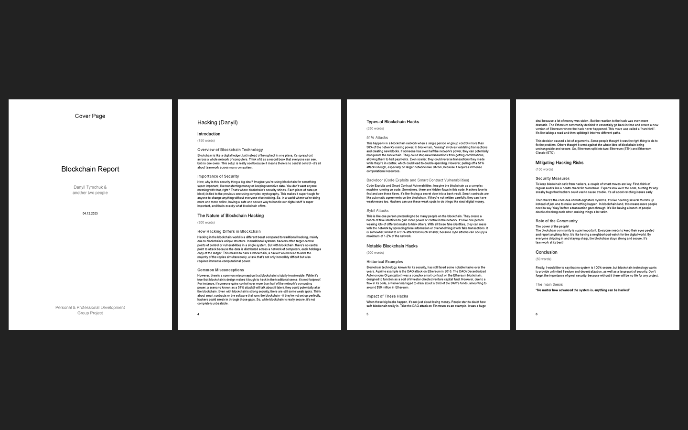
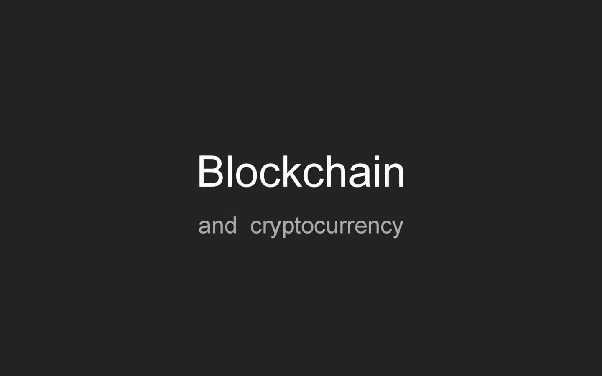

# Assessment 1: Blockchain report and presentation

**Module:** Personal and Professional Development (`COMP H1033`)  
**Semester:** 1 (Year 1), folder `sem01`  
**Type:** report and presentation, group of 3  
**Weight:** —  
**Deadline:** the report on 7 December 2023, the presentation on 11 December 2023  
**Result:** —  
**On main:** [`sem01/personal_and_professional_development/assessment/01/`](https://github.com/DanyilT/projects-in-university/tree/main/sem01/personal_and_professional_development/assessment/01) (the reports, the presentations and this README)  
**Branch:** —  
**Repository:** —

[Module README](../../README.md)

## What this assessment is for

The main assessment of the module is a group report and a group presentation on a subject that the group chooses. This group chose blockchain technology and cryptocurrency. The report and the presentation each have three parts, one for each member of the group: an introduction to blockchain and cryptocurrency, banking and Bitcoin, and how to hack a blockchain. The brief was not kept, and the weighting is not recorded.

The report is dated 7 December 2023 (its cover page says 04.12.2023) and the presentation 11 December 2023. The folder has the full group versions and, next to them, the part on how to hack a blockchain on its own, as a report and as a presentation.

<table>
  <tr valign="top">
    <td width="50%"> <i>Pages 1, 5, 6 and 7 of the report PDF (9 pages): the cover page ("Blockchain Report", dated 04.12.2023) and the hacking part: the introduction and the nature of blockchain hacking, the types of hacks and the notable hacks, and the ways to mitigate the risks with the conclusion.</i></td>
    <td width="50%"> <i>Slide 1 of the presentation PDF: the title slide, "Blockchain and cryptocurrency".</i></td>
  </tr>
</table>

## Files

| File | What it contains |
|---|---|
| [`README.md`](README.md) | This README. |
| [`submission/blockchain_report.pdf`](submission/blockchain_report.pdf) | The report on how to hack a blockchain (9 pages): the part of the group report on hacking, with the nature of blockchain hacking and common misconceptions, the types of hacks (51% attacks, backdoors and smart contract vulnerabilities, Sybil attacks), notable hacks, ways to reduce the risks and a conclusion. |
| [`submission/blockchain_report.md`](submission/blockchain_report.md) | The Markdown version of that report, with a contents list and the word count of each section. |
| [`submission/blockchain_report_full.pdf`](submission/blockchain_report_full.pdf) | The full group report (16 pages): an introduction to blockchain and cryptocurrency, banking and Bitcoin, and the part on hacking, one part for each of the three group members. The report is also a Google Doc: [the document](https://docs.google.com/document/d/1p2yTl3g8FZukt0PnC3gJFIZgpt_Tp6_JgNVaiNahsGc). |
| [`submission/blockchain_presentation.pdf`](submission/blockchain_presentation.pdf) | The presentation on how to hack a blockchain (22 slides). |
| [`submission/blockchain_presentation_full.pdf`](submission/blockchain_presentation_full.pdf) | The full group presentation (34 slides) with the parts of the other two group members. It is also a Google Slides file with the speaker notes: [the presentation](https://docs.google.com/presentation/d/146YP41qGQr0zgnRQ5mwN7r1qBBPFG8eqp-MDiRtQkBU) and [its published version](https://docs.google.com/presentation/d/e/2PACX-1vQLF03k8tQTv3LlpjKFoTIOenAaKcXmIVAnXqfevpMx8LHHLDmouoAaK-yaI2X0yPuuTE0YjSGz9Xhf/pub). |

The PowerPoint files of the two presentations are not kept: the Google Slides file holds the same slides.

## Online versions

- [Report (Google Docs)](https://docs.google.com/document/d/1p2yTl3g8FZukt0PnC3gJFIZgpt_Tp6_JgNVaiNahsGc): the full group report as a Google Doc, the online version of [`submission/blockchain_report_full.pdf`](submission/blockchain_report_full.pdf).
- [Presentation (Google Slides)](https://docs.google.com/presentation/d/146YP41qGQr0zgnRQ5mwN7r1qBBPFG8eqp-MDiRtQkBU): the full group presentation as a Google Slides file with the speaker notes, the online version of [`submission/blockchain_presentation_full.pdf`](submission/blockchain_presentation_full.pdf).
- [Presentation, published version](https://docs.google.com/presentation/d/e/2PACX-1vQLF03k8tQTv3LlpjKFoTIOenAaKcXmIVAnXqfevpMx8LHHLDmouoAaK-yaI2X0yPuuTE0YjSGz9Xhf/pub): the same presentation, published on the web.
