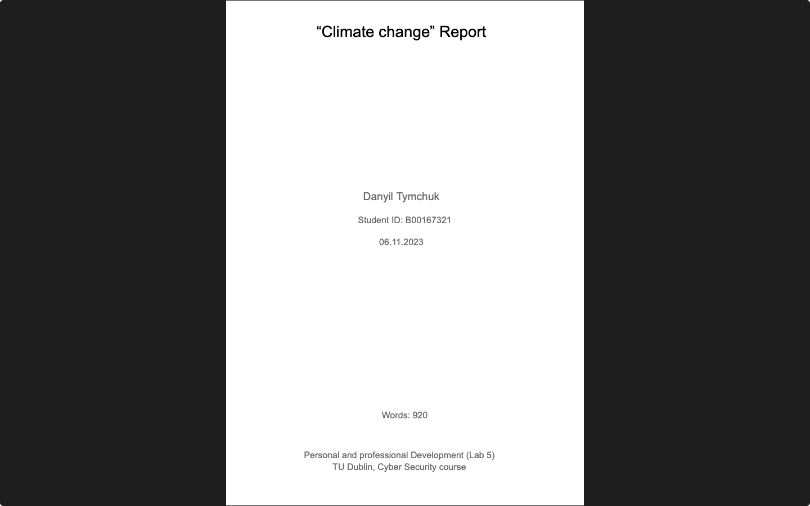

# Week 08 — Lab 5: climate change report

**Module:** Personal and Professional Development (`COMP H1033`)  
**Semester:** 1 (Year 1), folder `sem01`

[Module README](../README.md)

## What this week is for

Lab 5: a climate change report of seven pages (920 words). It covers the science of climate change, its impacts on the planet and on sectors such as agriculture, water and energy, adaptation and mitigation, and a conclusion, with references.

## Screenshots

*Cover page of the climate change report: "Climate change" Report, Danyil Tymchuk, dated 06.11.2023, 920 words.*

## Files

| File | What it contains |
|---|---|
| [`README.md`](README.md) | This README. |
| [`lab/solution/personal_and_professional_development_week08_lab_report.pdf`](lab/solution/personal_and_professional_development_week08_lab_report.pdf) | Climate change report (7 pages, Lab 5): introduction, the science of climate change, impacts (primary changes and sectors), adaptation and mitigation, conclusion and references. |
