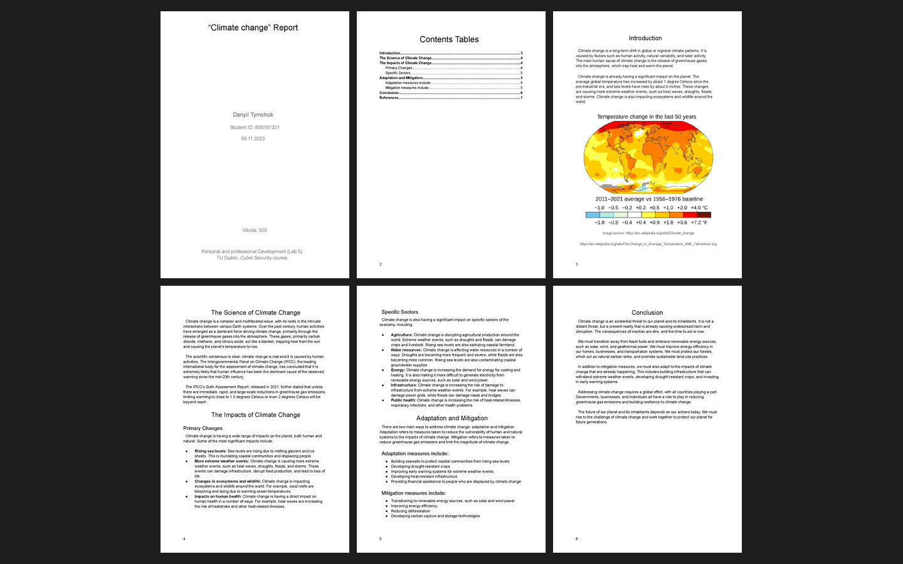

# Week 08 — Lab 5: climate change report

**Module:** Personal and Professional Development (`COMP H1033`)  
**Semester:** 1 (Year 1), folder `sem01`

[Module README](../README.md)

## What this week is for

Lab 5: a climate change report of seven pages (920 words). It covers the science of climate change, its impacts on the planet and on sectors such as agriculture, water and energy, adaptation and mitigation, and a conclusion, with references.

*Pages 1 to 6 of the climate change report PDF (7 pages): the cover page ("Climate change" Report, Danyil Tymchuk, dated 06.11.2023, 920 words), the contents, the introduction, the science and the impacts of climate change, the adaptation and mitigation measures, and the conclusion; the references on page 7 are not shown.*

## Files

| File | What it contains |
|---|---|
| [`README.md`](README.md) | This README. |
| [`lab/solution/personal_and_professional_development_week08_lab_report.pdf`](lab/solution/personal_and_professional_development_week08_lab_report.pdf) | Climate change report (7 pages, Lab 5): introduction, the science of climate change, impacts (primary changes and sectors), adaptation and mitigation, conclusion and references. |
