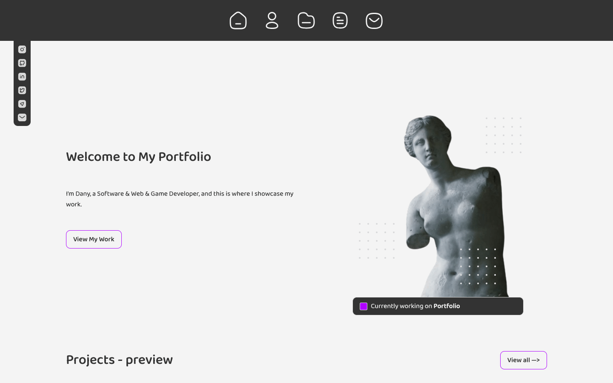

# Assessment 1: Personal portfolio

**Module:** Web Development Fundamentals (`COMP H1026`)  
**Semester:** 1 (Year 1), folder `sem01`  
**Type:** project (Assignment 2), individual (the brief also allows a team of two)  
**Weight:** 50%  
**Deadline:** Sunday 10 December 2023, with a demonstration in the lab session of the week beginning 11 December  
**Result:** —  
**On main:** [`sem01/web_development_fundamentals/assessment/01/`](https://github.com/DanyilT/projects-in-university/tree/main/sem01/web_development_fundamentals/assessment/01) (the brief, the link to the project, the screenshot and this README)  
**Branch:** [`project/year01/module-web_development_fundamentals/personal-portfolio`](https://github.com/DanyilT/projects-in-university/tree/project/year01/module-web_development_fundamentals/personal-portfolio) (the website with its README and licence)  
**Repository:** [WebDev](https://github.com/DanyilT/WebDev) (a later, rewritten version of the portfolio on the branch [`page/personal-portfolio`](https://github.com/DanyilT/WebDev/tree/page/personal-portfolio); the folder PersonalPortfolio of the branch archive has only a README that points to it)

[Module README](../../README.md)

## What this assessment is for

Assignment 2 is the project of the module (50%): a themed website of at least nine pages, on one of five themes (hobby, holiday destination, local company, charity or TV series). The home page uses a flexbox layout with a horizontal and a vertical navigation bar, text about the subject, an external link, an image and a footer with Facebook and X icons. The other pages are a site map as a nested list, a contact page, a characters or staff page with at least two sub-pages, and a merchandise page with at least four items, two of them with detail pages. All text has to be original, the CSS goes in separate files, and a wireframe of three pages is exported to a Word document. The project is uploaded to Moodle as a zip and demonstrated in the lab session of the week beginning 11 December 2023.

The submitted project is a personal portfolio in HTML and CSS with JavaScript that loads the header, the sidebar and the footer into every page. It has six pages (home, about, projects, resume, contact and a site map) and a separate resume site that the resume page shows in a frame. The layout is planned in a Figma design.

> [!WARNING]
> [`web_development_fundamentals_assessment.pdf`](web_development_fundamentals_assessment.pdf): The brief asks for a themed website of at least nine pages (home, site map, contact, characters or staff, and merchandise) on one of five themes: hobby, holiday destination, local company, charity and TV series. The project is a personal portfolio, which is not one of the five themes, and it has six pages: home, about, projects, resume, contact and a site map.

*The home page of the portfolio: the icon navigation bar, the welcome text with the "View My Work" button and the "Projects - preview" heading.*

## Files

| File | What it contains |
|---|---|
| [`README.md`](README.md) | This README. |
| [`web_development_fundamentals_assessment.pdf`](web_development_fundamentals_assessment.pdf) | The Assignment 2 brief (7 pages, 50%): a themed website of at least nine pages (home, site map, contact, characters or staff, and merchandise), with a flexbox home page, a nested-list site map and a wireframe. It lists five themes: hobby, holiday destination, local company, charity and TV series. |
| [`submission/project_link.txt`](submission/project_link.txt) | Two lines: the GitHub link to the portfolio project on its branch, and the branch name. |

## Online versions

- [web-development-fundamentals--personal-portfolio.pages.dev](https://web-development-fundamentals--personal-portfolio.pages.dev): the website of the branch on Cloudflare Pages.
- [dany-portfolio.netlify.app](https://dany-portfolio.netlify.app): a later version of the portfolio, not the submitted one.
- [danyilt-personal-portfolio.pages.dev](https://danyilt-personal-portfolio.pages.dev): the website of the branch `page/personal-portfolio` of the WebDev repository, the later, rewritten version.
