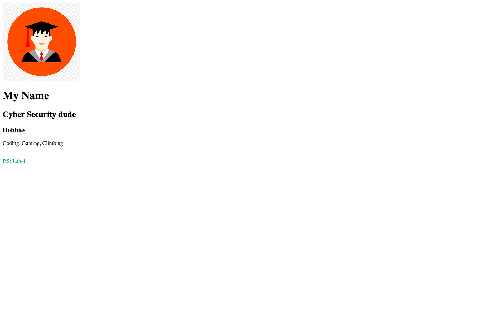

# Week 02 — Lab 1: first HTML page

**Module:** Web Development Fundamentals (`COMP H1026`)  
**Semester:** 1 (Year 1), folder `sem01`

[Module README](../README.md)

## What this week is for

Lab 1: the first HTML page. The brief asks for a page titled "my 1st web page", with a heading for a name, a Hobbies heading and paragraph, and an image. The solution page, lab01.html, has these parts.

> [!WARNING]
> [`lab/solution/lab01.html`](lab/solution/lab01.html): The title is "Lab-1", but the brief asks for "my 1st web page".

## Screenshots

*Render of lab01.html: avatar image, "My Name", "Cyber Security dude", "Hobbies", "Coding, Gaming, Climbing", "P.S: Lab-1".*

## Files

| File | What it contains |
|---|---|
| [`README.md`](README.md) | This README. |
| [`lab/web_development_fundamentals_week02_lab.pdf`](lab/web_development_fundamentals_week02_lab.pdf) | The lab brief (4 pages), "1st HTML page". It asks for the title "my 1st web page", a name heading, a Hobbies heading and paragraph, and an image. It names the image student.jpg in the steps and student.png in the submission list. |
| [`lab/solution/lab01.html`](lab/solution/lab01.html) | Lab 1 page: title "Lab-1", H1 "My Name", H2 "Cyber Security dude", H3 "Hobbies", a paragraph of hobbies, the image images/student.png and a "P.S: Lab-1" line. |
| [`lab/solution/css/style.css`](lab/solution/css/style.css) | Stylesheet has one rule: span text in green (#339966). |
| [`lab/solution/images/student.png`](lab/solution/images/student.png) | The avatar image (a graduation cap on an orange circle), used by lab01.html. |
