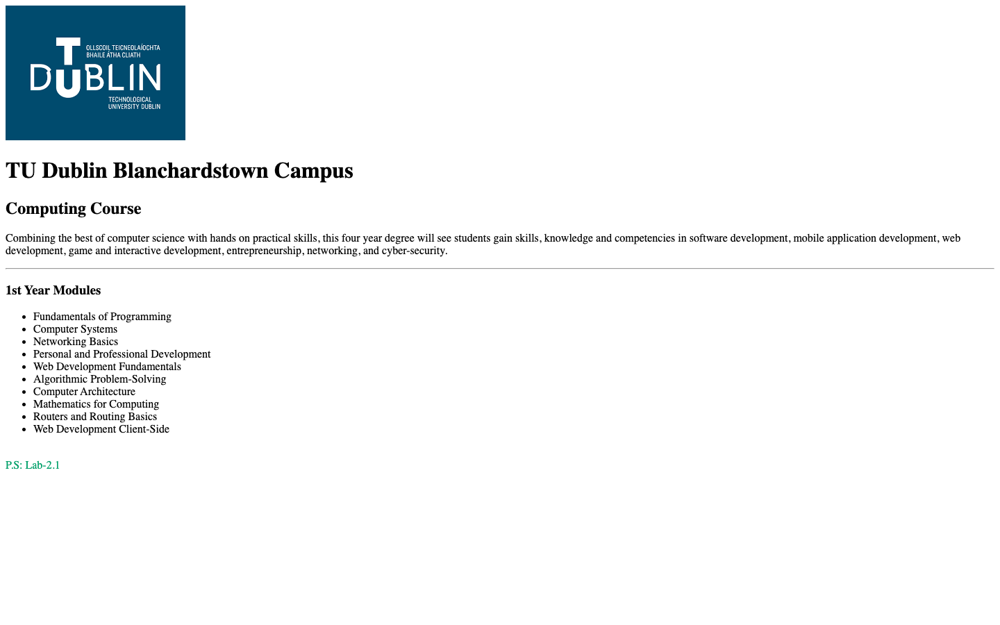
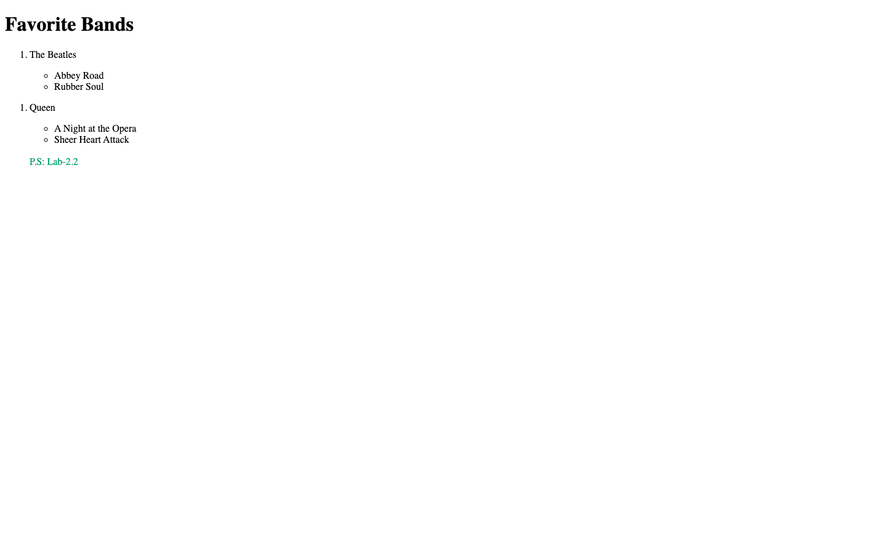
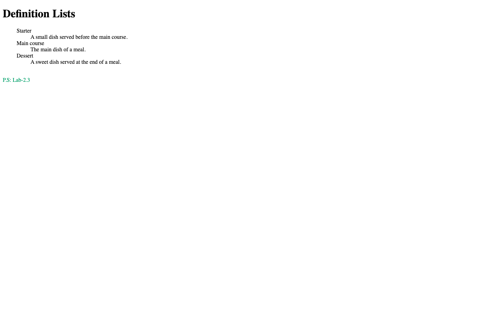

# Week 03 — Lab 2: college page, lists and definition lists

**Module:** Web Development Fundamentals (`COMP H1026`)  
**Semester:** 1 (Year 1), folder `sem01`

[Module README](../README.md)

## What this week is for

Lab 2: three exercises. A college page with a title, a logo, headings, a description, a horizontal rule and a list of first-year modules; a page with an ordered list of two bands and nested album lists; and a definition list for a restaurant menu.

> [!WARNING]
> - [`lab/solution/lab02ex1.html`](lab/solution/lab02ex1.html): The stylesheet link points to ../../Lab1/css/style.css, which is not in this repository, so the page has no styling here.
> - [`lab/solution/lab02ex2.html`](lab/solution/lab02ex2.html): The lists are nested incorrectly (a ul inside a ul), and the last list is never closed.
> - [`lab/solution/lab02ex3.html`](lab/solution/lab02ex3.html): The definition list uses generic definitions, not the menu items the sheet lists (soup, garlic bread, pasta, chicken curry, pizza, brownie, apple pie and tiramisu), and its dl element sits inside an ol.

## Files

| File | What it contains | Screenshot |
|---|---|---|
| [`README.md`](README.md) | This README. | — |
| [`lab/web_development_fundamentals_week03_lab.pdf`](lab/web_development_fundamentals_week03_lab.pdf) | The lab brief (5 pages): a college page with an image and a modules list, nested lists, and definition lists (a restaurant menu). | — |
| [`lab/solution/images/TUDublin.png`](lab/solution/images/TUDublin.png) | The TU Dublin logo used by lab02ex1.html, as rendered in [`.screenshots/week03/screenshot_1.png`](../.screenshots/week03/screenshot_1.png). | — |
| [`lab/solution/lab02ex1.html`](lab/solution/lab02ex1.html) | College page: title "Computing TU Dublin", the logo, an H1 and an H2, a description, a horizontal rule, the H3 "1st Year Modules" and a list of ten modules. |  *Render of lab02ex1.html: TU Dublin logo, campus and course headings, course description, "1st Year Modules" list of ten modules.* |
| [`lab/solution/lab02ex2.html`](lab/solution/lab02ex2.html) | Lists page: title "Lists", an ordered list of two bands with album lists. |  *Render of lab02ex2.html: "Favorite Bands" with a numbered list (The Beatles, Queen) and album sub-lists. The second band is numbered "1." as well.* |
| [`lab/solution/lab02ex3.html`](lab/solution/lab02ex3.html) | Definition list page: title "Definition Lists", with Starter, Main course and Dessert, and generic one-line definitions. |  *Render of lab02ex3.html: "Definition Lists" with Starter, Main course and Dessert, each with a generic one-line definition.* |
