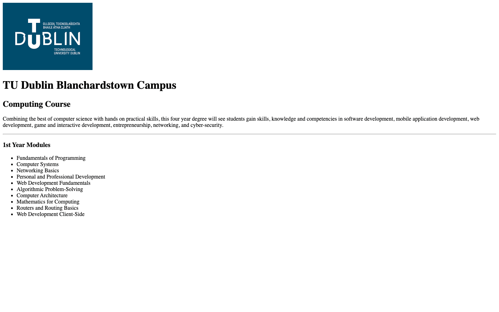
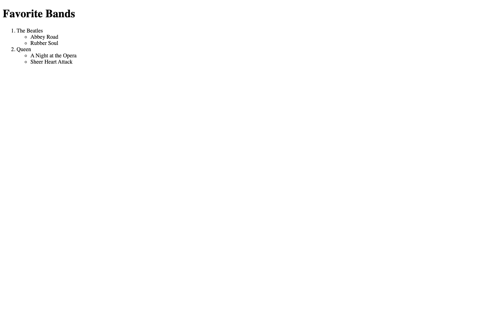
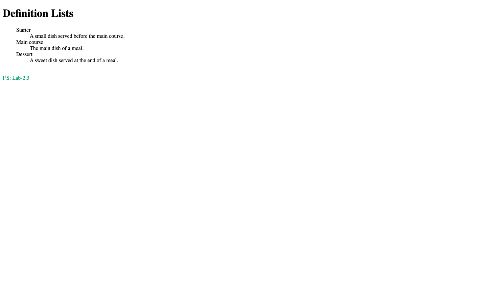

# Week 03 — Lab 2: college page, lists and definition lists

**Module:** Web Development Fundamentals (`COMP H1026`)  
**Semester:** 1 (Year 1), folder `sem01`

[Module README](../README.md)

## What this week is for

Lab 2: three exercises. A college page with a title, a logo, headings, a description, a horizontal rule and a list of first-year modules; a page with an ordered list of two bands and nested album lists; and a definition list for a restaurant menu.

<table>
  <tr valign="top">
    <td width="33%"> <i>Render of lab02ex1.html: TU Dublin logo, campus and course headings, course description, "1st Year Modules" list of ten modules.</i></td>
    <td width="33%"> <i>Render of lab02ex2.html: "Favorite Bands" with a numbered list of two bands (The Beatles, Queen), each with a list of two albums.</i></td>
    <td width="33%"> <i>Render of lab02ex3.html: "Definition Lists" with Starter (soup, garlic bread), Main course (pasta, chicken curry, pizza) and Dessert (brownie, apple pie, tiramisu).</i></td>
  </tr>
</table>

## Files

| File | What it contains |
|---|---|
| [`README.md`](README.md) | This README. |
| [`lab/web_development_fundamentals_week03_lab.pdf`](lab/web_development_fundamentals_week03_lab.pdf) | The lab brief (5 pages): a college page with an image and a modules list, nested lists, and definition lists (a restaurant menu). |
| [`lab/solution/images/TUDublin.png`](lab/solution/images/TUDublin.png) | The TU Dublin logo used by lab02ex1.html, as rendered in [`.screenshots/week03/screenshot_1.png`](../.screenshots/week03/screenshot_1.png). |
| [`lab/solution/lab02ex1.html`](lab/solution/lab02ex1.html) | College page: title "Computing TU Dublin", the logo, an H1 and an H2, a description, a horizontal rule, the H3 "1st Year Modules" and a list of ten modules. |
| [`lab/solution/lab02ex2.html`](lab/solution/lab02ex2.html) | Lists page: title "Lists", an ordered list of two bands, each with a nested list of two albums. |
| [`lab/solution/lab02ex3.html`](lab/solution/lab02ex3.html) | Definition list page: title "Definition Lists", with Starter, Main course and Dessert and their menu items (soup and garlic bread; pasta, chicken curry and pizza; brownie, apple pie and tiramisu). |
