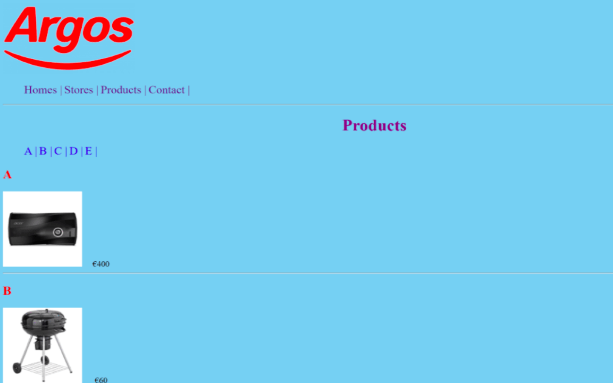
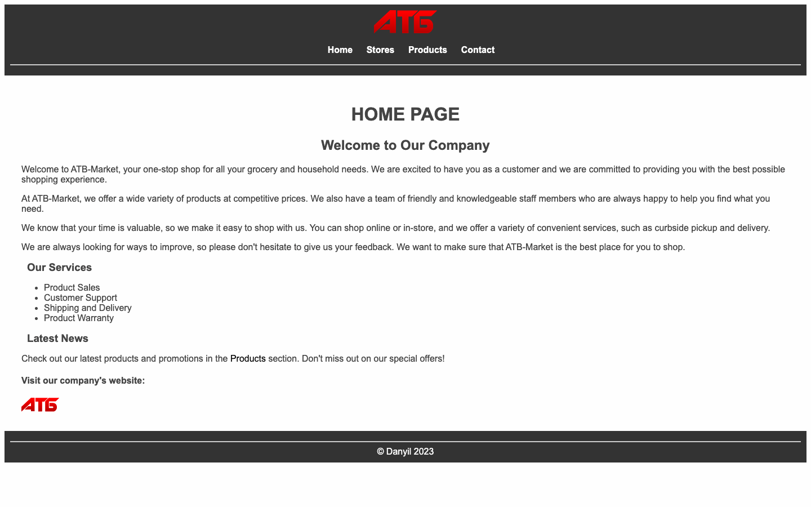
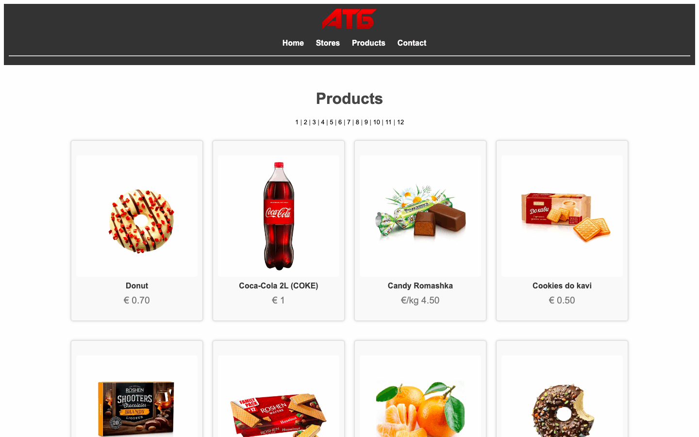
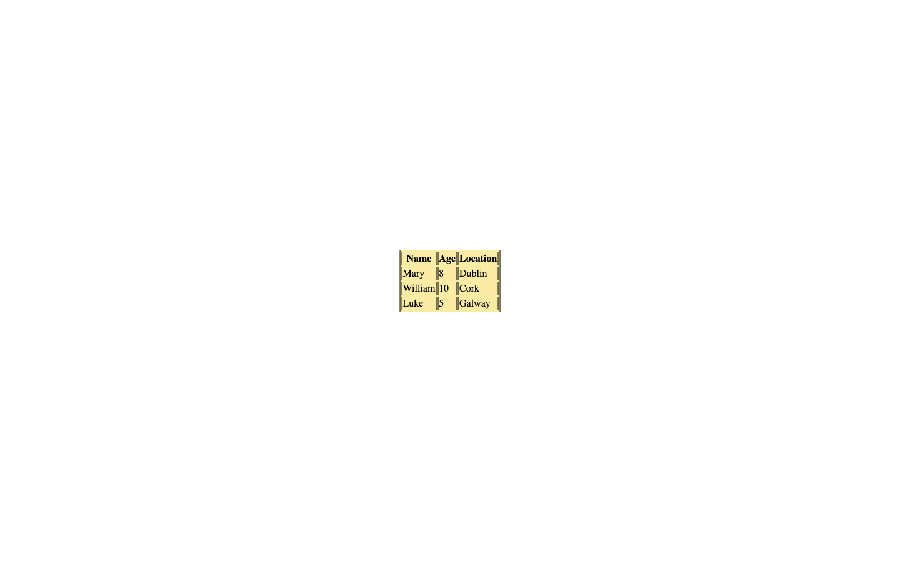

# Week 04 — Lab 3: linked pages, bookmarks and a table

**Module:** Web Development Fundamentals (`COMP H1026`)  
**Semester:** 1 (Year 1), folder `sem01`

[Module README](../README.md)

## What this week is for

Lab 3: four linked pages (home, stores, products and contact) with bookmarks, plus a table exercise. The solution is an ATB Market site, not the Argos sample in the sheet.

<table>
  <tr valign="top">
    <td width="25%"> <i>Sample products page from the lab brief (Argos branding, A–E bookmarks, two items). It is the brief's sample, not part of the solution; the brief says not to use Argos images.</i></td>
    <td width="25%"> <i>Render of ex1/index.html: ATB Market home page with logo, navigation (Home, Stores, Products, Contact), "HOME PAGE" heading, services list, latest news, external logo link, footer.</i></td>
    <td width="25%"> <i>Render of ex1/products.html: five ATB products with euro prices and the bookmarks A–E.</i></td>
    <td width="25%"> <i>Render of lab03ex2.html: table with Name, Age and Location for Mary, William and Luke, with a yellow background and black borders.</i></td>
  </tr>
</table>

## Files

| File | What it contains |
|---|---|
| [`README.md`](README.md) | This README. |
| [`lab/web_development_fundamentals_week04_lab.pdf`](lab/web_development_fundamentals_week04_lab.pdf) | The lab brief (6 pages): four linked pages (home, stores, products and contact) with bookmarks A to E, and a table exercise. |
| [`lab/solution/ex1/index.html`](lab/solution/ex1/index.html) | ATB Market home page: title "АТБ - Home", a header with the logo and navigation, the "HOME PAGE" heading, services, latest news, an external logo link and a footer ("© Danyil 2023"). |
| [`lab/solution/ex1/products.html`](lab/solution/ex1/products.html) | Products page: title "АТБ - Products", five products in alphabetical order with images, names and prices, and the bookmarks A to E. |
| [`lab/solution/ex1/stores.html`](lab/solution/ex1/stores.html) | Stores page: title "АТБ - Stores", three Kyiv addresses as links, and a Google Maps frame. |
| [`lab/solution/ex1/contact.html`](lab/solution/ex1/contact.html) | Contact page: title "АТБ - Contact", a form and the contact details of TU Dublin: the address (TU Dublin, Blanchardstown, Ireland) with a map link, a phone link (+353 1 220 5000) and an email link (hello@tudublin.ie). |
| [`lab/solution/ex1/index.css`](lab/solution/ex1/index.css) | Site stylesheet: body, header and navigation, the bookmark list, the product grid and flip cards, the contact form and the footer. |
| [`lab/solution/ex1/images/logo.svg`](lab/solution/ex1/images/logo.svg) | The ATB logo (a red SVG), used on every page of the site. |
| [`lab/solution/ex1/images/products/Buckwheat.webp`](lab/solution/ex1/images/products/Buckwheat.webp) | Product photo: Buckwheat Groats 1kg (€1), shown on products.html. |
| [`lab/solution/ex1/images/products/Coffee.webp`](lab/solution/ex1/images/products/Coffee.webp) | Product photo: Coffee (€0.20), shown on products.html. |
| [`lab/solution/ex1/images/products/Cookies.webp`](lab/solution/ex1/images/products/Cookies.webp) | Product photo: Cookies (€0.50), shown on products.html. |
| [`lab/solution/ex1/images/products/Pepper.webp`](lab/solution/ex1/images/products/Pepper.webp) | Product photo: Pepper (€0.20), shown on products.html. |
| [`lab/solution/ex1/images/products/Romashka.webp`](lab/solution/ex1/images/products/Romashka.webp) | Product photo: Candy Romashka (€4.50 per kg), shown on products.html. |
| [`lab/solution/ex2/lab03ex2.html`](lab/solution/ex2/lab03ex2.html) | Table page: title "Tables Example", linked to table.css, with a three-row table (Name, Age, Location). |
| [`lab/solution/ex2/table.css`](lab/solution/ex2/table.css) | Table style: background colour, positioning, and 1px black borders on the table, th and td. |
