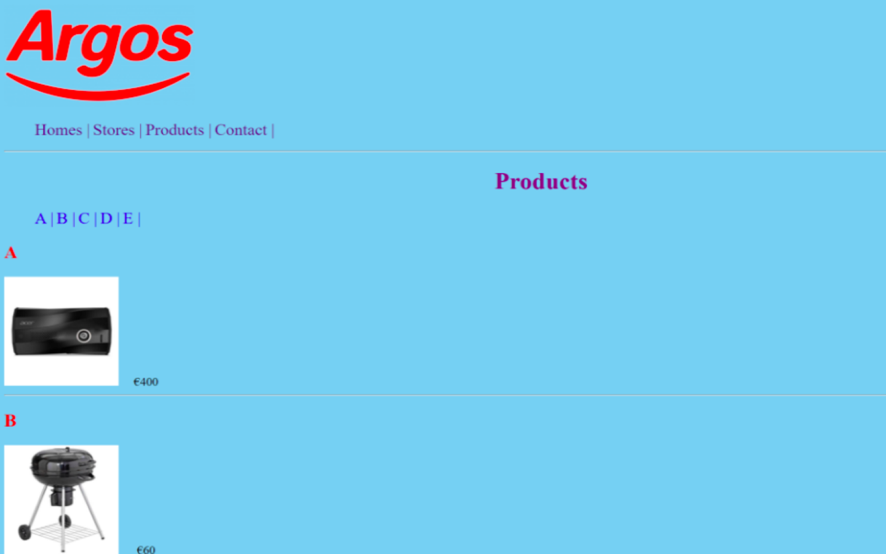
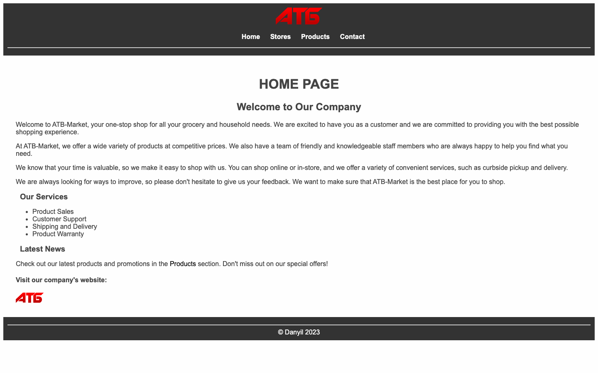
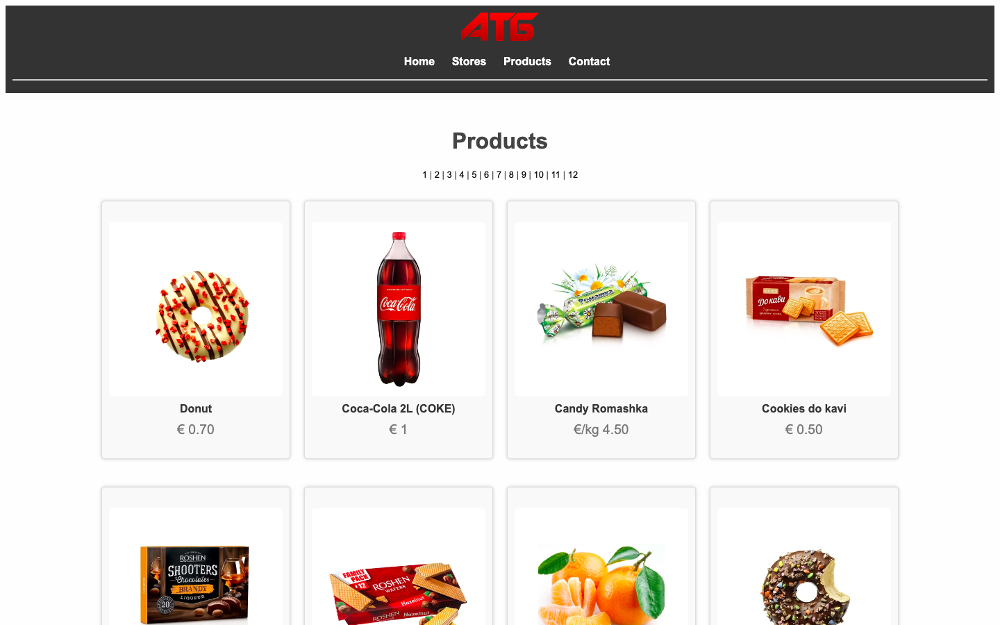
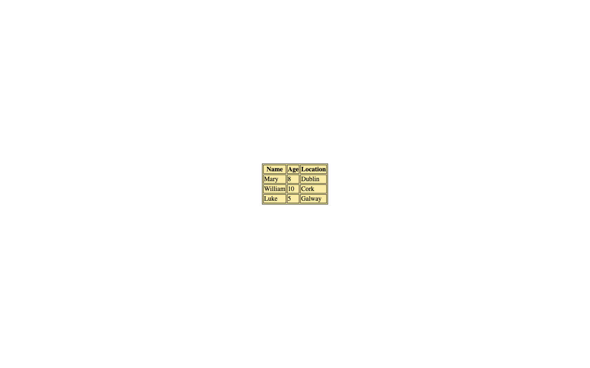

# Week 04 — Lab 3: linked pages, bookmarks and a table

**Module:** Web Development Fundamentals (`COMP H1026`)  
**Semester:** 1 (Year 1), folder `sem01`

[Module README](../README.md)

## What this week is for

Lab 3: four linked pages (home, stores, products and contact) with bookmarks, plus a table exercise. The solution is an ATB Market site, not the Argos sample in the sheet.

> [!WARNING]
> - [`lab/solution/ex1/products.html`](lab/solution/ex1/products.html): It has 12 products with numbered bookmarks 1 to 12, but the brief asks for 5 products with bookmarks A to E.
> - [`lab/solution/ex1/contact.html`](lab/solution/ex1/contact.html): It gives placeholder details (123 Main Street, City, Country; +123-456-7890; info@example.com), but the brief asks for a real email address.
> - [`lab/solution/ex1/index.html`](lab/solution/ex1/index.html): One closing tag is wrong: an h4 is closed with h3.
> - [`lab/solution/ex1/index.css`](lab/solution/ex1/index.css): One value is invalid: text-align: auto.

## Files

| File | What it contains | Screenshot |
|---|---|---|
| [`README.md`](README.md) | This README. | — |
| [`lab/web_development_fundamentals_week04_lab.pdf`](lab/web_development_fundamentals_week04_lab.pdf) | The lab brief (6 pages): four linked pages (home, stores, products and contact) with bookmarks A to E, and a table exercise. |  *Sample products page from the lab brief (Argos branding, A–E bookmarks, two items). It is the brief's sample, not part of the solution; the brief says not to use Argos images.* |
| [`lab/solution/ex1/index.html`](lab/solution/ex1/index.html) | ATB Market home page: title "АТБ - Home", a header with the logo and navigation, the "HOME PAGE" heading, services, latest news, an external logo link and a footer ("© Danyil 2023"). |  *Render of ex1/index.html: ATB Market home page with logo, navigation (Home, Stores, Products, Contact), "HOME PAGE" heading, services list, latest news, external logo link, footer.* |
| [`lab/solution/ex1/products.html`](lab/solution/ex1/products.html) | Products page: title "АТБ - Products", 12 products with images, names and prices, and numbered bookmarks 1 to 12. |  *Render of ex1/products.html: grid of ATB products with euro prices and numbered bookmarks 1–12.* |
| [`lab/solution/ex1/stores.html`](lab/solution/ex1/stores.html) | Stores page: title "АТБ - Stores", three Kyiv addresses as links, and a Google Maps frame. The H1 is closed with h2, and the dt tags are closed with li and dd. | — |
| [`lab/solution/ex1/contact.html`](lab/solution/ex1/contact.html) | Contact page: title "АТБ - Contact", a form and placeholder details (123 Main Street, City, Country; +123-456-7890; info@example.com). | — |
| [`lab/solution/ex1/index.css`](lab/solution/ex1/index.css) | Site stylesheet: body, header and navigation, the bookmark list, the product grid and flip cards, the contact form and the footer. | — |
| [`lab/solution/ex1/images/logo.svg`](lab/solution/ex1/images/logo.svg) | The ATB logo (a red SVG), used on every page of the site. | — |
| [`lab/solution/ex1/images/products/Buckwheat.webp`](lab/solution/ex1/images/products/Buckwheat.webp) | Product photo: Buckwheat Groats 1kg (€1), shown on products.html. | — |
| [`lab/solution/ex1/images/products/Candy.webp`](lab/solution/ex1/images/products/Candy.webp) | Product photo: Candy with liqueur (€1.50), shown on products.html. | — |
| [`lab/solution/ex1/images/products/Coca-Cola.webp`](lab/solution/ex1/images/products/Coca-Cola.webp) | Product photo: Coca-Cola 2L (€1), shown on products.html. | — |
| [`lab/solution/ex1/images/products/Coffee.webp`](lab/solution/ex1/images/products/Coffee.webp) | Product photo: Coffee (€0.20), shown on products.html. | — |
| [`lab/solution/ex1/images/products/Cookies.webp`](lab/solution/ex1/images/products/Cookies.webp) | Product photo: Cookies (€0.50), shown on products.html. | — |
| [`lab/solution/ex1/images/products/Donut.webp`](lab/solution/ex1/images/products/Donut.webp) | Product photo: Donut (€0.70), shown on products.html. | — |
| [`lab/solution/ex1/images/products/DonutB.webp`](lab/solution/ex1/images/products/DonutB.webp) | Product photo: Bitten Donut (€0.50), shown on products.html. | — |
| [`lab/solution/ex1/images/products/Mandarin.webp`](lab/solution/ex1/images/products/Mandarin.webp) | Product photo: Mandarin (€2 per kg), shown on products.html. | — |
| [`lab/solution/ex1/images/products/Pepper.webp`](lab/solution/ex1/images/products/Pepper.webp) | Product photo: Pepper (€0.20), shown on products.html. | — |
| [`lab/solution/ex1/images/products/Romashka.webp`](lab/solution/ex1/images/products/Romashka.webp) | Product photo: Candy Romashka (€4.50 per kg), shown on products.html. | — |
| [`lab/solution/ex1/images/products/Wafers.webp`](lab/solution/ex1/images/products/Wafers.webp) | Product photo: Hazelnut wafers (€1), shown on products.html. | — |
| [`lab/solution/ex1/images/products/Water.webp`](lab/solution/ex1/images/products/Water.webp) | Product photo: Water 0.75 L (€0.40), shown on products.html. | — |
| [`lab/solution/ex2/lab03ex2.html`](lab/solution/ex2/lab03ex2.html) | Table page: title "Tables Example", linked to table.css, with a three-row table (Name, Age, Location). |  *Render of lab03ex2.html: table with Name, Age and Location for Mary, William and Luke, with a yellow background and black borders.* |
| [`lab/solution/ex2/table.css`](lab/solution/ex2/table.css) | Table style: background colour, positioning, and 1px black borders on the table, th and td. | — |
