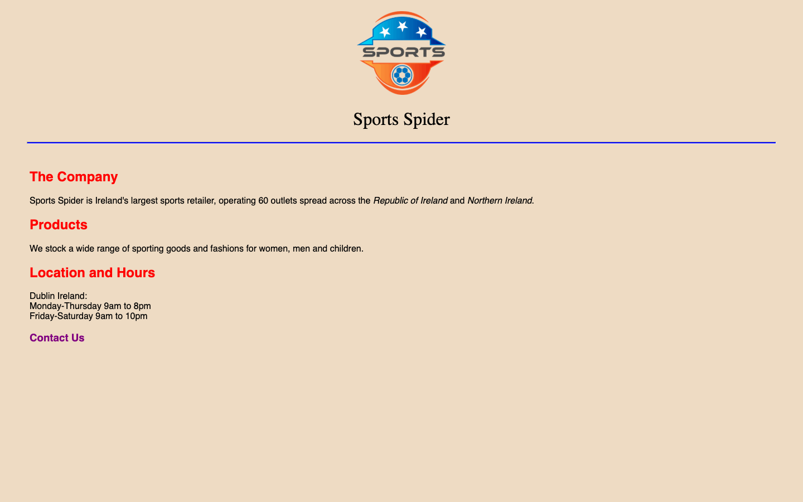
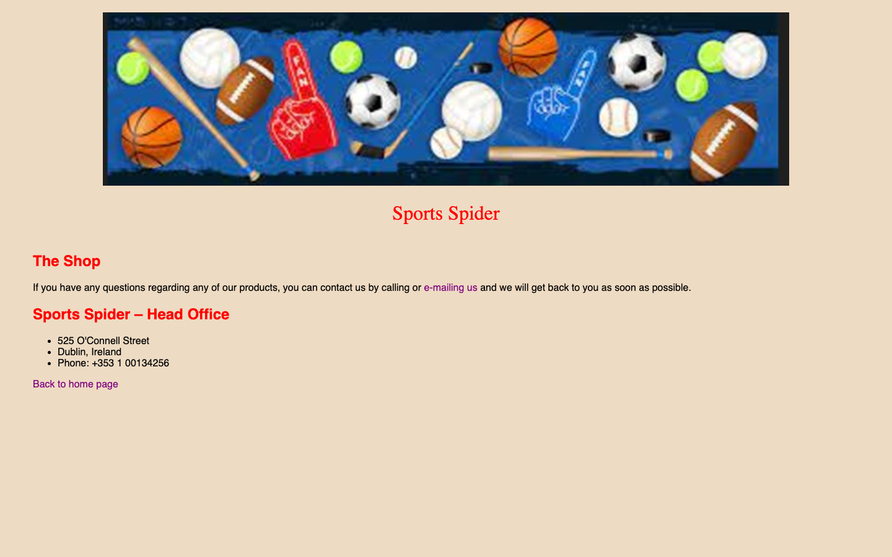

# Week 05 — Lab 4: Sport Spider pages and styles

**Module:** Web Development Fundamentals (`COMP H1026`)  
**Semester:** 1 (Year 1), folder `sem01`

[Module README](../README.md)

## What this week is for

Lab 4: a Sport Spider home page and contact page, styled with colours, fonts, italics and link styles.

<table>
  <tr valign="top">
    <td width="50%"> <i>Render of week05 index.html: Sport Spider home with logo, red headings, italic country names and a purple "Contact Us" link. The body text is sans-serif and the "Sports Spider" heading is serif.</i></td>
    <td width="50%"> <i>Render of week05 contact.html: banner, red "Sports Spider" heading, "The Shop", head-office list, "Back to home page" link.</i></td>
  </tr>
</table>

## Files

| File | What it contains |
|---|---|
| [`README.md`](README.md) | This README. |
| [`lab/web_development_fundamentals_week05_lab.pdf`](lab/web_development_fundamentals_week05_lab.pdf) | The lab brief (4 pages): Sport Spider home and contact pages, with colours, fonts, italics and link styles (purple, yellow, red and green). |
| [`lab/solution/index.html`](lab/solution/index.html) | Sport Spider home page: title "Sport Spider", the logo, the "Sports Spider" heading, The Company, Products, Location and Hours, and a Contact Us link. |
| [`lab/solution/contact.html`](lab/solution/contact.html) | Contact page: title "Contact Us", a banner, "The Shop", the head-office list and "Back to home page". |
| [`lab/solution/css/sport.css`](lab/solution/css/sport.css) | Sport Spider stylesheet. The body is sans-serif and the "Sports Spider" heading is serif. The links are purple, yellow (visited), red (hover) and green (active). The h2 headings and the red class are red, and the italic spans are set. |
| [`lab/solution/images/banner.jpg`](lab/solution/images/banner.jpg) | The sports banner photo, shown on the contact page. |
| [`lab/solution/images/sport.png`](lab/solution/images/sport.png) | The Sport Spider logo, shown on the home page. |
