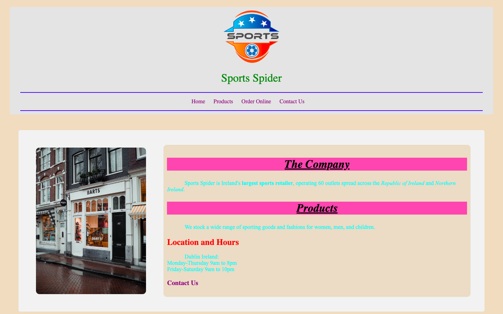

# Week 06 — Lab 5: page structure and styling

**Module:** Web Development Fundamentals (`COMP H1026`)  
**Semester:** 1 (Year 1), folder `sem01`

[Module README](../README.md)

## What this week is for

Lab 5: structure for the Sport Spider home page, with header, main and footer tags, a navigation bar, and id, class, div and span styling.

> [!WARNING]
> The solution follows most of the brief, with these exceptions:
>
> - [`lab/solution/index.html`](lab/solution/index.html): The one bold phrase uses the b tag, but the brief asks for span.
> - [`lab/solution/css/sport.css`](lab/solution/css/sport.css): The small-caps rule is written as a text-transform value, which is not valid CSS.

## Screenshots

*Render of week06 index.html: header with logo and navigation, two-column main with the shop photo, pink headings, cyan paragraphs.*

## Files

| File | What it contains |
|---|---|
| [`README.md`](README.md) | This README. |
| [`lab/web_development_fundamentals_week06_lab.pdf`](lab/web_development_fundamentals_week06_lab.pdf) | The lab brief (3 pages): structure with header, main and footer tags; a navigation bar; id, class, div and span styling. |
| [`lab/solution/index.html`](lab/solution/index.html) | Week 6 home page: a header with the logo and navigation (Home, Products, Order Online, Contact Us), a main section with the shop photo and company text in div and span markup, and a footer with contact details. |
| [`lab/solution/contact.html`](lab/solution/contact.html) | Contact page: title "Contact Us", a banner, a header, the shop text, the head-office list and "Back to home page". |
| [`lab/solution/css/sport.css`](lab/solution/css/sport.css) | Week 6 stylesheet: header, main and footer colours, a two-column layout, hot-pink class headings, cyan div paragraphs and the footer rules. |
| [`lab/solution/images/banner.jpg`](lab/solution/images/banner.jpg) | The same banner as week 5 (an identical file). |
| [`lab/solution/images/shop.jpg`](lab/solution/images/shop.jpg) | The shop-front photo (a BARTS store on an Amsterdam street, 3.3 MB), shown in the main section. |
| [`lab/solution/images/sport.png`](lab/solution/images/sport.png) | The same logo as week 5 (an identical file). |
