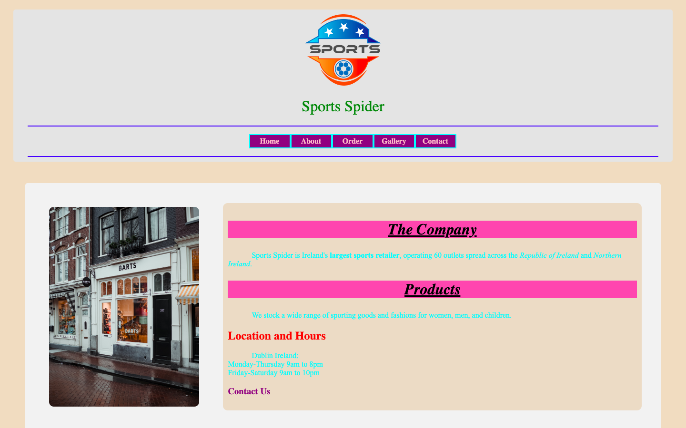
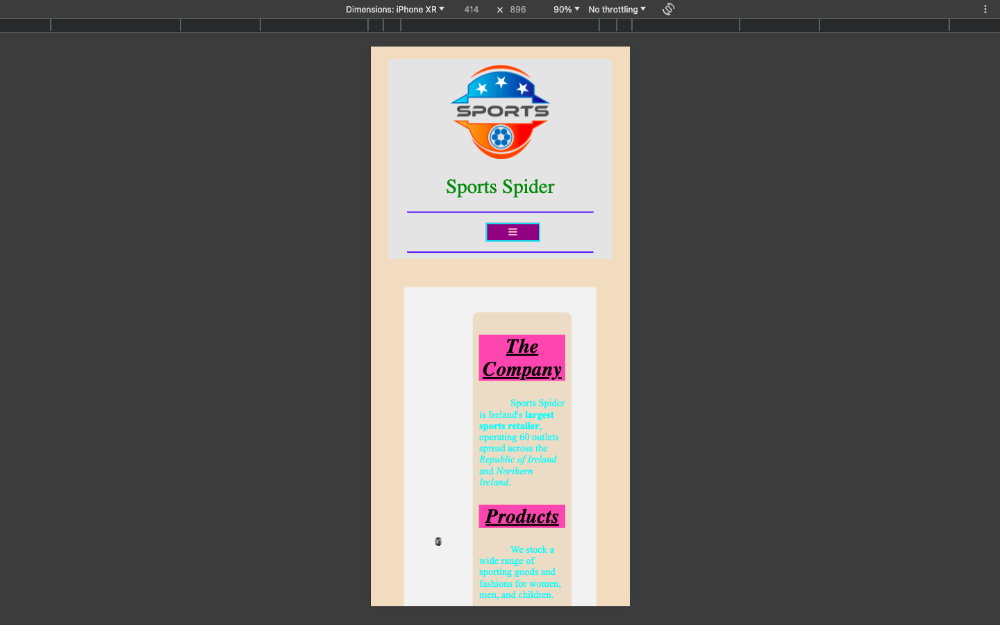

# Week 08 — Lab 6: navigation bar and responsive menu

**Module:** Web Development Fundamentals (`COMP H1026`)  
**Semester:** 1 (Year 1), folder `sem01`

[Module README](../README.md)

## What this week is for

Lab 6: a navigation bar. A horizontal menu with pink links on purple and a cyan border, a responsive version that shows a hamburger icon on small screens, and linked pages for About Us, Gallery and Order Online. The menu uses a short JavaScript function to show and hide the links.

> [!WARNING]
> [`lab/solution/contact.html`](lab/solution/contact.html): A second header is nested inside the first, which is invalid HTML.

## Screenshots

*Render of week08 index.html: horizontal navigation bar (Home, About, Order, Gallery, Contact) with pink text, purple background and cyan borders.*

*Phone-size view (414 × 896) of week08 index.html: the navigation collapses to a hamburger icon.*

## Files

| File | What it contains |
|---|---|
| [`README.md`](README.md) | This README. |
| [`lab/web_development_fundamentals_week08_lab.pdf`](lab/web_development_fundamentals_week08_lab.pdf) | The lab brief (3 pages): a horizontal navigation bar, a responsive menu with a hamburger icon, and linked pages (About Us and others). |
| [`lab/solution/index.html`](lab/solution/index.html) | Week 8 home page: a navigation bar (Home, About, Order, Gallery, Contact) with a hamburger link, Font Awesome loaded from a CDN, a company section and a footer. |
| [`lab/solution/about.html`](lab/solution/about.html) | About Us page: navigation and placeholder text ("This is the About Us page. Add information about your company here."). |
| [`lab/solution/contact.html`](lab/solution/contact.html) | Contact page: navigation, the shop text and the contact details. |
| [`lab/solution/gallery.html`](lab/solution/gallery.html) | Gallery page: navigation and placeholder text ("This is the Gallery page..."). |
| [`lab/solution/order.html`](lab/solution/order.html) | Order Online page: navigation and placeholder text ("This is the Order Online page..."). |
| [`lab/solution/css/nav.css`](lab/solution/css/nav.css) | Navigation styles: centred horizontal links (pink on purple, with a cyan 2px border), colours swapped on hover and when active, and a media query that shows a hamburger menu below 600 px. |
| [`lab/solution/script.js`](lab/solution/script.js) | One function, myFunction(), which toggles the responsive class on the navigation bar. |
| [`lab/solution/images/banner.jpg`](lab/solution/images/banner.jpg) | The same banner as week 5 (an identical file). |
| [`lab/solution/images/shop.jpg`](lab/solution/images/shop.jpg) | The same shop photo as week 6 (an identical file). |
| [`lab/solution/images/sport.png`](lab/solution/images/sport.png) | The same logo as week 5 (an identical file). |
