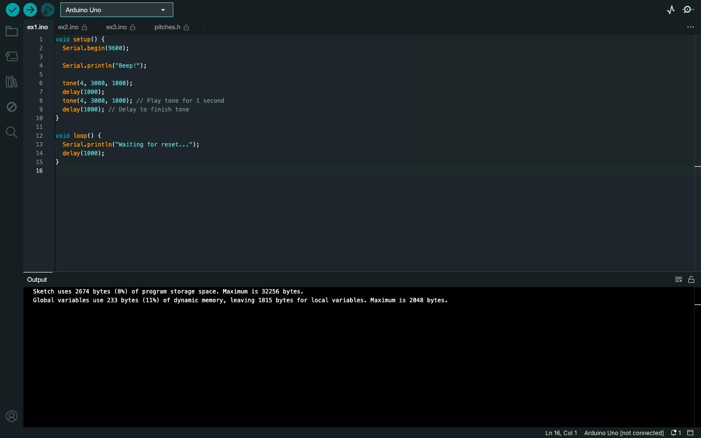
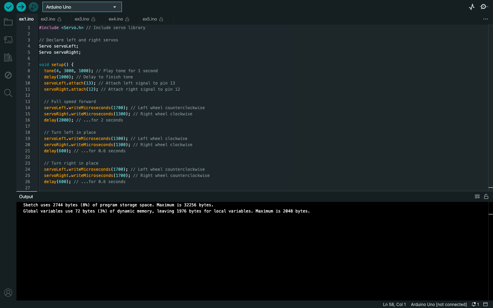
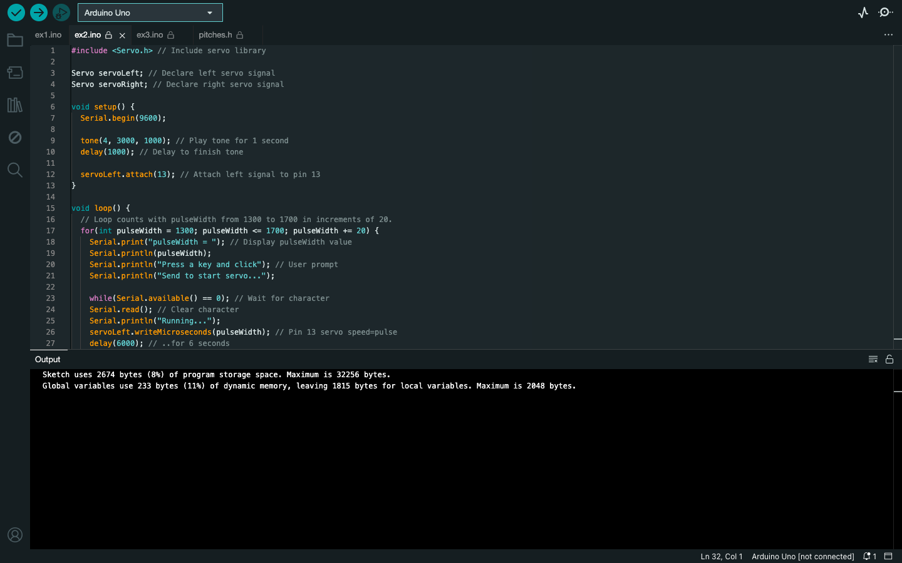
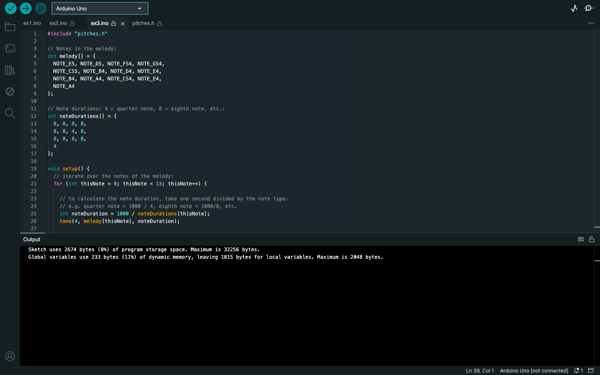
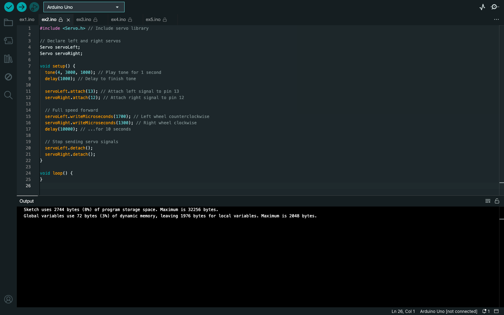
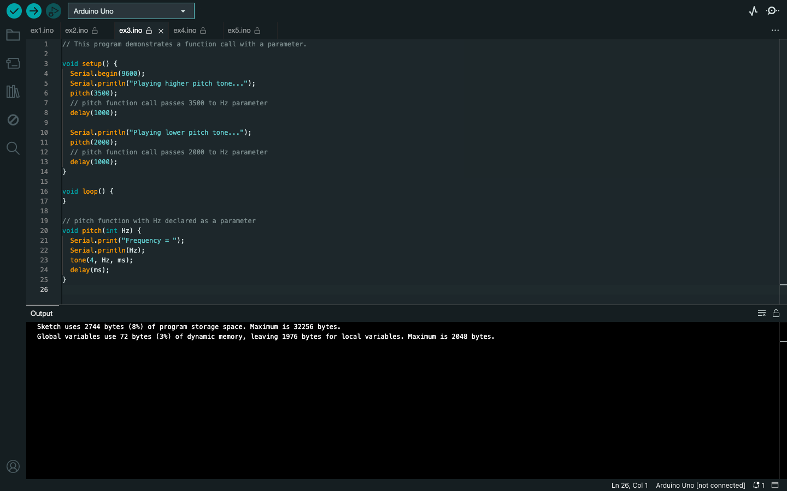
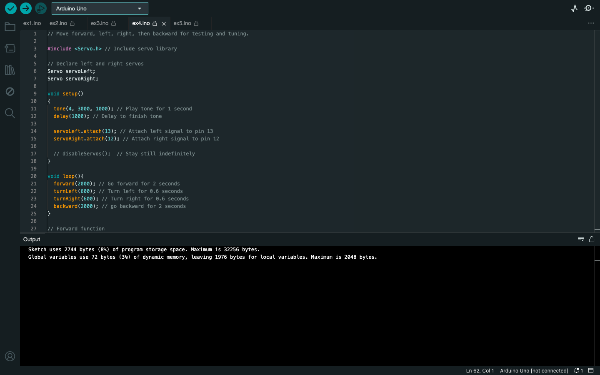
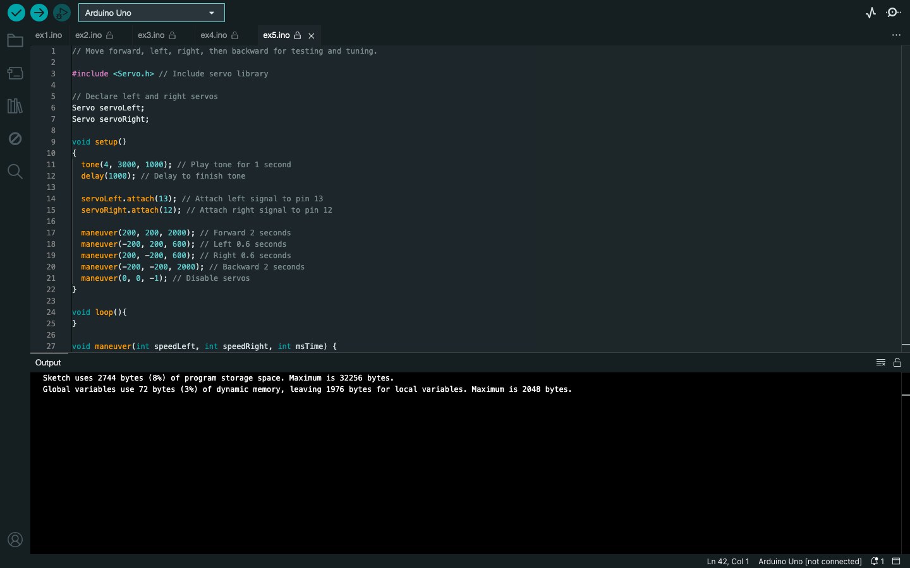
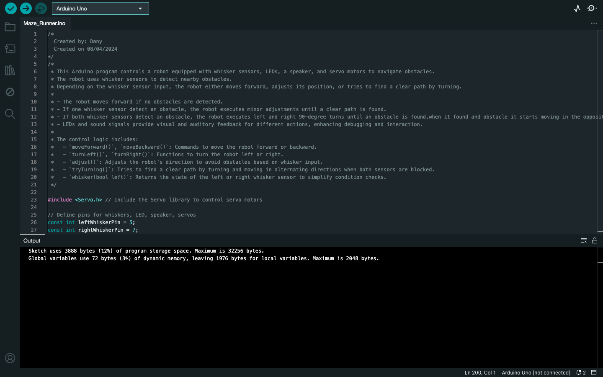

# Computer Architecture

**Module:** Computer Architecture (`COMP H1027`)  
**Semester:** 2 (Year 1), folder `sem02`  
**Lecturer:** Gerome Donnelly  
**Date:** January - May 2024  
**Credits:** 5 ECTS  
**Matching project branch:** [`project/year01/module-computer_architecture/maze-runner`](https://github.com/DanyilT/projects-in-university/tree/project/year01/module-computer_architecture/maze-runner) (the Maze Runner project)

## What this module is for

Computer Architecture is a hands-on module about controlling hardware with an Arduino Uno and the BOE Shield-Bot, a small robot with two servo wheels. The labs go through the Arduino software and sketches (functions, variables, conditions and loops), LED circuits with resistors, servo signals and wheel control, programming the robot's movements, and whisker switches for sensing obstacles. Week 1 has no labs. The assessments are the Maze Runner project (20%), a group project in which the bot finds its way through a maze using its whiskers, and an MCQ test in week 11, which is not in the repository. This folder has the sketches and screenshots for weeks 2 and 4 to 8, and the Maze Runner code is on its branch.

## Grades Breakdown

| Assessment Type | Weighting |
|---|---|
| Weekly Labs | idk |
| CA (MCQ Test) | idk |
| Project | 20% |

## All weeks

| Week | Title | Files | Screenshot |
|---|---|---|---|
| Week 1 | No labs week | None. | — |
| [Week 2](week02/) | Lab 1: Introduction | [`lab/computer_architecture_week02_lab.pdf`](week02/lab/computer_architecture_week02_lab.pdf) [`lab/solution/ex1/ex1.ino`](week02/lab/solution/ex1/ex1.ino) [`lab/solution/ex2/ex2.ino`](week02/lab/solution/ex2/ex2.ino) [`lab/solution/ex3/ex3.ino`](week02/lab/solution/ex3/ex3.ino) [`lab/solution/ex4/ex4.ino`](week02/lab/solution/ex4/ex4.ino) [`lab/solution/ex5/ex5.ino`](week02/lab/solution/ex5/ex5.ino) [`lab/solution/ex6/ex6.ino`](week02/lab/solution/ex6/ex6.ino) [`lab/solution/ex7/ex7.ino`](week02/lab/solution/ex7/ex7.ino) |  |
| [Week 4](week04/) | Lab 2: Shield, resistors and LEDs | [`lab/computer_architecture_week04_lab.pdf`](week04/lab/computer_architecture_week04_lab.pdf) [`lab/solution/ex1/ex1.ino`](week04/lab/solution/ex1/ex1.ino) [`lab/solution/ex2/ex2.ino`](week04/lab/solution/ex2/ex2.ino) [`lab/solution/ex3/ex3.ino`](week04/lab/solution/ex3/ex3.ino) [`lab/solution/ex4/ex4.ino`](week04/lab/solution/ex4/ex4.ino) |  |
| [Week 5](week05/) | Lab 3: LED servo signal monitors | [`lab/computer_architecture_week05_lab.pdf`](week05/lab/computer_architecture_week05_lab.pdf) [`lab/solution/ex1/ex1.ino`](week05/lab/solution/ex1/ex1.ino) [`lab/solution/ex2/ex2.ino`](week05/lab/solution/ex2/ex2.ino) |  |
| [Week 6](week06/) | Lab 4: attach the BOE Shield to the chassis | [`lab/computer_architecture_week06_lab.pdf`](week06/lab/computer_architecture_week06_lab.pdf) [`lab/solution/ex1/ex1.ino`](week06/lab/solution/ex1/ex1.ino) [`lab/solution/ex2/ex2.ino`](week06/lab/solution/ex2/ex2.ino) [`lab/solution/ex3/ex3.ino`](week06/lab/solution/ex3/ex3.ino) [`lab/solution/ex3/pitches.h`](week06/lab/solution/ex3/pitches.h) |  |
| [Week 7](week07/) | Lab 5: programming strategies for the Shield-Bot | [`lab/computer_architecture_week07_lab.pdf`](week07/lab/computer_architecture_week07_lab.pdf) [`lab/solution/ex1/ex1.ino`](week07/lab/solution/ex1/ex1.ino) [`lab/solution/ex2/ex2.ino`](week07/lab/solution/ex2/ex2.ino) [`lab/solution/ex3/ex3.ino`](week07/lab/solution/ex3/ex3.ino) [`lab/solution/ex4/ex4.ino`](week07/lab/solution/ex4/ex4.ino) [`lab/solution/ex5/ex5.ino`](week07/lab/solution/ex5/ex5.ino) The MCQ test is in week 11, not in this week. |  |
| [Week 8](week08/) | Lab 6: tactile navigation with whiskers | [`lab/computer_architecture_week08_lab.pdf`](week08/lab/computer_architecture_week08_lab.pdf) [`lab/solution/ex1/ex1.ino`](week08/lab/solution/ex1/ex1.ino) [`lab/solution/ex2/ex2.ino`](week08/lab/solution/ex2/ex2.ino) [`lab/solution/ex3/ex3.ino`](week08/lab/solution/ex3/ex3.ino) |  |
| Week 11 | CA: MCQ test | None. | — |

## Assessments and other files

| File | What it contains |
|---|---|
| [`assessment/01/computer_architecture_assessment.pdf`](assessment/01/) | The Maze Runner brief (2 pages): a group project of up to three students, worth 20%. The code must be uploaded by Monday 22 April 2024 at 09:00. The bot must navigate a maze in person, using the whisker code to detect obstacles and turns; it lights an LED and sounds a bleep when a whisker is hit, and beeps while reversing. |
| [`assessment/01/submission/project_link.txt`](assessment/01/submission/project_link.txt) | Two lines: the GitHub link to the Maze Runner project folder, and the branch name. |

---

## Weeks
- [Weeks](#weeks)
    - [Week 1](#week-1-no-labs-week): No labs week
    - [Week 2 (Lab 1)](#week-2-lab-1-introduction): Introduction
    - [Week 4 (Lab 2)](#week-4-lab-2-shield-resistors-and-leds): Shield, Resistors and LEDs
    - [Week 5 (Lab 3)](#week-5-lab-3-led-servo-signal-monitors): LED Servo Signal Monitors
    - [Week 6 (Lab 4)](#week-6-lab-4-attach-the-boe-shield-to-the-chassis): Attach the BOE Shield to the Chassis
    - [Week 7 (Lab 5)](#week-7-lab-5-programming-strategies-for-boe-shield-bot): Programming Strategies for BOE Shield-Bot
    - [Week 8 (Lab 6)](#week-8-lab-6-tactile-navigation-with-whiskers): Tactile Navigation with Whiskers
    - [Week 11 (CA)](#week-11-ca-mcq-test): MCQ Test
- [Project](#project)
    - [Arduino Uno Vehicle Maze Navigation](#maze-runner)

### Week 1: No labs week
> Intruduction week, no labs

### [Week 2 (Lab 1)](./week02/lab/): Introduction
[Task](./week02/lab/computer_architecture_week02_lab.pdf) | [Solution (.ino)](./week02/lab/solution/)

This lab introduces the Arduino Uno and the BOE Shield-Bot. How to set up the Arduino Development Environment, write and upload basic sketches, and understand fundamental programming concepts such as functions, variables, and loops. The lab also covers arithmetic, decisions with if and else, loops with for and while, and constants and comments.
- [ex1](./week02/lab/solution/ex1/ex1.ino)
    
- [ex2](./week02/lab/solution/ex2/ex2.ino)
    
- [ex3](./week02/lab/solution/ex3/ex3.ino)
    
- [ex4](./week02/lab/solution/ex4/ex4.ino)
    
- [ex5](./week02/lab/solution/ex5/ex5.ino)
    
- [ex6](./week02/lab/solution/ex6/ex6.ino)
    
- [ex7](./week02/lab/solution/ex7/ex7.ino)
    

### [Week 4 (Lab 2)](./week04/lab/): Shield, Resistors and LEDs
[Task](./week04/lab/computer_architecture_week04_lab.pdf) | [Solution (.ino)](./week04/lab/solution/)

This lab focuses on using the BOE Shield to build and test circuits with resistors and LEDs. The basics of building circuits, understanding resistor color codes, and making the Arduino interact with these circuits. The lab includes activities for setting up the BOE Shield, building and testing LED indicator lights, and programming the Arduino to control the LEDs.
- [ex1](./week04/lab/solution/ex1/ex1.ino)
    
- [ex2](./week04/lab/solution/ex2/ex2.ino)
    
- [ex3](./week04/lab/solution/ex3/ex3.ino)
    
- [ex4](./week04/lab/solution/ex4/ex4.ino)
    

### [Week 5 (Lab 3)](./week05/lab/): LED Servo Signal Monitors
[Task](./week05/lab/computer_architecture_week05_lab.pdf) | [Solution (.ino)](./week05/lab/solution/)

This lab covers the use of LEDs to monitor servo signals. How to generate servo control signals using the Arduino, understand the importance of precise timing for servo motor control, and use the Arduino Servo library for more accurate and efficient signal generation. The lab includes activities for setting up and testing servo signals, connecting servos to the BOE Shield, and controlling servo speed and direction.
- [ex1](./week05/lab/solution/ex1/ex1.ino)
    
- [ex2](./week05/lab/solution/ex2/ex2.ino)
    

### [Week 6 (Lab 4)](./week06/lab/): Attach the BOE Shield to the Chassis
[Task](./week06/lab/computer_architecture_week06_lab.pdf) | [Solution (.ino)](./week06/lab/solution/)

This lab involves attaching the BOE Shield to the chassis and testing the servos to ensure proper electrical connections. How to build a start-reset indicator circuit, program the Arduino to control servo motors, and test servo speed and direction. The lab includes activities for assembling the BOE Shield-Bot, connecting the battery pack, and using a piezospeaker to play some sounds.
- [ex1](./week06/lab/solution/ex1/ex1.ino)
    
- [ex2](./week06/lab/solution/ex2/ex2.ino)
    
- [ex3](./week06/lab/solution/ex3/ex3.ino)
    

### [Week 7 (Lab 5)](./week07/lab/): Programming Strategies for BOE Shield-Bot
[Task](./week07/lab/computer_architecture_week07_lab.pdf) | [Solution (.ino)](./week07/lab/solution/)
> The MCQ test is in week 11, not in this week.

This lab introduces different programming strategies to make the BOE Shield-Bot move. How to control the BOE Shield-Bot's movements, including moving forward, backward, rotating, and pivoting. The lab also covers creating functions for each maneuver to simplify navigation and improve code reusability.
- [ex1](./week07/lab/solution/ex1/ex1.ino)
    
- [ex2](./week07/lab/solution/ex2/ex2.ino)
    
- [ex3](./week07/lab/solution/ex3/ex3.ino)
    
- [ex4](./week07/lab/solution/ex4/ex4.ino)
    
- [ex5](./week07/lab/solution/ex5/ex5.ino)
    

### [Week 8 (Lab 6)](./week08/lab/): Tactile Navigation with Whiskers
[Task](./week08/lab/computer_architecture_week08_lab.pdf) | [Solution (.ino)](./week08/lab/solution/)

This lab introduces tactile navigation using whisker switches. Build and test whisker circuits, program the BOE Shield-Bot to monitor whisker states, and implement autonomous navigation by touch. The lab includes activities for building whisker circuits, testing whisker inputs, and programming the BOE Shield-Bot to respond to obstacles using whisker inputs.
- [ex1](./week08/lab/solution/ex1/ex1.ino)
    
- [ex2](./week08/lab/solution/ex2/ex2.ino)
    
- [ex3](./week08/lab/solution/ex3/ex3.ino)
    

### Week 11 (CA): MCQ Test
> Multiple Choice Questions (MCQ) Test covering all topics from this module.

## Project
This is have to be the final project for the module.

### [Maze Runner](./assessment/01/)
**Deadline:** Monday, April 22, 2024 @ 09:00

> [!IMPORTANT]  
> The project is located on [`project/year01/module-computer_architecture/maze-runner`](https://github.com/DanyilT/projects-in-university/tree/project/year01/module-computer_architecture/maze-runner) branch.  
> Please switch to this branch to see the project files.  
> This branch contains my Arduino code (.ino) and README describing the project. 

[Task](./assessment/01/computer_architecture_assessment.pdf) | [Submission](./assessment/01/submission/project_link.txt)

This is a code for Arduino Uno Vechile to navigate through a maze. The vehicle is equipped with two servo motors (one for each wheel) and whisker switches to detect obstacles and navigate around them. The code uses a combination of servo control, whisker input monitoring, and decision-making logic to guide the vehicle through the maze autonomously.

_Note: this version of the bot did not successfully complete the maze, but implements the required sensor, LED, and audio logic._

