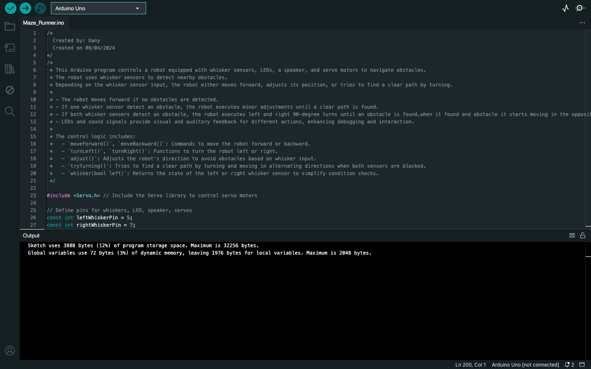

# Assessment 1: Maze Runner

**Module:** Computer Architecture (`COMP H1027`)  
**Semester:** 2 (Year 1), folder `sem02`  
**Type:** project (Arduino), group of up to 3  
**Weight:** 20%  
**Deadline:** Monday 22 April 2024, 09:00 (code upload), with a demonstration in the week beginning 22 April  
**Result:** —  
**On main:** [`sem02/computer_architecture/assessment/01/`](https://github.com/DanyilT/projects-in-university/tree/main/sem02/computer_architecture/assessment/01) (the brief, the link to the project, the screenshot and this README)  
**Branch:** [`project/year01/module-computer_architecture/maze-runner`](https://github.com/DanyilT/projects-in-university/tree/project/year01/module-computer_architecture/maze-runner) (the Arduino sketch with its README and licence)  
**Repository:** —

[Module README](../../README.md)

## What this assessment is for

The project of the module (20%) is code for the BOE Shield-Bot, a robot with an Arduino Uno, two servo wheels, whisker switches, two LEDs and a speaker. The bot has to find its way through a maze with one entry and one exit, and the logic has to work for any similar maze. When a whisker meets an obstacle, the bot lights an LED and sounds a bleep before turning, and when it reverses it sounds a series of beeps. The code has to be well structured, with functions and loops, and fully commented, and it carries a comment at the top with the group members and the lab group number. Every member uploads a copy of the code by Monday 22 April 2024 at 09:00 (15% off for each day late), and the bot is demonstrated in the maze in person; without a demonstration the mark is 0%.

The submitted project is one Arduino sketch, created on 08/04/2024. The loop reads the two whiskers: with both pressed it calls `tryTurning`, with one pressed it calls `adjust`, and with none pressed it moves forward. The other functions are `moveForward`, `moveBackward` (beeps while reversing), `turnLeft` and `turnRight` (each lights its LED and sounds a bleep), and `whisker`, which reads one whisker. The bot did not complete the maze; the whisker, LED and speaker logic is in place.

*The Maze Runner sketch in the Arduino IDE (board: Arduino Uno): the header comment, the first pin constants and the compile output, 3888 bytes (12%) of program storage.*

## Files

| File | What it contains |
|---|---|
| [`README.md`](README.md) | This README. |
| [`computer_architecture_assessment.pdf`](computer_architecture_assessment.pdf) | The Maze Runner brief (2 pages): a group project of up to three, worth 20%. The code must be uploaded by Monday 22 April 2024 at 09:00. The bot must navigate a maze in person, using the whisker code to detect obstacles and turns; it lights an LED and sounds a bleep when a whisker is hit, and beeps while reversing. |
| [`submission/project_link.txt`](submission/project_link.txt) | Two lines: the GitHub link to the Maze Runner project folder, and the branch name. |
