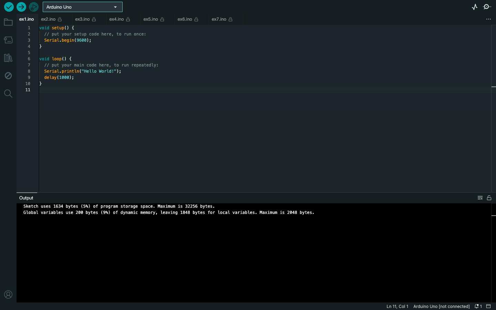
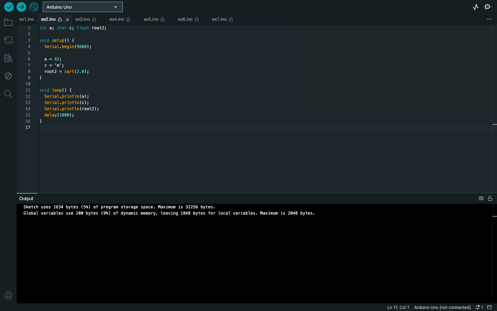
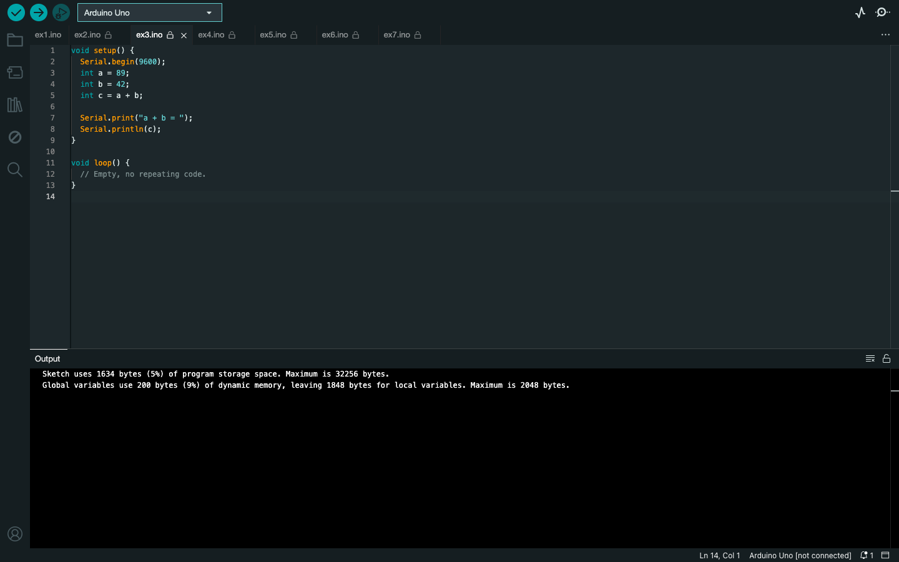
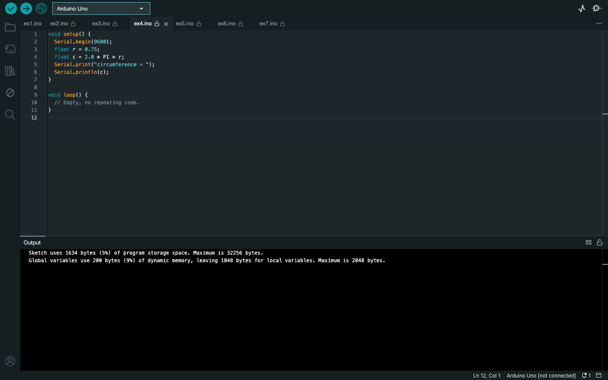
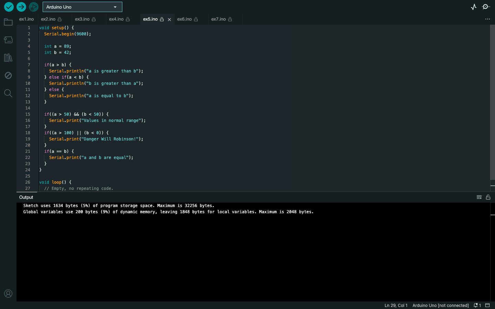
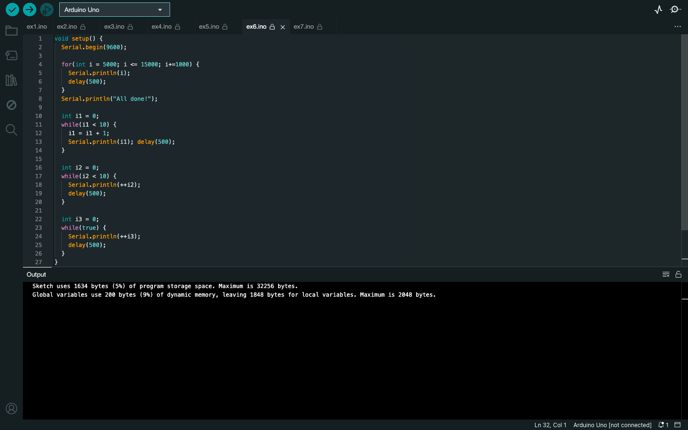
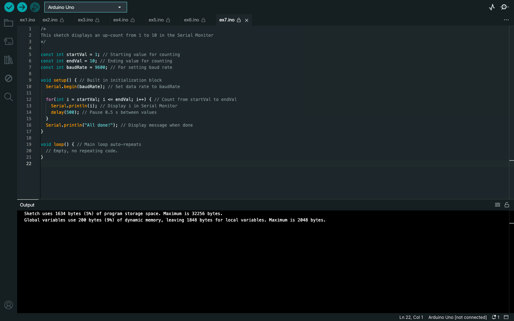

# Week 02 — Lab 1: Introduction

**Module:** Computer Architecture (`COMP H1027`)  
**Semester:** 2 (Year 1), folder `sem02`

[Module README](../README.md)

## What this week is for

Lab 1 introduces the Arduino Uno and the Shield-Bot: setting up the Arduino software, uploading sketches, and the basics of functions, variables, arithmetic, decisions and loops. The solution has seven small sketches (ex1 to ex7), from printing Hello World to counting with for and while loops.

## Files

| File | What it contains | Screenshot |
|---|---|---|
| [`README.md`](README.md) | This README. | — |
| [`lab/computer_architecture_week02_lab.pdf`](lab/computer_architecture_week02_lab.pdf) | The lab sheet (19 pages): the Arduino and Shield-Bot introduction and the activities. | — |
| [`lab/solution/ex1/ex1.ino`](lab/solution/ex1/ex1.ino) | Prints Hello World! to the Serial Monitor once a second. |  *Arduino IDE showing ex1.ino.* |
| [`lab/solution/ex2/ex2.ino`](lab/solution/ex2/ex2.ino) | Stores 42, the character m and the square root of 2, and prints them once a second. |  *Arduino IDE showing ex2.ino.* |
| [`lab/solution/ex3/ex3.ino`](lab/solution/ex3/ex3.ino) | Adds 89 and 42 and prints the sum (131) once. |  *Arduino IDE showing ex3.ino.* |
| [`lab/solution/ex4/ex4.ino`](lab/solution/ex4/ex4.ino) | Calculates the circumference of a circle with radius 0.75 and prints it once. |  *Arduino IDE showing ex4.ino.* |
| [`lab/solution/ex5/ex5.ino`](lab/solution/ex5/ex5.ino) | Compares 89 and 42 with if and else, then prints range and equality messages. |  *Arduino IDE showing ex5.ino.* |
| [`lab/solution/ex6/ex6.ino`](lab/solution/ex6/ex6.ino) | Counts 5000 to 15000 in steps of 1000, then counts 1 to 10 twice with while loops, then counts up with no stop. Its last loop is while(true), so the sketch never ends. |  *Arduino IDE showing ex6.ino.* |
| [`lab/solution/ex7/ex7.ino`](lab/solution/ex7/ex7.ino) | Counts 1 to 10 with a for loop, half a second apart, then prints All done!. |  *Arduino IDE showing ex7.ino.* |
