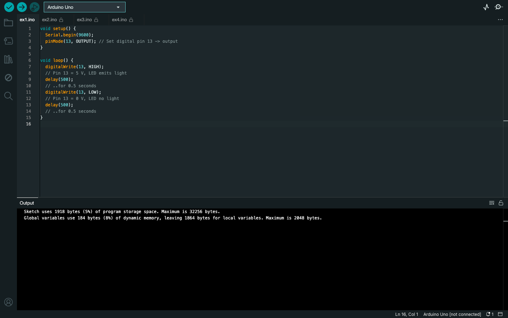
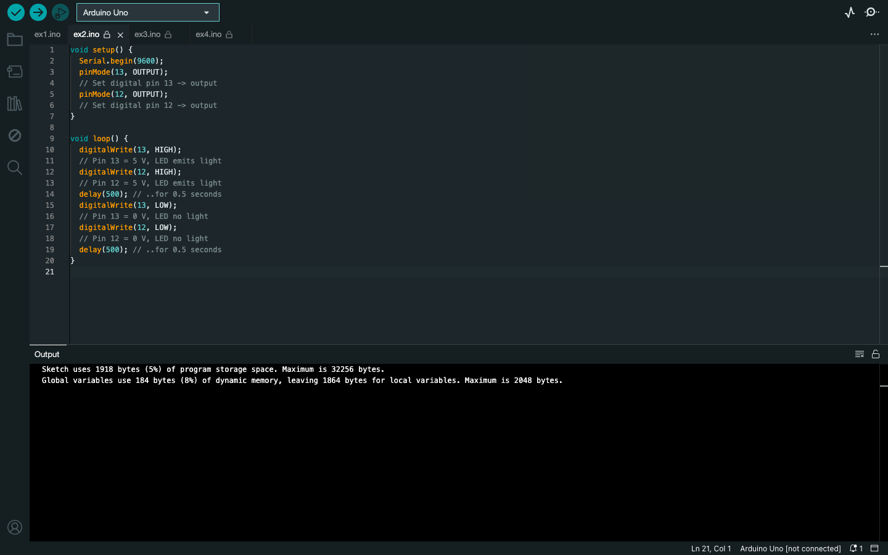
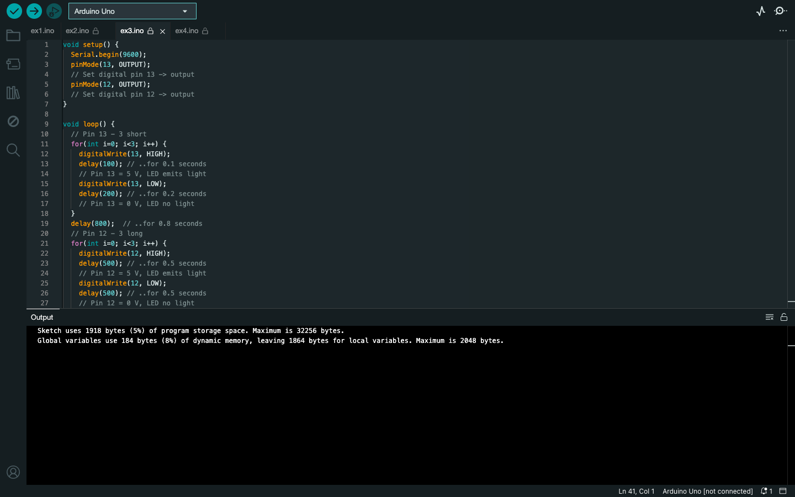
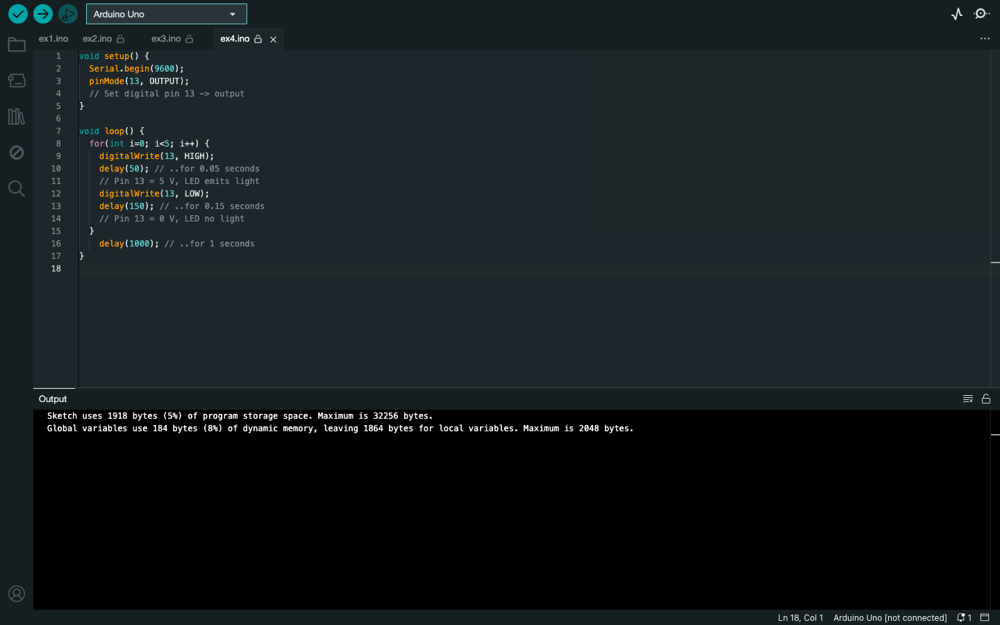

# Week 04 — Lab 2: Shield, resistors and LEDs

**Module:** Computer Architecture (`COMP H1027`)  
**Semester:** 2 (Year 1), folder `sem02`

[Module README](../README.md)

## What this week is for

Lab 2 uses the BOE Shield to build LED circuits with resistors and to control the LEDs from the Arduino. The solution has four sketches (ex1 to ex4) that blink LEDs on pins 13 and 12 in different patterns.

## Files

| File | What it contains | Screenshot |
|---|---|---|
| [`README.md`](README.md) | This README. | — |
| [`lab/computer_architecture_week04_lab.pdf`](lab/computer_architecture_week04_lab.pdf) | The lab sheet (15 pages): BOE Shield setup, resistors and LEDs, and the activities. | — |
| [`lab/solution/ex1/ex1.ino`](lab/solution/ex1/ex1.ino) | Blinks an LED on pin 13: half a second on, half a second off. |  *Arduino IDE showing ex1.ino.* |
| [`lab/solution/ex2/ex2.ino`](lab/solution/ex2/ex2.ino) | Blinks LEDs on pins 13 and 12 together, half a second on and off. |  *Arduino IDE showing ex2.ino.* |
| [`lab/solution/ex3/ex3.ino`](lab/solution/ex3/ex3.ino) | LED pattern: three short flashes on pin 13, three long flashes on pin 12, then three short flashes again. |  *Arduino IDE showing ex3.ino.* |
| [`lab/solution/ex4/ex4.ino`](lab/solution/ex4/ex4.ino) | Five short flashes on pin 13 (0.05 s on, 0.15 s off), then a one-second pause, repeated. |  *Arduino IDE showing ex4.ino.* |
