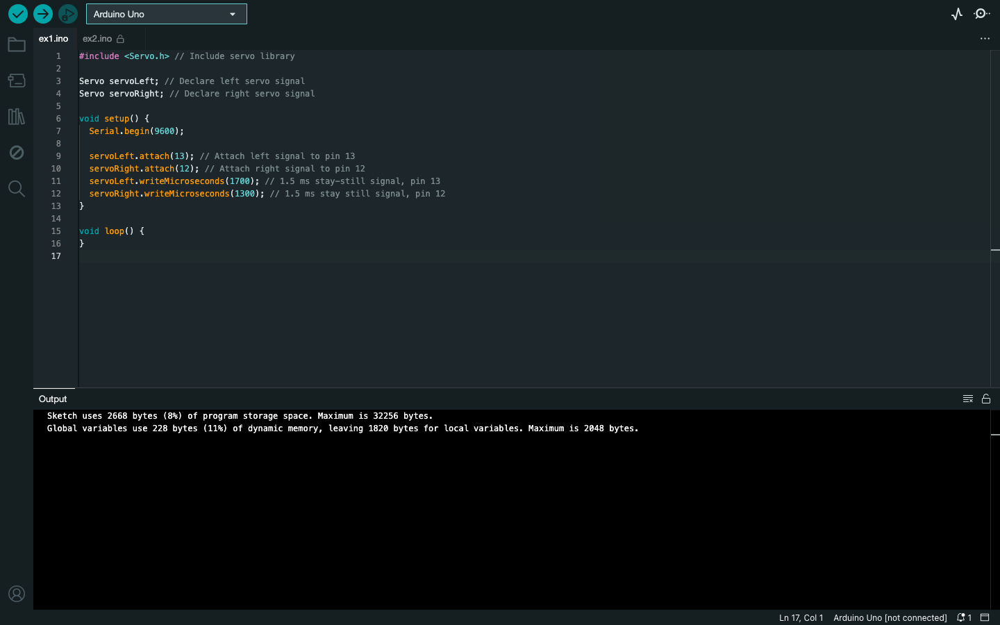
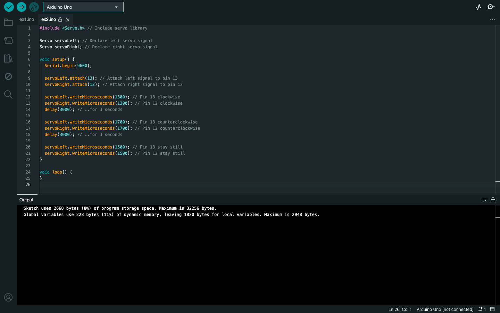

# Week 05 — Lab 3: LED servo signal monitors

**Module:** Computer Architecture (`COMP H1027`)  
**Semester:** 2 (Year 1), folder `sem02`

[Module README](../README.md)

## What this week is for

Lab 3 covers servo control signals: the timing of the pulses, the Servo library, and how the pulse width sets a servo's speed and direction. ex1 sends pulses to two servos. ex2 turns the two wheels in opposite directions for three seconds each.

> [!WARNING]
> [`lab/solution/ex1/ex1.ino`](lab/solution/ex1/ex1.ino): The comments say 1.5 ms (the stay-still signal), but the values in the code (1700 and 1300 microseconds) make the wheels turn.

## Files

| File | What it contains | Screenshot |
|---|---|---|
| [`README.md`](README.md) | This README. | — |
| [`lab/computer_architecture_week05_lab.pdf`](lab/computer_architecture_week05_lab.pdf) | The lab sheet (22 pages): servo timing, with the ServoSlowMo example sketches. | — |
| [`lab/solution/ex1/ex1.ino`](lab/solution/ex1/ex1.ino) | Attaches two servos to pins 13 and 12 and sends them pulses. |  *Arduino IDE showing ex1.ino.* |
| [`lab/solution/ex2/ex2.ino`](lab/solution/ex2/ex2.ino) | Runs both servos clockwise for three seconds, counterclockwise for three seconds, then stops them. |  *Arduino IDE showing ex2.ino.* |
