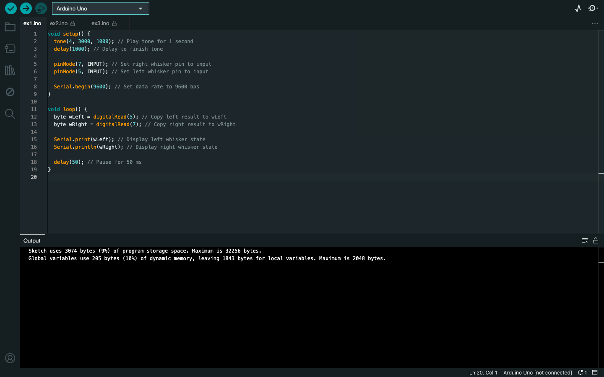
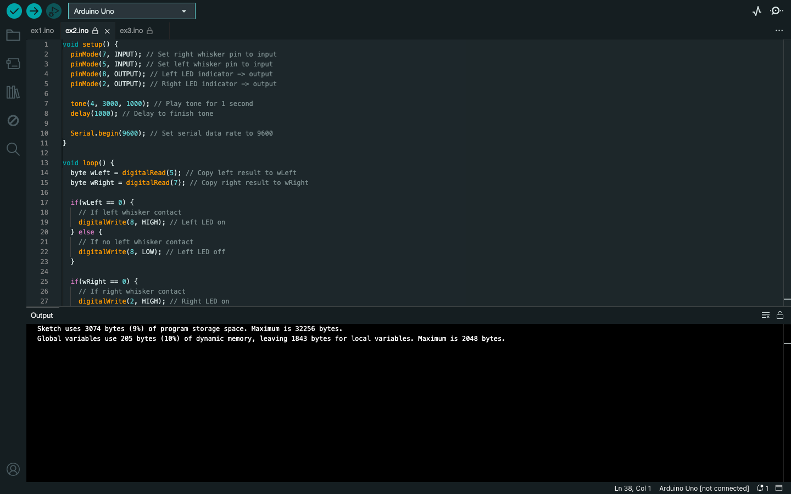
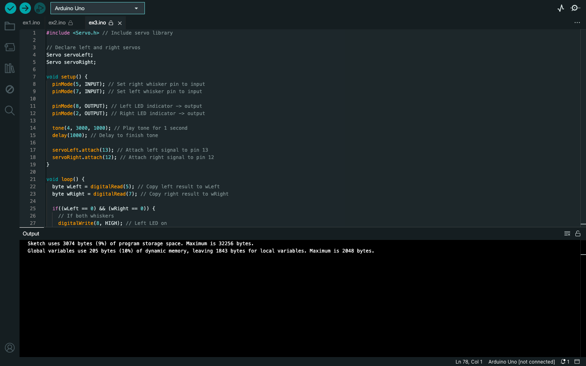

# Week 08 — Lab 6: tactile navigation with whiskers

**Module:** Computer Architecture (`COMP H1027`)  
**Semester:** 2 (Year 1), folder `sem02`

[Module README](../README.md)

## What this week is for

Lab 6 uses whisker switches so the bot can feel obstacles. The lab asks for the whisker circuits to be built and tested. The sketches read the whisker states, light an LED when a whisker is pressed, and make the bot back up and turn when it touches something.

> [!WARNING]
> [`lab/solution/ex3/ex3.ino`](lab/solution/ex3/ex3.ino): A comment says turn right above a turnLeft call, and its whisker pins are the reverse of ex1 and ex2.

## Files

| File | What it contains | Screenshot |
|---|---|---|
| [`README.md`](README.md) | This README. | — |
| [`lab/computer_architecture_week08_lab.pdf`](lab/computer_architecture_week08_lab.pdf) | The lab sheet (16 pages): tactile navigation with whiskers. | — |
| [`lab/solution/ex1/ex1.ino`](lab/solution/ex1/ex1.ino) | Plays a tone, then prints the left (pin 5) and right (pin 7) whisker states every 50 ms. |  *Arduino IDE showing ex1.ino.* |
| [`lab/solution/ex2/ex2.ino`](lab/solution/ex2/ex2.ino) | Lights the left LED (pin 8) and the right LED (pin 2) while the matching whisker is pressed, and prints the whisker states. |  *Arduino IDE showing ex2.ino.* |
| [`lab/solution/ex3/ex3.ino`](lab/solution/ex3/ex3.ino) | Drives the Shield-Bot: on whisker contact it backs up for a second and turns; with no contact it moves forward in 20 ms steps. |  *Arduino IDE showing ex3.ino.* |
