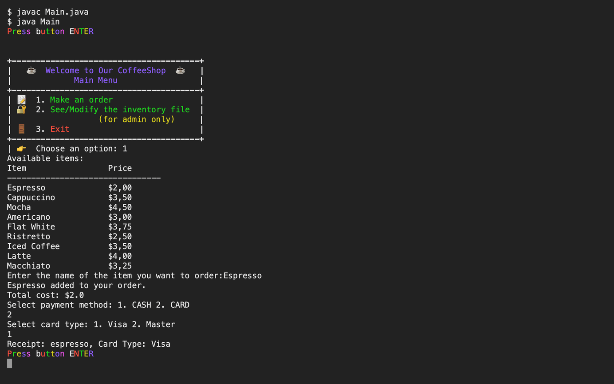

# Assessment 1: Coffee Shop

**Module:** Fundamentals of Programming 2 (`COMP H1031`)  
**Semester:** 2 (Year 1), folder `sem02`  
**Type:** project (mini-project in Java), individual  
**Weight:** 40%  
**Deadline:** Sunday 14 April 2024, 9 pm  
**Result:** —  
**On main:** [`sem02/fundamentals_of_programming_2/assessment/01/`](https://github.com/DanyilT/projects-in-university/tree/main/sem02/fundamentals_of_programming_2/assessment/01) (the brief, the link to the project, the screenshot and this README)  
**Branch:** [`project/year01/module-fundamentals_of_programming_2/coffee-shop`](https://github.com/DanyilT/projects-in-university/tree/project/year01/module-fundamentals_of_programming_2/coffee-shop) (the five Java classes, the two CSV files, its README and the licence)  
**Repository:** [Java](https://github.com/DanyilT/Java) (the folder CoffeeShop has only a README that points to the branch; the code was removed on 11 November 2025 and is in the history)

[Module README](../../README.md)

## What this assessment is for

The Coffee Shop mini-project (40%) is a point-of-sale program for a coffee shop, a number-based, menu-driven system that reads its menu items and prices from an inventory file (`item, price`), so that the owner can change the menu. A transaction picks an item and then CASH or CARD: for cash the amount tendered is entered and a receipt is shown on screen; for card the card type (Visa or Master) is chosen and a receipt is shown. All transactions are kept while the program runs and written to a transaction file when the user exits, with the date and time, the item, the price, and the amount tendered and the change for cash or the card type for card. All user input has to be validated. The project is individual: a single zip with the source, the inventory and transaction files and the documentation is uploaded by the deadline, with a signed plagiarism declaration, and the code is demonstrated. The marking rubric gives 5% for loading the menu from the CSV file, 10% each for the menu, storing the transactions in an ArrayList, writing them to the file on exit, the object-oriented techniques, the input validation, the code style and additional functionality, and 25% for the demonstration.

The submitted project is a console program in five classes: `Main` (the main menu, ordering and the admin panel with a password), `InventoryManager` (reads, prints, adds and removes items of `inventory.csv`), `MenuItem` (a name and a price), `Transaction` (one sale, with its CSV line) and `TransactionManager` (appends the transactions to `transactions.csv`). The inventory has nine coffees, from Espresso at 2.00 to Latte at 4.00. The menu uses colours and emojis.

*The Coffee Shop in the terminal: the main menu, the list of items, an order of one Espresso paid by Visa and the receipt.*

## Files

| File | What it contains |
|---|---|
| [`README.md`](README.md) | This README. |
| [`fundamentals_of_programming_2_assessment.pdf`](fundamentals_of_programming_2_assessment.pdf) | The Coffee Shop brief (3 pages): a point-of-sale program for a coffee shop, worth 40%, due Sunday 14 April 2024 at 9 pm. The program reads an inventory file of menu items and prices, takes CASH or CARD payments, prints a receipt on screen, keeps a record of transactions and writes them to a transaction file when the program exits. All user input must be validated. |
| [`submission/project_link.txt`](submission/project_link.txt) | Two lines: the GitHub link to the Coffee Shop project folder, and the branch name. |
