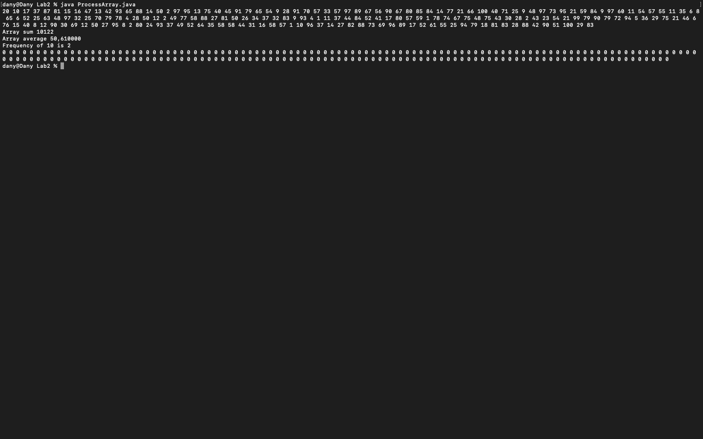

# Week 02 — Exercise sheet 2: arrays

**Module:** Fundamentals of Programming 2 (`COMP H1031`)  
**Semester:** 2 (Year 1), folder `sem02`

[Module README](../README.md)

## What this week is for

Exercise sheet 2: a ProcessArray program with six methods. One makes a random array, one prints an array, and others give the sum, the average and the frequency of a value, and set every value to zero. The solution has all six, with a main method that uses them.

> [!WARNING]
> [`lab/solution/ProcessArray.java`](lab/solution/ProcessArray.java): makeRandomArray takes its bounds in the order (size, upper, lower), where the sheet uses (size, lower, upper).

## Screenshots

*ProcessArray output: random values, sum, average, frequency of 10, and the zeroed array.*

## Files

| File | What it contains |
|---|---|
| [`README.md`](README.md) | This README. |
| [`lab/fundamentals_of_programming_2_week02_lab.pdf`](lab/fundamentals_of_programming_2_week02_lab.pdf) | The exercise sheet (2 pages): question 1, six methods for a ProcessArray class (random array, print, sum, average, frequency and zeroing). |
| [`lab/solution/ProcessArray.java`](lab/solution/ProcessArray.java) | Solution: static methods for a random array, printing, sum, average, frequency and zeroing, with a main method that uses them. |
